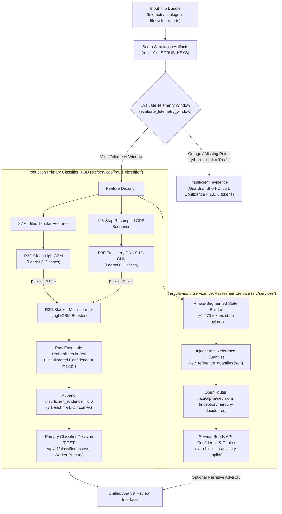

# P-063 Ride-Hailing Fraud & Violation Classification Model

An end-to-end architectural narrative detailing problem framing, data scarcity, evolutionary search loops, teaching principles, and the finalized multi-modal stacked classifier for single-trip ride-hailing dispute adjudication.

**Core Documentation References:**
- **Current Synthetic Research Corpus (`releases_v2.1`):** [docs/data/DATASET.md](data/DATASET.md)
- **External Prior Data Cards:** [docs/data/DATASET_CARDS.md](data/DATASET_CARDS.md)
- **Autonomous Research Staircase & Attempt History:** [docs/data/AUTORESEARCH.md](data/AUTORESEARCH.md)
- **Consolidated Benchmark Index:** [docs/data/BENCHMARK.md](data/BENCHMARK.md)
- **Object Storage & Hugging Face Hub Card:** [data/benchmark-10k/STORAGE.md](../data/benchmark-10k/STORAGE.md), [docs/data/HF_DATASET_CARD.md](data/HF_DATASET_CARD.md)
- **Architecture Decision Records:** [ADR-004](architecture/adr-004-bounded-jev-fraud-workflow.md), [ADR-011](architecture/adr-011-versioned-road-telemetry-dataset.md), [ADR-012](architecture/adr-012-llm-provider-selection.md), [ADR-013](architecture/adr-013-jev-advisory-anomaly-scoring-and-single-trip-fraud.md), [ADR-014](architecture/adr-014-grounded-advisory-evaluation.md), [ADR-025](architecture/adr-025-benchmark-evidence-boundaries.md), [ADR-027](architecture/adr-027-ghost-trip-fallback-rule.md), [ADR-029](architecture/adr-029-harness-live-call-accounting.md).

---

## 1. Problem Definition, Target Categories, and Guardrail Separation

In single-trip ride-hailing operations, platform operators must adjudicate customer disputes and identify driver misconduct rapidly and consistently. P-063 produces **advisory classifications and raw confidence scores** to assist human analysts; models do not execute automated sanctions ([ADR-013](architecture/adr-013-jev-advisory-anomaly-scoring-and-single-trip-fraud.md)).

### 1.1 The Six Model Classes and Seventh Guardrail Outcome

A critical architectural invariant is that statistical machine learning models and large language models learn **exactly six categories**. The seventh outcome (`insufficient_evidence`) is produced **exclusively by deterministic data validity guardrails** and is never emitted by a trained model:

1. `no_violation`: Policy-compliant, normal trip execution.
2. `ERR-01`: Unjustified driver cancellation (Driver Policy Art. 14.1).
3. `ERR-02`: Deliberate stall or waiting out passenger to force passenger-side cancellation (Art. 14.2).
4. `ERR-03`: Route deviation or moving away from pickup/destination (Art. 16.1).
5. `ERR-04`: Ghost trip completed without carrying the passenger (Art. 15.1).
6. `ERR-05`: GPS spoofing / mock location injection (Art. 15.3).
7. `insufficient_evidence`: Severe telemetry outage, app crash, or missing spatial-temporal breadcrumbs, emitted **strictly by data-validity guardrail short-circuits** (`evaluate_telemetry_window` in [run_10k.py](../scripts/benchmark/run_10k.py)).

When telemetry fails validity checks (e.g. fewer than minimum required pings, platform network dropout), the pipeline short-circuits immediately with fixed confidence 1.0 at zero LLM cost, bypassing model inference entirely.

---

## 2. Data Scarcity, Synthetic Grounding, and Methodological Rigor

A foundational constraint in ride-hailing dispute research is the **severe scarcity of public ground-truth labels**:
- Public mobility corpora (e.g. Porto Taxi [[REF-PORTO]](data/DATASET_CARDS.md#ref-porto), NYC TLC [[REF-NYC-TLC]](data/DATASET_CARDS.md#ref-nyc-tlc)) contain millions of GPS trajectories but lack driver misconduct or dispute labels.
- Benchmarks from other domains, such as the synthetic mobile-money dataset PaySim [[REF-PAYSIM]](data/DATASET_CARDS.md#ref-paysim), exhibit low fraud prevalence (~0.13%, or 13 positives per 10,000 transactions). However, this financial fraud proxy must **not** be conflated with true operational ride-hailing dispute prevalence.
- Proprietary dispute logs from commercial ride-hailing networks are inaccessible publicly due to passenger and driver PII protection.

### 2.1 Synthetic Enrichment as an Evaluation Mechanism
To overcome data scarcity, P-063 engineered a deterministic generator (`scripts/benchmark/build_v2/`):
1. **Distributional Grounding**: Anchored on real-world reference priors, including 15s urban taxi cadence ([[REF-PORTO]](data/DATASET_CARDS.md#ref-porto)), 1s high-frequency mobile pings ([[REF-MIPO]](data/DATASET_CARDS.md#ref-mipo)), 18 real OpenStreetMap road corridors in Hanoi and Ho Chi Minh City ([[REF-OSM-VN]](data/DATASET_CARDS.md#ref-osm-vn)), and empirical traffic speeds (5.5–8.5 m/s cruise, 16.7 m/s arterial p95).
2. **Enriched Class Distribution**: Rather than simulating a 0.13% needle-in-a-haystack where a 6,000-trip test set would contain fewer than 8 total violations, we enriched violation classes (70% honest, 8% ERR-02, 6% insufficient evidence, 5% ERR-01, 5% ERR-03, 3% ERR-04, 3% ERR-05). This enrichment is an explicit benchmarking decision to provide adequate statistical power for per-class F1, not a claim about real-world market prevalence.
3. **Disjoint Driver Partitions**: The 40,000-trip corpus (`releases_v2.1`, `d52e52ff...`, published on Hugging Face Hub under [`datamonsterr/p-063-synthesized-trips`](https://huggingface.co/datasets/datamonsterr/p-063-synthesized-trips) at revision `abb8cc8b2464aacdcbec0aab039ef4e066f71f8e`) is partitioned 70% train (28,000), 15% validation (6,000), and 15% test (6,000) grouped strictly by `driver_id` across 2,000 drivers (0 driver overlap).

### 2.2 Methodological Caveats: Leakage and Generalization
- **"Leak-Audited" does NOT mean "Leak-Free"**: The R3C leak audit ([R3C_LEAK_AUDIT.md](data/experiments/R3C_LEAK_AUDIT.md)) enforced a strict univariate threshold (dropping features with single-variable depth-3 tree macro-F1 $> 0.30$). While this eliminated blatant synthetic generator artifacts, it does not prove that subtle multivariate interactions or synthetic generator idiosyncrasies are absent.
- **Validation-Test Agreement does NOT prove Real-World Generalization**: The close alignment between validation (0.8705) and test (0.8680) proves absence of overt test-split tuning, but it only demonstrates in-generator stability within the synthetic distribution. It does not establish out-of-distribution generalization to actual commercial fleet telemetry.

---

## 3. Evolutionary Search & Architectural Milestones

The classification research progressed through four distinct phases:

| Milestone | Architecture | Primary Metric (Enum-Blind) | False Positive Rate | Token / Financial Cost | Critical Limitation / Finding |
|---|---|---|---|---|---|
| **1. Heuristic Baseline** | Rule cascades on kinematics & cancellation enums | 0.5059 macro-F1 (v1) / 0.4904 (30k) | Unmeasured in 30k; 0.384 on v2 val | 0 tokens, $0 | 0% recall on ERR-03/04; fragile to GPS noise |
| **2. Zero-Shot Decision Model** | `~typesafe/jev-latest` on raw trip state | 0.4737 macro-F1 (E0 baseline) | 0.251 | ~39k tokens/trip, ~$0.95/1k trips | **Invalid as model evidence:** 942/1,000 calls were silent heuristic fallbacks; 5.2% token overflow |
| **3. Rule-Free Evidence Context** | `inception/mercury-decide:free` with anchors | 0.6372 macro-F1 (R3H dev300) | 0.275 (0.357 on test) | ~1,470 state tokens, 2,300–2,600 input tokens, $0 | Removing rules caused anchor collapse (FPR 1.0) until train-set class quantiles were injected |
| **4. Leak-Audited Stacker (R3D)** | Meta-learner over clean GBM (R3C) & 1D-CNN (R3F) | **0.8680 [0.861, 0.875]** (test) | **0.027** | 0 tokens, $0 (~35ms latency) | Best in-generator candidate, but **failed cross-generator transfer** (0.5347 on v1, FPR 0.246) |

---

## 4. Teaching Principles & System Implementation Deep-Dive

### 4.1 Actual Vietnamese System Prompt Contents & Processing Pipeline

The research decision model service ([JevAssessmentService](../src/services/jev_assessment_service.py)) is configured with an evidence-bound, rule-free Vietnamese system instruction:

```text
Bạn là Chuyên gia AI Phân tích Gian lận Giao vận Cao cấp (Jev Decision Engine) của hệ thống GreenSM 2026.
Nhiệm vụ của bạn là phân tích tổng hợp các dữ liệu hành trình cuốc xe đơn (single-trip) bao gồm:
1. Thông tin hồ sơ tài xế (driver profile)
2. Thống kê hành vi tài xế (driver analytics)
3. Hội thoại chuyến đi giữa khách và tài xế (trip conversation)
4. Lý do hủy/giải trình của tài xế và trao đổi với hỗ trợ (driver reason & agent conversation)
5. Báo cáo phản ánh của khách hàng (customer reports)
6. Dữ liệu viễn thông telemetry (GPS, tốc độ, thời gian dừng đỗ, mock location)
7. Dữ liệu chuyến đi (trip data)

Quy chế Hợp tác Kinh doanh GreenSM 2026 quy định các nhóm vi phạm đơn cuốc:
- ERR-01: Hủy chuyến không có lý do chính đáng (Điều 14.1) - Tài xế đơn phương hủy chuyến hoặc cố tình tìm cách né tránh đón khách.
- ERR-02: Cố tình dừng đỗ kéo dài / câu giờ (Điều 14.2) - Đứng yên không tiếp cận điểm đón nhằm ép khách phải hủy chuyến.
- ERR-03: Lệch tuyến / đi lòng vòng cố ý (Điều 16.1) - Di chuyển ngược hướng điểm đón hoặc kéo dài lộ trình di chuyển so với lộ trình dự kiến.
- ERR-04: Cuốc xe ảo / gian lận hoàn thành (Điều 15.1) - Hoàn thành chuyến đi nhưng thực tế không đón chở khách.
- ERR-05: Giả mạo định vị GPS / can thiệp phần mềm (Điều 15.3) - Sử dụng mock location provider, bước nhảy tọa độ hoặc vận tốc tức thời phi thực tế.
- no_violation: Chuyến xe hợp lệ, di chuyển bình thường theo lộ trình, hoặc sự cố khách quan (kẹt xe, thời tiết, hạ tầng mạng) đã được ghi nhận.

LƯU Ý PHẠM VI: Chỉ xử lý gian lận hành vi đơn cuốc (single-trip fraud). Các hình thức gian lận mạng lưới phức tạp (vòng lặp thông đồng tài xế - khách hàng đa tài khoản, bào voucher chuỗi) được chuyển sang pipeline đồ thị ngoại tuyến.
```

#### Rule-Free Mandate and Evidence Context
Per user requirements, hardcoded numeric thresholds (such as `>=180s`, `>35%`, `200 km/h`) and verdict adjectives ("high risk", "suspicious", "abnormal") were purged from the research semantic prompt, criteria ([CRITERIA_SEMANTIC](../src/services/jev_criteria.py)), and state builder ([test_jev_evidence_context.py](../tests/unit/services/test_jev_evidence_context.py)):

In service code, `JevAssessmentInput` defaults `criteria_variant='baseline'`, even though `get_jev_criteria()` specifies default parameter `variant='semantic'`. During execution, `_call_jev_api` passes `criteria_variant=getattr(inp, "criteria_variant", "baseline")`. `CRITERIA_BASELINE` still contains hardcoded numeric rules (`>=180s` for `ERR-02` and `>35%` for `ERR-03`). The research benchmark variant `r3h_evidence_classref` explicitly overrides this with `criteria_variant="semantic"`. Therefore, the rule-free benchmark context differs from the production-service DEFAULT criteria; we do not claim that the default service is completely rule-free. Furthermore, this research branch does not claim that a deployed production model was live-verified; this reflects research-branch service code.
- **Phase Segmentation**: Telemetry is divided into `driver_approach` (pickup phase) and `in_trip` (transport phase).
- **Data-Derived Anchors (`evidence_classref`)**: To prevent the model from misidentifying normal post-pickup distance increases as route deviation (`ERR-03`), the state builder injects empirical training-set medians and percentiles from 19,637 honest trips ([jev_reference_quantiles.json](../src/services/data/jev_reference_quantiles.json), [test_jev_state_builder.py](../tests/unit/services/test_jev_state_builder.py)).
- **Token Efficiency**: State payloads take ~1,470 tokens, leading to total input calls of 2,300–2,600 tokens (compared to ~39,000 raw tokens).
- **Latency Distinction**: The ~700ms figure represents **API probe latency** to OpenRouter's `/api/alpha/decisions` endpoint; it does not measure full end-to-end service latency (which includes state extraction, serialization, HTTP transit, and post-processing).

### 4.2 Exact Confidence Behavior from Implementation Code

A critical distinction must be maintained between mathematical probability theory and actual codebase implementation:

1. **How Code Actually Handles Confidence**:
   In [JevAssessmentService.assess](../src/services/jev_assessment_service.py):
   ```python
   # 1. Directly extract float confidence from OpenRouter response
   conf_val = float(error_ans.get("confidence", 0.90))

   # 2. Round to two decimal places (e.g. 0.9248 -> 0.92)
   confidence = round(conf_val, 2)
   ```
   The service **does not perform statistical calibration** (no Platt scaling, no isotonic regression, no temperature scaling) and **does not renormalize probabilities**.
2. **Multiplying by 100 is Purely Display Formatting**:
   In frontend components (`cockpit-view.tsx`, `HistoryTable.tsx`), expressions like `Math.round(confidence * 100)` or `${(run.confidence * 100).toFixed(1)}%` serve exclusively as UI percentage presentation (e.g. `0.92` rendered as `92%`).
3. **Probability Vector Math vs Code Verification**:
   - In probability theory, a valid discrete distribution requires non-negative elements summing to 1:
     $$p_i = \frac{s_i}{\sum_{k=1}^K s_k}, \quad s_k \ge 0, \quad \sum_{k=1}^K s_k > 0$$
   - When mapping unconstrained real-valued logits $\mathbf{z} \in \mathbb{R}^K$ to a simplex, softmax is defined as:
     $$p_i = \frac{e^{z_i}}{\sum_{k=1}^K e^{z_k}}$$
   - **Verification in Code**: In `scripts/benchmark/experiments/variants/r3d_stacked.py`, R3F explicitly computes `v / sum(raw_probs.values())`, and R3D normalizes stacker outputs across the 6 model classes. However, `JevAssessmentService` does **not** execute these functions on the decision API output; it takes whatever confidence float is returned by OpenRouter directly.

### 4.3 Why R3D is Not Statistically Calibrated Merely Because ECE Was Measured

Expected Calibration Error (test split ECE = 0.055520, ~0.056; validation split ECE = 0.055917, ~0.056; 0.030209 is validation `no_violation` FPR, not validation ECE) is an **empirical summary metric** that quantifies the difference between binned confidence and observed accuracy:
$$\text{ECE} = \sum_{m=1}^M \frac{|B_m|}{N} \left| \text{acc}(B_m) - \text{conf}(B_m) \right|$$

Measuring ECE is an evaluation diagnostic; it does **not** constitute a statistical calibration procedure. No post-hoc calibrator (such as temperature scaling, isotonic regression, or Platt scaling) was trained or applied to R3D's meta-learner outputs. Calling R3D "calibrated" is technically inaccurate; it is an uncalibrated tree ensemble whose raw outputs happen to exhibit relatively low empirical calibration error.

### 4.4 Unit Test Suite Provenance for Implemented Claims

Every claim regarding implemented algorithms, leak audits, and service behavior is backed by dedicated unit tests:

| Claimed Feature / Component | Source Implementation | Authoritative Unit Test File |
|---|---|---|
| Tabular Kinematic Features (37 features) | `scripts/benchmark/experiments/r3c/features.py` | [test_r3c_features.py](../tests/unit/benchmark/test_r3c_features.py) |
| Univariate Feature Leak Audit ($>0.30$ gate) | `scripts/benchmark/experiments/r3c/train.py` | [test_r3c_audit.py](../tests/unit/benchmark/test_r3c_audit.py) |
| R3C Clean LightGBM Training & Variant | `scripts/benchmark/experiments/r3c/train.py` | [test_r3c_train.py](../tests/unit/benchmark/test_r3c_train.py), [test_r3c_variant.py](../tests/unit/benchmark/test_r3c_variant.py) |
| Trajectory Resampling & Spatial Sequences | `scripts/benchmark/experiments/r3f/dataset.py` | [test_r3f_dataset.py](../tests/unit/benchmark/test_r3f_dataset.py) |
| R3F 1D-CNN Architecture & Training | `scripts/benchmark/experiments/r3f/model.py` | [test_r3f_model.py](../tests/unit/benchmark/test_r3f_model.py), [test_r3f_train.py](../tests/unit/benchmark/test_r3f_train.py), [test_r3f_variant.py](../tests/unit/benchmark/test_r3f_variant.py) |
| 5-Fold Grouped Out-of-Fold Probabilities | `scripts/benchmark/experiments/r3d/oof.py` | [test_r3d_oof.py](../tests/unit/benchmark/test_r3d_oof.py) |
| Stacker Meta-Learner & Disagreement Features | `scripts/benchmark/experiments/r3d/stack.py` | [test_r3d_stack.py](../tests/unit/benchmark/test_r3d_stack.py) |
| R3D Stacked Variant & Guardrail Bypass | `scripts/benchmark/experiments/variants/r3d_stacked.py` | [test_r3d_variant.py](../tests/unit/benchmark/test_r3d_variant.py) |
| Semantic Criteria (No Numeric Thresholds) | `src/services/jev_criteria.py` | [test_jev_criteria.py](../tests/unit/services/test_jev_criteria.py) |
| Rule-Free Evidence Context & Verdict Guards | `src/services/jev_assessment_service.py` | [test_jev_evidence_context.py](../tests/unit/services/test_jev_evidence_context.py) |
| State Builder & Reference Quantiles | `src/services/jev_state_builder.py` | [test_jev_state_builder.py](../tests/unit/services/test_jev_state_builder.py) |
| Decision Model Fallback & Retries | `src/services/jev_assessment_service.py` | [test_jev_model_fallback.py](../tests/unit/services/test_jev_model_fallback.py) |
| Ghost Trip Lifecycle Fallback Rule | `src/services/jev_assessment_service.py` | [test_ghost_trip_fallback_264.py](../tests/unit/services/test_ghost_trip_fallback_264.py) |

---

## 5. System Architecture: Production Classifier Wiring and Advisory Fusion

R3D is wired into production as the primary fraud classifier via `src/services/fraud_classifier`, `POST /api/v1/classifier/assess`, and the primary worker queue pipeline per [ADR-030](architecture/adr-030-production-fraud-classifier.md) and PRs #575, #574, #576, #597, #600:

- **Primary Classifier (`src/services/fraud_classifier/`)**:
  1. Production R3D stacker executes CPU-optimized `onnxruntime` for the R3F 1D-CNN and native `LightGBM` boosters for R3C and the Stacker meta-learner ($0 PyTorch/pickle dependencies).
  2. Pinned immutable artifacts loaded from Hugging Face Hub (`datamonsterr/p-063-r3d-classifier` @ `268003f7...`) with SHA256 integrity verification.
  3. Single-digit millisecond inference latency (~2.5–10.7 ms p50) serving real-time queue admission and triage.
- **Secondary Advisory Layer (`src/services/jev_assessment_service.py`)**:
  1. Asynchronous decision-model advisory (`inception/mercury-decide:free`) providing forensic narrative explanation and customer dialogue reading.
  2. Optional per request and non-blocking in the worker pipeline.



---

## 6. Real Offline Inference Examples on Validation Sample

To demonstrate real model behavior without live paid API calls or re-evaluating the locked test set, offline inference was executed on the `dev300` validation screening set of `releases_v2.1` using the real model artifacts:
- R3C: local run directory `research_v2/R3C/model.pkl` (configured via `R3C_MODEL_PATH`)
- R3F: local run directory `research_v2/R3F/model.pt` (configured via `R3F_MODEL_PATH`)
- R3D: local run directory `research_v2/R3D/stacker.pkl`

### Exact Reproduction Command

```bash
.venv/bin/python - << 'EOF'
import json
from pathlib import Path
from scripts.benchmark.experiments.variants.r3d_stacked import r3d_stacked_variant

# Load from fetched or locally built release directory
dev300_path = Path("data/benchmark-10k/releases_v2.1/dev300.jsonl")
# Iterate and evaluate trip bundles offline
EOF
```

### 1. Correct Classification Example (`ERR-02` Stall)
- **Trip ID:** `c8ccef52-ac8d-53b8-b1bd-8f2115f3cc07`
- **True Label:** `ERR-02` | **Predicted Label:** `ERR-02`
- **Percentage Confidence:** `100.0%` (raw float `0.999998`)
- **Model Used:** `r3d_stacked_lightgbm`
- **Probability Distribution (Sums to 1.0):**
  - `no_violation`: $1.259 \times 10^{-6}$
  - `ERR-01`: $3.011 \times 10^{-8}$
  - `ERR-02`: **$0.999998$**
  - `ERR-03`: $2.784 \times 10^{-8}$
  - `ERR-04`: $7.037 \times 10^{-7}$
  - `ERR-05`: $4.234 \times 10^{-8}$
  - `insufficient_evidence`: $0.0$ (guardrail outcome)

### 2. Failure Mode Example: `ERR-04` Ghost Trip Blind Spot
- **Trip ID:** `b275a354-2366-531b-abd7-c75f54235035`
- **True Label:** `ERR-04` | **Predicted Label:** `no_violation` (Misclassification)
- **Percentage Confidence:** `68.80%` (raw float `0.688039`)
- **Model Used:** `r3d_stacked_lightgbm`
- **Root Cause:** Ghost trips exhibit normal vehicle trajectory kinematics. In enum-blind mode, lifecycle cancellation signals are removed, causing kinematics models to confuse the ride with a normal honest trip.
- **Probability Distribution (Sums to 1.0):**
  - `no_violation`: **$0.688039$**
  - `ERR-01`: $2.384 \times 10^{-5}$
  - `ERR-02`: $2.404 \times 10^{-5}$
  - `ERR-03`: $2.867 \times 10^{-5}$
  - `ERR-04`: $0.311860$
  - `ERR-05`: $2.425 \times 10^{-5}$
  - `insufficient_evidence`: $0.0$

### 3. Data-Validity Guardrail Short-Circuit Example
- **Trip ID:** `d5b733fc-d925-5518-9a7f-6ce06e61c1f9`
- **True Label:** `insufficient_evidence` | **Predicted Label:** `insufficient_evidence`
- **Percentage Confidence:** `100.0%` (raw float `1.0`)
- **Model Used:** `guardrail_short_circuit` (Reason: `APP_CRASH`)
- **Probability Distribution (Sums to 1.0):**
  - `insufficient_evidence`: **$1.0$**
  - All six model classes: $0.0$

---

## 7. Final Test Evaluation: Held-Out Test Split (Used Once)

The finalized R3D Stacker was evaluated against the cold-storage **test split** of `releases_v2.1` (6,000 trips, seed `20261017`, `--enum-blind`, disjoint driver grouping).

### 7.1 Test Performance Summary

| Architecture / Model | Test Sample | Macro-F1 [95% CI] | Accuracy | `no_violation` FPR | ECE | Per-Class F1 Breakdown |
|---|---:|---|---|---|---|---|
| **R3D Stacker (Candidate)** | **6,000** | **0.8680 [0.861, 0.875]** | **0.9507** | **0.027** | **0.056** | `no_viol` 0.967, `E01` 1.000, `E02` 1.000, `E03` 0.997, `E04` 0.115, `E05` 0.997, `insuff` 1.000 |
| R3C Clean LightGBM | 6,000 | 0.8618 [0.856, 0.869] | 0.9398 | 0.080 | 0.053 | `no_viol` 0.940, `E01` 1.000, `E02` 1.000, `E03` 0.980, `E04` 0.119, `E05` 0.994, `insuff` 1.000 |
| R3F Trajectory CNN | 6,000 | 0.8205 [0.813, 0.828] | 0.9610 | 0.0005* | 0.170 | `no_viol` 0.977, `E01` 0.900, `E02` 0.948, `E03` 0.978, `E04` 0.000, `E05` 0.940, `insuff` 1.000 |
| Mercury `evidence_classref` | 300 | 0.5155 [0.455, 0.575] | 0.5833 | 0.357 | 0.391 | `no_viol` 0.745, `E01` 0.370, `E02` 0.750, `E03` 0.357, `E04` 0.143, `E05` 0.243, `insuff` 1.000 |

*\*R3F test FPR is 0.000481 (~0.05%, 2 false positives / 4,159 normal trips), rounded to 0.000 in summary tables; validation FPR is 0.000476. It is low but not zero.*

### 7.2 R3D Test Confusion Matrix (6,000 Trips)

```
                  no_viol  ERR-01  ERR-02  ERR-03  ERR-04  ERR-05  insuff
no_violation      [  4046       0       0       1     112       0       0 ]
ERR-01            [     0     297       0       0       0       0       0 ]
ERR-02            [     0       0     492       0       0       0       0 ]
ERR-03            [     0       0       0     314       0       0       0 ]
ERR-04            [   165       0       0       0      18       0       0 ]
ERR-05            [     0       0       0       1       0     176       0 ]
insufficient      [     0       0       0       0       0       0     378 ]
```

---

## 8. Honest Assessment: R3D as Best In-Generator Candidate with Failed Transfer Guard

R3D must be accurately reported as the **best in-generator candidate**, **not** as a universally accepted production winner:

1. **Cross-Generator Transfer Failure & Overlapping CIs**:
   When evaluated against the older `releases_v1` generator corpus (6,000 validation trips, enum-blind), R3D scored macro-F1 **0.534732** [0.521, 0.550] with a severe false positive rate of **0.246135**. In comparison, the R3F trajectory CNN transferred significantly better (macro-F1 **0.556208** [0.544, 0.567], FPR **0.055556**). R3D failed original cross-generator acceptance targets. R3D is the winner for the current synthetic research corpus, not an all-guards-passed accepted production model. Furthermore, R3D's validation F1 advantage over R3C (0.8705 vs 0.8695) has overlapping confidence intervals ([0.864, 0.877] vs [0.863, 0.877]); we do not claim statistical significance or guaranteed absence of overfit.
2. **`ERR-04` Blind Spot**:
   With only 0.115 F1 on ghost trips in enum-blind mode, R3D cannot reliably adjudicate passenger non-boarding from GPS coordinates alone.
3. **Review-Budget Triage Disconnect (`adverse_recall_at_budget = 0.0`)**:
   In the saved R3D test evaluation, `adverse_recall_at_budget` is **0.0**. Evaluation metrics rank cases by risk ($1 - P(\text{no\_violation})$). The data-validity guardrail emits `insufficient_evidence` with $P(\text{no\_violation}) = 0.0$, assigning them maximum priority ($1.0$). Consequently, all top 300 of the 6,000 saved test predictions are `insufficient_evidence` (out of 378 total insufficient trips). The entire 5% analyst review budget is occupied by telemetry dropout and data-quality incidents, rather than fraud triage. Platform operations must route telemetry dropout into an isolated data-recovery queue separate from the human fraud adjudication queue.
4. **Artifact Degradation Provenance**:
   In `scripts/benchmark/experiments/variants/r3d_stacked.py`, artifact loading failures or feature extraction errors fall back to uniform base probabilities (e.g. $1/6$) while `model_used` continues to report `r3d_stacked_lightgbm`. Production integration requires startup artifact integrity validation and explicit fallback degradation tagging in audit logs.
5. **Next Steps for Engineering**:
   - Fuse customer dispute text embeddings into the stacker meta-learner to resolve `ERR-04`.
   - Resolve telemetry edge cases (e.g. Issue #601: R3D missing violations on 1–3 point telemetry windows).
   - Rectify the generator artifact where `platform_incident` correlates with `ERR-05` and `insufficient_evidence`.

---

## 9. Deployment Status

R3D is deployed to production on Railway `p063-backend` (region `sfo`) as the primary fraud classifier via `src/services/fraud_classifier`, exposed at `POST /api/v1/classifier/assess`, and integrated as the primary worker queue pipeline per [ADR-030](architecture/adr-030-production-fraud-classifier.md) and PRs #575, #574, #576, #597, #600.

- **Production Deployment Metadata**:
  - **Service**: Railway `p063-backend` production (`sfo`), deployed 2026-10-19 by workflow run `39287451597` from `main`.
  - **Model ID**: `r3d-2026.10.18`.
  - **Artifacts**: Pinned on Hugging Face Hub under `datamonsterr/p-063-r3d-classifier` at revision `268003f795b2950893e9ef6a54b250dec13eeee6` (`r3c.txt` `0eb2e54522e8`, `r3f.onnx` `23e9d5a2b96a`, `stacker.txt` `1559cd14cd74`).
  - **Artifact Load Time**: 44.6 ms on startup.
  - **Advisory LLM**: `inception/mercury-decide:free` (optional per request, non-blocking in worker).
- **Production Load Test Validation (`scripts/loadtest/classifier_load_test.py`)**:
  - Evaluated on 300 `dev300` trips (`releases_v2.1` `dev300` SHA-256 `cd008ee10b22...`) per concurrency level from a test client in Vietnam against `sfo`.
  - Baseline: `GET /health` baseline is 465.5 ms (cross-Pacific network RTT dominates client-side latency).
  - Accuracy: Served macro-F1 is `0.8688` across all concurrency levels, exactly matching the offline benchmark.
  - Cold Start: `feat` 4.8 ms, `infer` 11.4 ms, `total` 16.6 ms.
  - Latency & Throughput Profile:
    - **Concurrency 1**: 3.79 req/s | 300/0 ok/errors | Client p50 237.8 / p95 395.1 / p99 545.3 ms | Server total p50 10.6 / p95 56.5 / p99 129.8 ms | Inference p50 2.5 / p95 6.6 / p99 8.8 ms | Features p50 7.2 / p95 53.1 ms
    - **Concurrency 4**: 13.27 req/s | 300/0 ok/errors | Client p50 264.9 / p95 511.1 / p99 620.3 ms | Server total p50 15.3 / p95 78.4 / p99 268.5 ms | Inference p50 4.0 / p95 19.7 / p99 27.0 ms | Features p50 8.7 / p95 73.9 ms
    - **Concurrency 8**: 23.19 req/s | 300/0 ok/errors | Client p50 308.4 / p95 532.4 / p99 824.4 ms | Server total p50 18.9 / p95 114.1 / p99 242.2 ms | Inference p50 4.8 / p95 23.9 / p99 41.1 ms | Features p50 9.6 / p95 89.2 ms
    - **Concurrency 16**: 30.89 req/s | 300/0 ok/errors | Client p50 455.0 / p95 879.5 / p99 1123.4 ms | Server total p50 43.6 / p95 165.3 / p99 332.1 ms | Inference p50 10.7 / p95 43.8 / p99 71.8 ms | Features p50 12.9 / p95 118.8 ms
  - Advisory (Mercury, concurrency 4, 100 requests, 0 errors): advisory latency p50 364.0 / p95 522.2 / p99 1492.6 ms; client p50 609.1 / p95 1068.8 ms.
- **Targets & Compliance**:
  - Inference p95 $\le$ 50 ms: **MET** at all levels (max 43.8 ms at concurrency 16).
  - Server p95 $\le$ 300 ms: **MET** at all levels (max 165.3 ms at concurrency 16).
  - Error rate 0: **MET** (0 HTTP failures across all load runs).
  - Note: Client-side p95 exceeds 300 ms solely due to WAN network RTT between Vietnam and US West (`sfo`).
- **PR Preview Comparison (`pr-576`, 2026-10-19)**:
  - Server p95: 76 / 75 / 113 / 182 ms at concurrency 1 / 4 / 8 / 16.
  - Inference p95: 13 / 18 / 31 / 52 ms at concurrency 1 / 4 / 8 / 16.
  - Advisory: p50 497 ms / p95 1566 ms.
- **Known Gap**:
  - Issue [#601](https://github.com/AI20K-Build-Phase-Cohort-4/P-063/issues/601): R3D misses violations on 1–3 point telemetry windows (mitigation planned).

