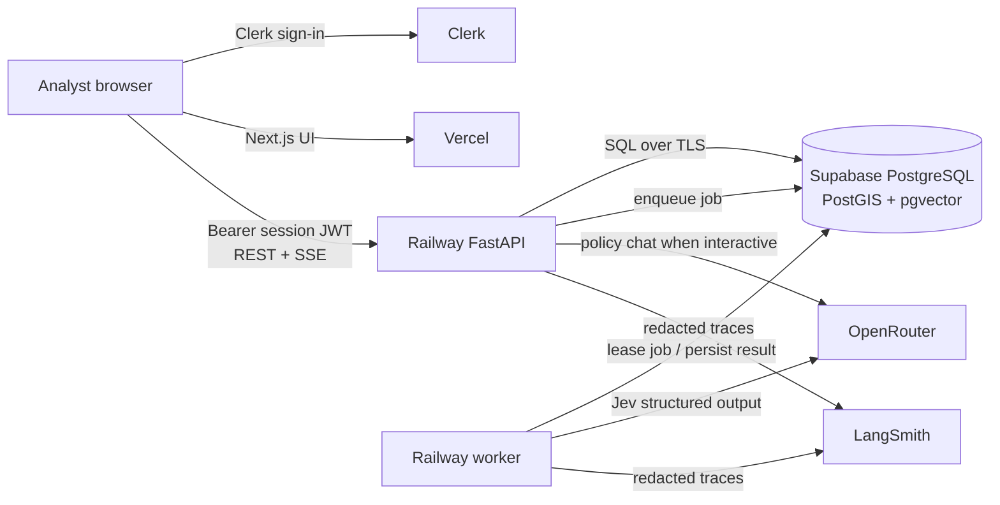
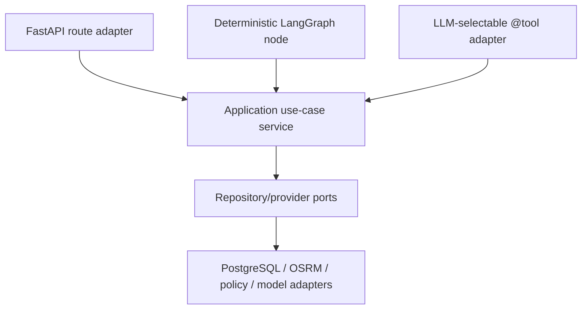

# Deployment and Integration Runbook

Verified against official product documentation on 2026-09-22.

## CI/CD: single `production` environment

Updated 2026-11-21. One environment only: Railway project `greensentinel` (environment `production`: Postgres, Redis, `greensentinel-backend`) plus Vercel production. No dev/staging environments and no per-PR preview deploys.

- CI: `.github/workflows/ci.yml` on GitHub-hosted `ubuntu-latest` runners. The repository is public, so standard runners are free.
- Backend deploy: Railway's GitHub integration. The `greensentinel-backend` service builds the root `Dockerfile` from `main`, waits for GitHub check suites to pass, and only rebuilds when backend paths change (see `watchPatterns` in `.railway/railway.ts`). Health check: `/health`. The service sleeps when idle and wakes on the first request (about 6 s).
- Frontend deploy: Vercel's GitHub integration. Project `greensentinel`, root directory `src/webapp`, builds `main` only (ignored build step skips other branches).
- There are no deploy workflows and no deploy tokens in GitHub. `RAILWAY_API_TOKEN` and `VERCEL_TOKEN` are not needed.
- Database migrations are not run by CI/CD. Apply them manually with `scripts/migrate_postgres.py --database-url ...` before pushing code that needs them.

GitHub secrets used by CI: `OPENROUTER_API_KEY`, `CLERK_SECRET_KEY`, `NEXT_PUBLIC_CLERK_PUBLISHABLE_KEY`. Optional (feature skips cleanly when absent): `HF_TOKEN` (private HF artifacts), `OPENAI_API_KEY` (RAG embedding, ingest and judge steps in `ci_rag.yml`), `LANGCHAIN_API_KEY` (LangSmith tracing). Qdrant runs as a local container in CI; no Qdrant secrets.

## Target topology



Recommended order:

1. Prepare repository and environment contracts.
2. Create Supabase and apply migrations.
3. Configure Clerk.
4. Create OpenRouter and LangSmith credentials.
5. Deploy Railway API and worker.
6. Deploy Next.js to Vercel.
7. Connect final domains, CORS, Clerk authorized parties, and smoke tests.

## Current repository readiness

Repository contains design and database migration, but complete target system is not deployable yet.

| Gap | Current state | Required before hosted smoke test |
|---|---|---|
| Frontend | `apps/web` does not exist | Build Next.js 16 cockpit and Clerk integration |
| Persistence | SQL migration exists; Python still defaults to SQLite and has no repositories | Add SQLAlchemy 2 async/psycopg, migrations, repositories, and transaction boundaries |
| Model provider | `src/services/llm.py` uses `OPENAI_API_KEY` and default OpenAI URL | Add OpenRouter base URL, key, pinned Jev model, and structured output |
| Authentication | No Clerk middleware or FastAPI JWT verifier | Add Next.js Clerk setup and FastAPI JWKS verification |
| Worker | No durable worker entry point | Add PostgreSQL job leasing and `python -m src.worker` |
| API | Only scaffold chat/status routes exist | Add telemetry, case, claim, action, adjudication, stream, and policy endpoints |
| Docker Compose | Runs backend only | Add PostgreSQL with PostGIS/pgvector, worker, and web |
| Railway port | Docker command binds fixed port `8000` | Bind Railway's injected `PORT` |
| CI | Documentation referred to `.github/workflows/ci.yml`, but no workflow exists | Add lint, tests, migration validation, frontend build, and image build workflow |

Do not create production projects until first five runtime gaps are complete. Dev accounts can be created earlier for configuration.

## Documentation audit

The following stale statements were found and corrected against current official documentation and the canonical PRD taxonomy:

| Document | Stale statement | Correction |
|---|---|---|
| `README.md` | Node.js 18+, OpenAI key, complete CI, and a committed Mnemoverse credential | Node.js 20.9+ for Next.js 16; OpenRouter/Jev variables; CI marked pending; credential removed |
| `.env.example` | `LANGCHAIN_*`, OpenAI, Chroma, and SQLite defaults | `LANGSMITH_*`, OpenRouter/Jev, Supabase PostgreSQL, Clerk, and explicit browser/server boundaries |
| `docs/ba/MVP.md` | Chroma retrieval and simulator-generated final dossiers | Supabase pgvector; simulator emits raw events through preprocessing and Jev |
| `docs/architecture/ARCHITECTURE.md` | SQLite/Chroma, default OpenAI model, and open-ended ReAct emphasis | PostgreSQL/PostGIS/pgvector, pinned Jev through OpenRouter, and bounded deterministic graph stages |
| `docs/design/` | Wrong ERR mappings; 4G failure treated as fraud; unimplemented Ed25519/FIDO2/zero-PII claims | Canonical ERR taxonomy; technical guardrail separated; append-only request-hash and Clerk/least-privilege wording |
| Previous `docs/DEPLOYMENT.md` | Claimed the backend and CI were complete | Explicit readiness gaps plus current Vercel, Railway, Supabase, Clerk, LangSmith, and OpenRouter steps |

One remaining operational correction is external to the working tree: a removed Mnemoverse credential still exists in Git history. Rotate it before any deployment and purge the historical value using the repository's approved history-rewrite procedure.

## Environment ownership

Store each secret only where consuming process needs it.

| Variable | Local | Vercel web | Railway API | Railway worker | CI/migration |
|---|---:|---:|---:|---:|---:|
| `NEXT_PUBLIC_API_BASE_URL` | Yes | Yes | No | No | No |
| `NEXT_PUBLIC_CLERK_PUBLISHABLE_KEY` | Yes | Yes | No | No | No |
| `CLERK_SECRET_KEY` | Yes | Yes | No | No | No |
| `CLERK_ISSUER`, `CLERK_JWKS_URL`, `CLERK_AUDIENCE`, `CLERK_AUTHORIZED_PARTIES` | Yes | No | Yes | No | No |
| `DATABASE_URL` | Yes | No | Yes | Yes | Yes |
| `MIGRATION_DATABASE_URL` | Yes | No | No | No | Yes |
| `REDIS_URL` | Yes | No | Yes | Yes | Yes |
| `OPENROUTER_API_KEY`, `OPENROUTER_BASE_URL`, `OPENROUTER_MODEL` (default `z-ai/glm-5.3-flash`), `OPENROUTER_REASONING_EFFORT` (default `low`), `JEV_MODEL` | Yes | No | Yes | Yes | Optional evaluation job |
| `LANGSMITH_API_KEY`, `LANGSMITH_TRACING`, `LANGSMITH_PROJECT` | Yes | No | Yes | Yes | Optional evaluation job |
| `SUPABASE_PROJECT_REF` | Optional | No | No | No | Optional |

Never place database URLs, Clerk secret keys, OpenRouter keys, LangSmith keys, or Supabase service credentials in `NEXT_PUBLIC_*` variables. Next.js includes `NEXT_PUBLIC_*` values in browser bundles at build time.

Use separate credentials and projects for development, staging, and production. Development plus production is acceptable for first PoC; use synthetic identities and data in production until governance approves real data.

## 1. Prepare repository

Recommended layout:

```text
apps/web/                  # Next.js 16 frontend deployed by Vercel
src/api/                   # FastAPI transport adapters
src/agents/                # bounded LangGraph state and nodes
src/services/              # application services and external adapters
src/models/                # shared Pydantic contracts
db/migrations/             # canonical SQL migrations
scripts/simulate/          # telemetry and behavior producers
```

Use Node.js `20.9` or newer for Next.js 16. Keep Python at `3.11+`. Copy `.env.example` to `.env` only for local work; do not commit `.env`.

Before cloud deployment, implement these commands:

```bash
uv run uvicorn src.main:app --host 0.0.0.0 --port 8000
uv run python -m src.worker
pnpm --dir apps/web build
```

Each command must run independently. API and worker share code and schema, but remain separate processes.

## 2. Provision PostgreSQL (PostGIS)

1. Local: `docker compose up -d postgres` (first boot applies `db/migrations/` via initdb).
2. Hosted: create Railway Postgres near selected Railway region.
3. Save `DATABASE_URL` in team password manager.
4. Apply migrations and seed from repo root.

```bash
bash scripts/migrate.sh
# or targeted:
uv run python scripts/migrate_postgres.py --database-url "$DATABASE_URL"
```

To seed the dev demo driver with a deterministic slice of trips and ratings without loading the bulk corpus:

```bash
python scripts/seed/seed_driver_trips.py --database-url $DEV_DATABASE_URL --only-demo --demo-driver-id <drivers.id>
```

Migration creates PostGIS and pgvector in `extensions`, private `app` schema, constraints, indexes, append-only triggers, and browser-role revocations. Install PostGIS in a dedicated schema instead of `public`.

Connection choice:

- Use direct connection for migrations, backup, restore, and persistent backends when network permits it.
- Add `sslmode=require` to hosted connection strings.
- Give API and worker small application pools. Increase only after observing contention.

Browser must not connect to application tables directly. Migration revokes `anon` and `authenticated` access to `app`. FastAPI owns authorization.

Verify migration history:

```bash
ls db/migrations/
```

Use `psql "$DATABASE_URL"` to confirm `app.fraud_cases`, `app.ingest_events`, `app.jobs`, and `app.audit_events` exist. Do not paste secrets into screenshots or issue logs.

## 3. Configure Clerk

1. A single existing Clerk development instance serves all three environments (Railway dev, staging, production), with consistent organization roles and membership mapping across environments.
2. Enable email or approved OAuth sign-in.
3. Organizations are linked to tenant UUIDs in PostgreSQL (`app.organizations.clerk_organization_id`). Public roles are `admin`, `member`, and `driver`, mapping to internal roles (`admin`, canonical `fraud_analyst`, and `driver`). Synthetic dataset entities are never authenticated login accounts.
4. Real drivers receive deterministic profile binding derived from verified Clerk subject and UUID5(organization_id, subject) with no invented personal information; unlinked seeded drivers are never claimed.
5. From `src/webapp`, run current Next.js initializer:

```bash
npx -y clerk@latest init
npx -y clerk@latest doctor
```

For Next.js 16, Clerk uses `proxy.ts`; Next.js 15 and earlier use `middleware.ts`. Wrap application with `ClerkProvider` and protect cockpit routes.

Set in local/Vercel frontend environments:

```dotenv
NEXT_PUBLIC_CLERK_PUBLISHABLE_KEY=your-publishable-key
CLERK_SECRET_KEY=your-secret-key
```

For cross-origin Vercel-to-Railway calls, frontend obtains a short-lived session token with Clerk `getToken()` and sends `Authorization: Bearer <token>`. Use authenticated `fetch` plus an SSE stream parser for streaming endpoints because the browser's native `EventSource` API cannot set the bearer header. Never expose Clerk secret key to the browser frontend (`NEXT_PUBLIC_*`). The FastAPI backend securely uses `CLERK_SECRET_KEY` for server-side session token verification via the official Clerk backend SDK (`clerk_backend_api`).

FastAPI must:

1. Load token from `Authorization`.
2. Resolve signing key from Clerk JWKS and cache by `kid` or verify via backend SDK with `CLERK_SECRET_KEY`.
3. Restrict expected signing algorithm.
4. Validate signature, `exp`, `nbf`, issuer, audience, and authorized-party/origin claims.
5. Map JWT `sub` to `app.principals.external_subject` and enforce tenant organization scope.
6. Load roles and action limits from PostgreSQL.

This split prevents stale or client-controlled Clerk metadata from authorizing fines or suspensions. Database migrations default to schema-only (`--database-url`); implicit fixture seeding and mock principal generation are disabled across deployment workflows.

## 4. Configure OpenRouter and Jev

1. Create project-scoped OpenRouter key.
2. Store it only in Railway API/worker and local `.env`.
3. Configure OpenAI-compatible endpoint:

```dotenv
OPENROUTER_API_KEY=your-openrouter-key
OPENROUTER_BASE_URL=https://openrouter.ai/api/v1
OPENROUTER_MODEL=z-ai/glm-5.3-flash
OPENROUTER_REASONING_EFFORT=low
JEV_MODEL=~typesafe/jev-latest
```

Pin exact model/version before evaluated demo release. `~...latest` is convenient during development but can change behavior without code change.

Require strict JSON Schema structured output and provider routing that requires supported parameters. Validate every response again with Pydantic. Store model ID, provider, prompt version, output schema version, score semantics, latency, and LangSmith trace ID.

Send only tokenized case identifiers and minimum feature/evidence summary. Review OpenRouter and selected provider retention/training settings before sending real Passenger or Driver data.

## 5. Configure LangSmith

1. Create LangSmith workspace.
2. Create environment projects: `greensentinel-development`, `greensentinel-staging`, `greensentinel-production`.
3. Create project-scoped API key.
4. Set on Railway API and worker:

```dotenv
LANGSMITH_API_KEY=your-langsmith-key
LANGSMITH_TRACING=true
LANGSMITH_PROJECT=greensentinel-production
LANGSMITH_ENDPOINT=https://api.smith.langchain.com
```

Canonical variables now use `LANGSMITH_*`. Older `LANGCHAIN_API_KEY`, `LANGCHAIN_PROJECT`, and `LANGCHAIN_TRACING_V2` names in repository were outdated.

Trace only data needed for debugging:

- case token, never Passenger or Driver name;
- snapshot, feature, prompt, policy, and model versions;
- quality flags and reason codes;
- node latency, token use, retry count, and result status;
- redacted input/output, or no input/output when evidence could identify a person.

Create offline dataset from synthetic A/B/C, fake-GPS, GPS-jitter, malformed output, and provider-failure cases. Use deterministic code evaluators for schema, evidence references, guardrails, and brief length. Use LLM-as-judge only for qualitative clarity. Report accuracy only over labeled dataset, never as per-case score.

## 6. Deploy API and worker to Railway

Create one Railway project with development/staging and production environments. Add two empty services connected to same Git repository.

### API service

- Name: `greensentinel-api`
- Root directory: repository root
- Builder: Dockerfile
- Start command:

```bash
sh -c 'uvicorn src.main:app --host 0.0.0.0 --port ${PORT}'
```

- Healthcheck path: `/health`
- Public domain: enabled

Railway injects `PORT`; application must bind it. Railway healthchecks gate deployment activation but do not provide continuous uptime monitoring.

### Worker service

- Name: `greensentinel-worker`
- Root directory: repository root
- Builder: same Dockerfile/image
- Start command:

```bash
python -m src.worker
```

- Public domain: disabled
- Health: use worker heartbeat/job-lease monitoring, not API `/health`

Use Railway shared variables for database, OpenRouter, and LangSmith settings, then reference them from both services. Keep API-only Clerk/CORS variables on `greensentinel-api`. Seal secrets after configuration if workflow does not require copying them to preview environments.

Do not run same migration as pre-deploy command on API and worker: services can deploy concurrently and race. Run one explicit migration job before application services. Railway legacy `railway.toml`/`railway.json` Config as Code is deprecated and scheduled to stop for legacy services on 2026-12-01; use Railway Infrastructure as Code or dashboard settings for new setup.

Generate API public domain. Record it as `https://<api-domain>` for Vercel.

## 7. Deploy frontend to Vercel

After `apps/web` exists and passes `pnpm build`:

1. Import Git repository into Vercel.
2. Set Root Directory to `apps/web`.
3. Select Next.js framework preset.
4. Use Node.js `20.9+`.
5. Add variables separately for Preview and Production.

```dotenv
NEXT_PUBLIC_API_BASE_URL=https://<railway-api-domain>
NEXT_PUBLIC_CLERK_PUBLISHABLE_KEY=your-publishable-key
CLERK_SECRET_KEY=your-secret-key
```

6. Deploy preview and test sign-in.
7. Promote or deploy production.
8. Add production custom domain when available.

Vercel environment changes apply only to new deployments. Redeploy after changing API URL or Clerk key. Prefer stable staging domain for integration tests; dynamic preview URLs complicate API CORS and Clerk authorized-party validation.

## 7.1 Pull request preview checks

The `deploy-railway.yml` and `deploy-vercel.yml` workflows use hosted GitHub runners for pull requests and request `contents: read` only. Secret values are scoped to the individual CLI/deploy steps; job-level environment values contain only non-secret URLs or configuration-presence booleans. Internal pull requests can deploy to an isolated Railway preview project and then check `${RAILWAY_PREVIEW_URL}/health`; the Vercel workflow waits for that check, runs the CLI from `src/webapp` (the Vercel root directory), builds with `NEXT_PUBLIC_API_BASE_URL` set to the same preview URL, deploys a Vercel preview, and checks its root URL. Production project IDs, tokens, and database credentials must never be reused for previews.

Fork pull requests do not receive repository secrets. Their workflows run validation and record that preview deployment was skipped. Internal pull requests fail clearly when the isolated preview credentials or URL are not configured. Required repository configuration is `RAILWAY_PREVIEW_API_TOKEN`, `RAILWAY_PREVIEW_PROJECT_ID`, `RAILWAY_PREVIEW_ENVIRONMENT_ID`, `RAILWAY_PREVIEW_SERVICE_ID`, and the non-secret `RAILWAY_PREVIEW_URL` variable, plus the existing Vercel credentials. `VERCEL_PRODUCTION_URL` is optional and enables the post-deploy production smoke check.

These checks prove only that the configured HTTP endpoints respond during the workflow. No hosted preview URL or deployment success is recorded in this repository until credentials and an actual run are available.

### Preview and approval contract (ADR-012)

Both deployment workflows trigger on every pull request. A shared paginated classifier excludes `src/webapp` from backend scope and identifies docs-only, frontend-only, backend, and full-stack changes. Forks and docs-only pull requests skip deployment. Frontend-only pull requests route immediately to the stable Dev backend; they do not provision or wait for Railway.

Backend and full-stack pull requests use an isolated `pr-N` Railway environment. Vercel waits 120 seconds for the exact PR/head Railway workflow and health endpoint. It fails closed unless the submitted Railway deployment reaches `SUCCESS`, its exact deployment ID is tracked, and health passes. Vercel readiness requires the deployment API to report `READY`; Vercel deployment errors propagate.

One Vercel token and project serve `/driver` and `/workplace` on the same domain. The driver product scope remains deferred. The exact preview origin is merged into the existing Dev allowlist through a serialized authorization rollout. This is separate from required authentication completion. Wildcard origins are forbidden.

### Restricted Vercel token contract

Keep `VERCEL_TOKEN` restricted to the intended team/project, with matching `VERCEL_ORG_ID` and `VERCEL_PROJECT_ID` secrets. CI pins Vercel CLI `62.2.0`, which reads the token from the environment. Its `inspect` and `alias set` commands resolve `/v2/user` and can report `User not found.` for restricted credentials. Passing `--scope` also performs that user lookup.

The deploy wrapper verifies the linked project and project API first, submits with `vercel deploy --prebuilt --no-wait`, then uses [the deployment API](https://vercel.com/docs/rest-api/deployments/get-a-deployment-by-id-or-url) with explicit `teamId` to wait up to ten minutes for the exact project deployment to become `READY`. It retries submission at most three times only for recognized transport errors. Authentication errors, invalid output, terminal deployment failure, and timeout fail the job without publishing a preview URL. A lost submission response can create an additional deployment during a transport retry.

Aliases use [the alias API](https://vercel.com/docs/rest-api/aliases/assign-an-alias) with the verified deployment ID and team scope. Canonical Dev, Staging, and Production aliases are required; dotted Dev/Staging aliases are optional compatibility aliases. API responses and credentials are not printed. See [restricted-token manual tests](testing/MANUAL_TEST_VERCEL_115.md).

Staging and production remain selective dispatch paths. Production is main-only. API guards fail closed when required live reviewers are absent or production is not main-only. Current GitHub write access returns HTTP 404 for live-rules `PUT`; live rules are not recorded as configured. Migration and data scope are unchanged.

See [ADR-012](architecture/adr-012-pr-deployment-previews.md) and the [manual test runbook](testing/MANUAL_TEST_DEPLOYMENT_107.md).

The workflow/documentation change is being reviewed on the isolated branch `fix/poc-v1-preview-ci` in `.worktrees/poc-v1-preview-ci`. The worktree is a local review boundary; it does not itself create a hosted preview or replace the normal PR merge and CI process.

## 7.2 Multi-branch environment deployments

The CI/CD pipeline deploys Dev on `main` pushes and supports gated manual environment dispatch:

| Trigger | Target Environment | Frontend Domain (Vercel) | Backend API Target (Railway) | Database Migrations (PostgreSQL) |
|---|---|---|---|---|
| Gated Staging dispatch | Staging | `https://green-sentinel-staging.vercel.app` (optional `https://staging.green-sentinel.vercel.app`) | `RAILWAY_STAGING_SERVICE_ID` / `RAILWAY_STAGING_ENVIRONMENT_ID` (`https://greensentinel-backend-staging.up.railway.app`) | `STAGING_DATABASE_URL` |
| Gated Production dispatch from `main` | Production | `https://green-sentinel.vercel.app` | `RAILWAY_SERVICE_ID` / `RAILWAY_ENVIRONMENT_ID` (`https://greensentinel-backend-production.up.railway.app`) | `DATABASE_URL` |
| `main` push or Dev dispatch | Development | `https://green-sentinel-dev.vercel.app` (canonical) | `RAILWAY_DEV_SERVICE_ID` / `RAILWAY_DEV_ENVIRONMENT_ID` (`https://greensentinel-backend-dev.up.railway.app`) | `DEV_DATABASE_URL` |

Key mechanics:
1. **Vercel deployment and aliasing**: Builds the prebuilt bundle from the repository root, waits for project-scoped API readiness, then assigns the environment alias through `scripts/vercel_project.py`. The canonical development URL is `https://green-sentinel-dev.vercel.app` (nested subdomains like `dev.green-sentinel.vercel.app` fail wildcard SSL/DNS verification on Vercel).
2. **Railway Dynamic Scoping**: `deploy-railway.yml` checks `$GITHUB_REF_NAME` to route deployments to dedicated service/environment IDs, falling back gracefully to primary project defaults. The development backend is deployed to `https://greensentinel-backend-dev.up.railway.app`.
3. **PostgreSQL Migration Targeting**: `scripts/migrate_postgres.py` applies migrations and seeds to the matching environment database URL, configuring PostGIS in schema `extensions`.
4. **CORS & Clerk Invariants**: `src/config.py` allows all target domains in `cors_origins` and `clerk_authorized_parties`, while `src/main.py` provides dynamic redirects via `VERCEL_APP_URL`.

## 8. Connect Vercel, Clerk, and Railway

After Vercel production URL exists:

1. Add exact Vercel/custom origin to Railway API `CORS_ORIGINS`.
2. Add same origin to `CLERK_AUTHORIZED_PARTIES`.
3. Configure production domain in Clerk.
4. Confirm Vercel `NEXT_PUBLIC_API_BASE_URL` points to Railway API (`https://greensentinel-backend-dev.up.railway.app` for dev, `https://greensentinel-backend-production.up.railway.app` for production).
5. Redeploy Railway API via the IaC saved plan (`railway config plan --out railway-plan.json`, then `railway config apply --plan railway-plan.json --yes` per `deploy-railway.yml`), then Vercel web. Project resources are owned by `.railway/railway.ts` (see `railway config plan` for drift); persistent envs refuse `APP_ENV=test`/`TEST_AUTH_ENABLED`.

Code-deploys need per-environment project tokens (`railway link` rejects API
tokens, and token minting needs workspace admin). Create once per env in the
Railway dashboard (project Settings → Tokens → environment token for
dev/staging/prod), then store without printing:

```bash
gh secret set RAILWAY_TOKEN_DEV < /path/to/dev-token
gh secret set RAILWAY_TOKEN_STAGING < /path/to/staging-token
gh secret set RAILWAY_TOKEN_PRODUCTION < /path/to/prod-token
```

Until a token exists the job deploys via `railway up` and says so in its
summary; adding the token switches that env to saved-plan applies with no
workflow change.
6. Confirm REST and SSE clients both refresh the Clerk token and attach it as a bearer header; do not place session tokens in query strings.

### Exact Clerk origins and authentication release checks

[`scripts/auth_config.py`](../scripts/auth_config.py) declares the frontend
origins for each deployment. The canonical dev frontend is
`https://green-sentinel-dev.vercel.app` (paired with Railway dev backend `https://greensentinel-backend-dev.up.railway.app`); older dotted/dash aliases are retained for backwards compatibility.
Railway deployments write the generated `CLERK_AUTHORIZED_PARTIES` before
starting the deployment, so an obsolete explicit Railway value cannot silently
override corrected application defaults. An optional GitHub environment variable
of the same name must retain all declared first-party aliases. Wildcards and
path-bearing origins are rejected.

PR previews resolve only their scoped Railway backend. The frontend workflow
adds its exact returned Vercel deployment origin to that PR environment and
redeploys that backend; it does not authorize every `*.vercel.app` origin or
silently route to shared dev when provisioning is unavailable.

```bash
python3 scripts/auth_config.py production
python3 scripts/auth_config.py dev
python3 scripts/auth_config.py staging
```

After a gated rollout, verify a real Clerk browser session on the matching
frontend: `/api/v1/me`, `/api/v1/cases`, detail, SSE, and token renewal must work.
Keep rejection for untrusted origins and unmapped application principals. See
the [incident reproduction and test evidence](testing/MANUAL_TEST_AUTH_HOTFIX_104.md).

Recommended CORS policy:

- exact HTTPS origins only;
- methods `GET`, `POST`, and `OPTIONS` initially;
- headers `Authorization`, `Content-Type`, `Idempotency-Key`, and correlation headers;
- credentials only if cookie requests are intentionally used;
- no wildcard origin with credentials.

## 9. API and agent-tool boundary

HTTP routes and LangChain tools can appear to perform same task. Do not implement business rules twice. Do not expose every tool as endpoint.



Rules:

1. **One use-case implementation.** Routes, deterministic graph nodes, and tools call same typed service method.
2. **Transport models stay at edges.** HTTP and tool schemas map to canonical Pydantic command/result models.
3. **Tools are capability adapters.** Add `@tool` only when model must choose whether or how to call safe operation. Deterministic pipeline steps call services directly.
4. **No LLM authority injection.** Analyst ID, organization, roles, case scope, and trace context come from trusted runtime context, never model-generated tool arguments.
5. **No adjudication tools.** `adjudicate`, `fine`, `suspend`, role management, raw SQL, and secret access are unavailable to graph. Only authenticated HTTP command can create human adjudication.
6. **Read mostly.** Model-selectable tools retrieve frozen evidence, route snapshots, and published policy citations. Write tools may persist only model assessments or bounded progress.
7. **Same errors and idempotency.** Application services return typed domain errors used consistently by HTTP and graph adapters.
8. **Separate registries.** Maintain HTTP route registry and small agent tool registry. Review tool name, schema, permission, side effects, timeout, and owner before registration.

Recommended naming:

| Layer | Example | Responsibility |
|---|---|---|
| Application service | `CaseQueryService.get_dossier()` | domain operation over explicit trusted context |
| HTTP route | `GET /api/v1/cases/{case_id}` | JWT/auth context, status code, serialization, rate limit |
| Agent tool | `get_case_evidence(case_id)` | narrow read-only schema and model-facing description |
| Repository port | `CaseRepository.get_snapshot()` | persistence contract |

Structure keeps APIs stable for humans/clients while agent tools evolve without duplicated domain logic.

## 10. Deployment verification

Run in order:

1. `GET https://<api>/health` returns `2xx` and database readiness without secrets.
2. Clerk sign-in succeeds on Vercel.
3. Authenticated request reaches `GET /api/v1/cases`; missing/invalid tokens return `401`.
4. User without analyst permission receives `403`; adverse-command denial is audited.
5. Trigger simulation A. Raw ingest events and one durable job appear in Supabase.
6. Worker completes job. Case becomes `ready`; LangSmith shows redacted trace.
7. Cockpit shows synchronized route, breadcrumbs, confidence semantics, evidence gaps, and policy citations.
8. Authorized analyst claims and adjudicates. One adjudication, simulated sanction, audit event, and outbox event commit.
9. Replay same event IDs. No duplicate case, job, or adjudication appears.
10. Trigger scenario C. Direct API attempts to fine/suspend fail even if button is bypassed.

## 11. Rollback and recovery

- **Vercel:** promote previous known-good deployment.
- **Railway:** roll back API and worker to same compatible image revision.
- **Model:** restore previous pinned `JEV_MODEL`, prompt version, and output schema; redeploy API/worker.
- **Database:** use forward-only corrective migrations. Never run remote reset against production.
- **Secrets:** rotate compromised keys, update hosted secret stores, redeploy consumers, and purge committed secret history.

Never roll application code back across incompatible migration without compatibility plan. Prefer expand-migrate-contract changes: add compatible schema, deploy compatible code, backfill, then remove old fields later.

## OpenAI policy embeddings (PR #240)

Policy embedding now defaults to `RAG_EMBEDDING_PROVIDER=openai`, independently
of the chat provider. It uses `text-embedding-3-small` with 1536 dimensions.
Set `OPENAI_API_KEY` in GitHub **Repository secrets** and the Railway PR Preview
service. Never put its value in a tracked file or a PR comment.

Default collections are `dev-policies-openai-text-embedding-3-small-1536`,
`test-policies-openai-text-embedding-3-small-1536` (test/staging), and
`prod-policies-openai-text-embedding-3-small-1536`. Existing Gemini collections
are retained. A legacy `QDRANT_COLLECTION` name is mapped to its OpenAI namespace;
other explicit names are honored and must contain matching vectors.
Ensure the environment's Qdrant API key can create/read/write the new collection;
an RBAC key restricted to the old collection needs its scope updated.

Re-index **only the selected Preview/test environment** with
`python -m src.rag.ingest` after setting the intended Qdrant URL/key/collection.
The indexer checks the embedding provider before writing, uses deterministic IDs,
and upserts without resetting the collection. CI uses the new test collection.
Preview retrieval must point to the same populated collection; successful startup
alone does not prove policies have been indexed. Production re-indexing remains
a separate release step after branch review.

`RAG_EMBEDDING_PROVIDER=gemini` opts into the previous embedding provider and
legacy collection defaults. Chat generation and the LangSmith judge use the
selected `LLM_MODEL` through the shared provider adapter. The RAG CI workflow
selects OpenAI for chat, embeddings and judge, using `OPENAI_API_KEY` and the
optional repository variable `OPENAI_MODEL` (default `gpt-4o-mini`). The required
judge gate fails if the provider is unavailable or its score is invalid.
For `gpt-6-luna`, the Chat Completions adapter selects `reasoning_effort=none`
for tool compatibility and omits the legacy explicit temperature. Other provider
and GPT-4 configurations retain their existing sampling behavior. See the
[GPT-6 Luna contract](https://developers.openai.com/api/docs/models/gpt-6-luna).
See [OpenAI embedding documentation](https://developers.openai.com/api/docs/guides/embeddings).

The hosted Cockpit runtime also honors `LLM_MODEL`, including its asynchronous
tool-call loop. For OpenAI, configure `LLM_MODEL=openai`, `OPENAI_API_KEY` and
`OPENAI_MODEL` on the selected Railway Preview service. Adding a GitHub secret
configures the RAG workflow; it does not automatically change Railway variables.
Preview provisioning duplicates the development environment, so verify that
environment's provider configuration separately. Keep credentials in hosted
secret stores. Historical traffic still requires the gateway configuration in
[the traffic runbook](testing/manual/TRAFFIC_EVIDENCE.md); an OpenAI key supplies
the language model, not historical traffic observations.

## Official references

- [Vercel monorepos](https://vercel.com/docs/monorepos) and [CLI deployments](https://vercel.com/docs/projects/deploy-from-cli)
- [Railway monorepos](https://docs.railway.com/deployments/monorepo), [variables](https://docs.railway.com/variables), and [healthchecks](https://docs.railway.com/deployments/healthchecks)
- [Supabase migration workflow](https://supabase.com/docs/guides/local-development/cli-workflows), [database connections](https://supabase.com/docs/guides/database/connecting-to-postgres), [PostGIS](https://supabase.com/docs/guides/database/extensions/postgis), and [pgvector](https://supabase.com/docs/guides/database/extensions/pgvector)
- [Clerk Next.js quickstart](https://clerk.com/docs/nextjs/getting-started/quickstart), [cross-origin requests](https://clerk.com/docs/guides/development/making-requests), and [JWT verification](https://clerk.com/docs/guides/sessions/manual-jwt-verification)
- [LangSmith evaluation types](https://docs.langchain.com/langsmith/evaluation-types)
- [OpenRouter quickstart](https://openrouter.ai/docs/quickstart) and [structured outputs](https://openrouter.ai/docs/guides/features/structured-outputs)
