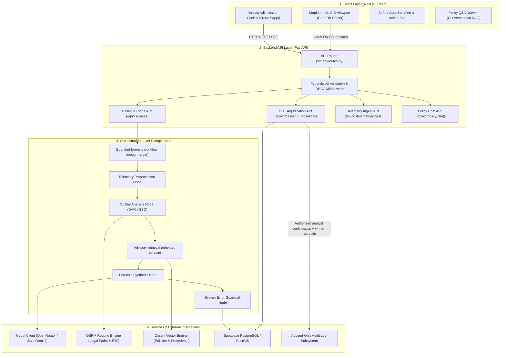

# System Architecture Specification

## Release authority and runtime boundary

[ADR-029](adr-029-oci-ci-artifact-storage.md) moves CI report/build transfers to private OCI Object Storage. All concrete CI/CD jobs use self-hosted runners. Repository/run/name keys preserve failed-job retries; secretless browser jobs rebuild locally. OCI lifecycle must be configured separately for retention. This infrastructure change leaves application layering, graph state, tool contracts and streaming flows unchanged.

[ADR-023](adr-023-preview-workflow-sequencing.md) sequences Railway and Vercel PR previews through a reusable workflow. Scheduler dependencies preserve exact-head backend health gates without occupying a runner during a cross-workflow wait.

[ADR-017](adr-017-offline-backend-type-boundaries.md) defines deterministic default Jev tests, interpreter-aligned static checks, and validated provider/case GeoJSON boundaries. API, service, agent, and model responsibilities remain separated; offline verification does not establish hosted or durable sanction evidence.
[ADR-024](adr-024-sprint-3-4-spec.md) defines Sprint 3–4 specifications for natural Vietnamese motivation assessment, dual-tab Copilot workspace, case document store, passive interaction learning, and PostHog/LangSmith hybrid telemetry.
General chat provider selection is specified by [ADR-012](adr-012-llm-provider-selection.md): `LLM_MODEL` selects native Gemini (default), OpenAI or OpenRouter; model IDs, Jev Decisions and embeddings keep separate configuration.


> Phase 1 runtime baseline: [`POC_DESIGN.md`](POC_DESIGN.md). Analyst Hypothesis Mapping: [`HYPOTHESIS_TO_CONTROL_MAPPING.md`](HYPOTHESIS_TO_CONTROL_MAPPING.md). Canonical data model: [`DATA_MODEL.md`](DATA_MODEL.md). API Specification: [`API_SPECIFICATION.md`](API_SPECIFICATION.md). Runtime decisions: [`ADR-002`](adr-002-relational-spatial-event-schema.md), [`ADR-004`](adr-004-bounded-jev-fraud-workflow.md), [`ADR-005`](adr-005-poc-runtime-and-deployment.md), [`ADR-006`](adr-006-shared-use-cases-for-api-and-agent-tools.md), and [`ADR-007`](adr-007-qdrant-vector-database-migration.md).

The strict Phase 1 [PRD](../ba/PRD.md), adopted **2026-09-30 by @datamonsterr**, governs release scope. Recommendations and corroboration wait for **authorized analyst confirmation with written rationale**. No automatic dismissal is approved. All dismissals and analyst Agree/Disagree outcomes require confirmation and rationale; the system never applies warnings, fines, clawbacks, or suspensions; algorithmic closure is deny-by-default; legacy adverse sanctions remain blocked and system error signals advise Disagree (System Error). Driver UI/mobile and appeal expansion are **deferred**.

[PR #40](https://github.com/AI20K-Build-Phase-Cohort-4/P-063/pull/40) is **MERGED historical runtime divergence**, commit `586caec05ddb7626a1f47066b55154e74d245cc0`, not accepted release scope. That baseline let traffic corroboration write `auto_dismissed` and return `needs_analyst_review=False`. Accepted upstream [PR #93](https://github.com/AI20K-Build-Phase-Cohort-4/P-063/pull/93), merged on 2026-10-02 at `16c1ad6bdc910badbe852418bc5de5b456759156`, removes the new automatic-dismissal transition and returns a recommendation awaiting analyst review. Legacy `auto_dismissed` records remain readable; this preserves history rather than authorizing a new autonomous outcome. [Issue #73](https://github.com/AI20K-Build-Phase-Cohort-4/P-063/issues/73) remains open for its independently accepted full DoD; merging #60/#86 does not close it by inference. Existing driver interfaces remain inherited baseline and do not approve driver/mobile/appeal expansion. This documentation correction changes no runtime and claims no separate hosted or database conformance proof.

## Approved Phase 1 analyst outcomes

Under PRD v1.4 and DEC-P1-06, GreenSentinel is a prediction-only system that predicts violations and flags system errors. The analyst outcome bar enables exactly three human outcomes: **Agree** (confirms predicted violation), **Disagree** (dismisses prediction as false alarm), and **Request More Evidence** (existing non-terminal action). All dismissals and analyst `Agree`/`Disagree` outcomes require authorized analyst confirmation plus written rationale (at least 10 non-whitespace characters). The product applies no warning, fine, clawback, suspension, termination, or escalation outcome. The system error guardrail is advisory only: it marks suggested outcome `Disagree (System Error)` and must not block or apply any outcome.

The old wire vocabulary is updated: `DISMISS` maps to `DISAGREE`, and fraud-confirming `APPROVE` maps to `AGREE`; old wire values `REJECT`, `WARN`, `FINE`, `SUSPEND`, and `APPROVE_FINE` are removed. The release flow must bind each confirmed action to actor, role, rationale, case version, and evidence snapshot. This document does not prove the full release action panel exists.

> Phase 1 design target (not verified runtime): [`POC_DESIGN.md`](POC_DESIGN.md). Canonical data model: [`DATA_MODEL.md`](DATA_MODEL.md). API Specification: [`API_SPECIFICATION.md`](API_SPECIFICATION.md). Runtime decisions: [`ADR-002`](adr-002-relational-spatial-event-schema.md), [`ADR-004`](adr-004-bounded-jev-fraud-workflow.md), [`ADR-005`](adr-005-poc-runtime-and-deployment.md), [`ADR-006`](adr-006-shared-use-cases-for-api-and-agent-tools.md), and [`ADR-007`](adr-007-qdrant-vector-database-migration.md).

T7 road evidence is specified by [`ADR-011`](adr-011-versioned-road-telemetry-dataset.md): synthetic pinned OSRM corpus `road-v1`, seed `42`, fixed UTC clock, and source-backed geometry for both legs. Gaps and unavailable traffic remain explicit; evaluation labels are recursively excluded from model inputs. The existing LangGraph graph, security boundary, RBAC, and case flow are unchanged. Driver UI/mobile and appeal expansion are deferred; inherited implementations do not change approved scope.

---

## 1. System Overview

P-063 uses a layered FastAPI, service, agent, and Next.js architecture. This specification separates the approved release design from inherited runtime; component presence does not establish production readiness. It combines a **FastAPI** backend for asynchronous request handling and SSE streaming with a **LangGraph** orchestrator for multi-turn reasoning and tool invocation.

The primary system deliverable for Phase 1 is the **GreenSentinel Workplace (Fraud Analyst Adjudication Cockpit)**, which operationalizes the Minimum Decision Flow:
`Priority Triage Queue` → `Spatial Telemetry GIS Map & Unified Dossier` → `System Error Guardrail` → `Authorized Analyst Confirmation + Written Rationale` → `Decision Audit Trail`. Authorized analyst outcomes follow PRD v1.4 `FR-04` (`Agree`, `Disagree`, `Request More Evidence`); the system error guardrail provides an advisory signal marking `Disagree (System Error)` without blocking or applying outcomes. The diagram shows logical target stages, not the node inventory of the checked-in conversational graph.



---

## 2. Component Specifications

### 2.1 Backend Layer (`src/api/`)
- **Framework**: FastAPI 0.115+ with asynchronous request handling.
- **Release command boundary and inherited endpoint context** (see [API specification](API_SPECIFICATION.md); availability is not verified here):
  - `GET /health`: Dependency health checks (PostgreSQL, Qdrant, OSRM).
  - `GET /api/v1/cases`: Server-side filtered and prioritized anomaly queue.
  - `GET /api/v1/cases/{id}`: Unified case dossier (spatial breadcrumbs, driver testimony, passenger reason, guardrail status, objective forensic brief, case-specific policy clauses).
  - `GET /api/v1/cases/{id}/forensic-brief`: Aggregates observed telemetry, trip, and guardrail abnormalities into an objective `ForensicBriefResponse` (pre-populated in the Cockpit `Decision rationale` box without fabricated metrics or verdict judgments).
  - `GET /api/v1/cases/{id}/policy`: Resolves exact applicable GreenSM 2026 policy clauses, guardrail exemptions, and precedent rules (`CasePolicyResponse`) for a specific case.
  - `POST /api/v1/cases/{id}/claim`: Concurrency lease acquisition with 300s auto-expiry.
  - `POST /api/v1/cases/{id}/adjudicate`: Target authorized human outcomes follow PRD v1.4 `FR-04` (`AGREE`, `DISAGREE`), subject to role, confirmation, and mandatory rationale ($\ge 10$ non-whitespace characters); evidence requests (`REQUEST_EVIDENCE`) remain non-terminal via actions.
  - `POST /api/v1/telemetry/ingest`: Ingestion of raw vehicle telemetry points with idempotent envelope validation.
  - `POST /api/v1/policy/chat/stream`: SSE token-streaming conversational policy RAG.
  - *(Inherited V2 / merged PR #40)* Driver REST/SSE intake is [historical baseline](POC_DESIGN.md#5-inherited-http-api-surface-not-new-release-scope). New driver/mobile/appeal product development is deferred.
- **Validation**: Strict Pydantic V2 models (`src/models/schemas.py`) enforcing schema versioning, coordinate ranges, and non-empty rationale constraints ($\ge 10$ characters).

### 2.2 Agent Orchestration Layer (`src/agents/`)
- **Framework**: LangGraph + LangChain Core 0.3+.
- **Pattern (release target)**: Bounded classification/synthesis stages in [POC design](POC_DESIGN.md#bounded-langgraph-design), with schema validation and explicit failure paths. The checked-in conversational [`graph.py`](../../src/agents/graph.py) has `agent` and `tools` nodes; `should_continue` selects tools when a tool call exists and otherwise ends. It is not the forensic stage inventory below.
- **Logical forensic lifecycle (design stages, not verified runtime nodes)**:
  1. `preprocessor`: Ingests raw GPS breadcrumbs, validates timestamps, and detects sensor missingness (gaps $>30$s).
  2. `spatial_analysis`: Calls OSRM for candidate legal routes, computes Distance Along Vehicle Index (DAVI), Spatial Displacement Drift (SDD), and stationary stall duration (SSD).
  3. `precedent_retrieval`: Searches permitted historical evidence for advisory grounding; retrieval itself does not calibrate confidence or authorize a decision.
  4. `forensic_synthesis`: Aggregates measured kinematic features, trip lifecycle facts, and technical guardrails into an objective `ForensicBriefResponse` (`get_forensic_brief` tool). Summarizes exact observed abnormalities in the Cockpit Decision Rationale box without faking data or issuing an automated judgment/verdict.
  5. `guardrail_evaluation`: Scans platform error logs (`app.system_errors`). If an outage coincides with the stall, the node emits an advisory system error signal and marks the suggested outcome as `Disagree (System Error)` without blocking or applying any outcome.
- **Proposed forensic TypedDict schema** (inherited conversational [`AgentState`](../../src/agents/state.py) instead carries query, context, analysis, response, error, metadata, and messages):
  ```python
  class ForensicAgentState(TypedDict):
      case_id: str
      trip_id: str
      driver_id: str
      telemetry_points: list[dict]
      spatial_features: dict  # davi, sdd, ssd_seconds, route_mismatch
      precedents: list[dict]
      forensic_brief: str
      violation_code: str  # ERR-02 / ERR-05 / no_violation / insufficient_evidence
      confidence: float  # Raw per-case classifier score
      score_semantics: str  # Default contract: uncalibrated_model_confidence
      guardrail_flags: list[str]  # e.g., ['APP_CRASH_DETECTED', 'NETWORK_LOSS_4G']
      recommended_action: str  # Advisory only; requires analyst confirmation and rationale
      is_punitive_blocked: bool
  ```

The classifier output contract defaults to `score_semantics = "uncalibrated_model_confidence"`; this is an intended contract, not proof of a field in every inherited runtime schema. Per-case confidence and precedent relevance are uncalibrated scores, not fraud probability or accuracy. **Aggregate decision quality** evaluates consistency/accuracy against analyst labels over a defined sample; it is separate from per-case confidence and is not established by retrieval or these diagrams.

Top-k ROUTE alternatives are optional pending product scope and distinct from RAG retrieval top-k (policy/precedent chunk count). Neither creates a calibrated classifier score or an automatic verdict. Available route geometry retains source/quality metadata; missing routes stay unavailable.

### 2.3 Spatial GIS Telemetry & Investigation Architecture (`src/webapp/` & `src/services/`)
- **Keyless Raster Map Rendering**: CartoDB Voyager raster tiles (`https://{s}.basemaps.cartocdn.com/rastertiles/voyager/{z}/{x}/{y}@2x.png`) rendered over MapLibre GL JS, avoiding a tile API key dependency. This is not hosted preview or deployment proof.
- **Route Analytics (OSRM & DAVI)**:
  - Containerized OSRM routing engine evaluates legal shortest paths from driver position to pickup point.
  - Computes Distance Along Vehicle Index: $DAVI = \frac{\Delta \text{distance toward pickup}}{\Delta \text{actual trajectory distance}}$.
  - Detects deliberate stalling ($SSD \ge 180s$) and reverse-vector movement ($DAVI \le 0$).
- **Telemetry Missingness Detection**: Monitors stream heartbeat intervals for data dropouts ($>30$s), rendering affected segments as dashed red warning trails with tooltip indicators.
- **Multi-Driver Traffic Corroboration**: Cross-references suspect driver stall claims against available peer fleet probe speeds traversing the same road segment; unavailable sources remain explicit evidence gaps.

The T7 adapter loads pinned OSRM responses through [`RoadTripFixture.load`](../../scripts/road_trip_generator.py) and writes assignment-linked route snapshots. Geometry is WGS84 `[lon, lat]`; producer payloads use named latitude/longitude fields, timestamps are UTC `Z`, and units are metres and metres per second. It never invents geometry, traffic, GPS, or midpoint routes. Variants are normal, stall, directed reverse, traffic, and technical dropout; existing agent nodes consume evidence and gap/unavailable flags without graph changes.

### 2.4 System Error Guardrail & Decision Safety Subsystem
- **Engine Logic**: Operates on the principle of *Deny-by-Default Punitive Action*.
- **Checks Performed**:
  - Driver smartphone application crash events within $\pm 60$ seconds of the stall.
  - 4G cellular signal dropout or network timeout exceeding 30 consecutive seconds.
  - Platform dispatch server errors (HTTP 5xx) during the assignment window.
- **Required release enforcement boundary (not a claim that all inherited paths comply)**:
  - The system error guardrail is advisory only: it marks the suggested outcome as `Disagree (System Error)` and must not block or apply any outcome; no warning, fine, clawback, suspension, termination, or escalation exists.
  - **HITL Invariant**: All dismissals and analyst `Agree`/`Disagree` outcomes require authorized analyst confirmation plus written rationale ($\ge 10$ non-whitespace characters); the system never applies penalties or closes cases automatically. Recommendations always wait for authorized analyst confirmation. The inherited driver automatic-dismissal path is the unresolved #73 divergence.

### 2.5 Policy RAG & Precedent Retrieval Layer (`src/rag/`)
- **Vector Search Engine**: Qdrant (`qdrant-client` SDK) running in Docker (`p063-qdrant:latest` on port `6333`) with native Qdrant Cloud cluster support.
- **Embedding Model**: Google Gemini Embedding 2 (`gemini-embedding-2`, 3072 dimensions, Cosine distance).
- **Collection**: `greensm_policies` (388 indexed chunks across official GreenSM policy documents) and `adjudication_precedents` (historical human decisions).
- **Case-Specific Policy & Forensic Brief Tools**: `CockpitRAGAgent` and `ANALYST_TOOLS` expose `get_forensic_brief(case_id)` and `get_case_policy(case_id)` (plus `case_id`-aware `query_policy` / `search_policy_documents`), resolving exact case violation clauses, technical guardrail exemptions, and precedent rules directly from database/Qdrant sources.
- **Resilience**: 4-tier fallback hierarchy (Qdrant Cloud/URL -> Docker host:port -> Embedded local disk `./data/qdrant_storage` -> In-memory `:memory:`).

### 2.6 Append-Only Decision Audit Subsystem
- **Release audit requirement**: A validated analyst adjudication appends an attributable decision bound to its evidence snapshot. Append-only structures are specified in [DATA_MODEL](DATA_MODEL.md); this correction does not verify database triggers or deployed persistence.
- **Payload Schema**:
  - `case_id`: Unique identifier of the investigated fraud case.
  - `analyst_id`: Authenticated user ID executing the decision.
  - `action`: Confirmed authorized human outcome from PRD v1.4 `FR-04` (`AGREE` | `DISAGREE` | `REQUEST_EVIDENCE`); neither model recommendations nor inherited tools authorize automatic outcomes or penalties.
  - `rationale`: Non-empty justification text ($\ge 10$ characters).
  - `evidence_snapshot_hash`: SHA-256 hash of the complete evidence dossier at time of decision.
  - `decided_at`: ISO-8601 UTC timestamp.
- **Database protection target**: Reviewed authorization and append-only constraints must prevent audit mutation. Consult [DATA_MODEL](DATA_MODEL.md) for the intended persistence contracts; migration/application/hosted enforcement is not tested by this documentation change.

### 2.7 Historical merged V2 baseline and deferred expansion
- **Driver intake/A2A**: Existing driver transports, tools, and session schema are inherited from merged PR #40. SMS/WhatsApp/Push outreach and new evidence/mobile/appeal flows remain historical proposals, not Phase 1 commitments.
- **Mobile Dispute Portal**: Existing driver UI is historical merged implementation; new driver/mobile expansion is deferred.
- **Precedent relevance**: Similarity ranks historical context; it does not calibrate classifier confidence or measure fraud probability.
- **A2A corroboration**: Inherited synthesis may inform a recommendation; the approved target always waits for authorized analyst confirmation with written rationale.

---

## 3. Approved Data Flow (target; not runtime or deployment proof)

```mermaid
sequenceDiagram
    autonumber
    actor Analyst as Fraud Analyst
    participant UI as Cockpit WebApp
    participant API as FastAPI Backend
    participant Graph as LangGraph Engine
    participant Guard as Guardrail Engine
    participant DB as PostgreSQL / Audit

    Note over UI,DB: 1. Case Intake & Priority Queue
    UI->>API: GET filtered queue
    API->>UI: Return prioritized cases (P0, P1, P2)
    Analyst->>UI: Selects critical Case #C-101
    UI->>API: POST /api/v1/cases/C-101/claim
    API->>DB: Set review_lock (lease: 300s)

    Note over UI,DB: 2. Dossier & GIS Visualization
    UI->>API: GET /api/v1/cases/C-101
    API->>DB: Read persisted analysis and evidence snapshot
    DB->>API: Dossier, quality flags, source metadata
    API->>UI: Return map evidence and neutral brief
    UI->>API: Authenticated case-scoped Agents request
    API->>Graph: Scoped conversation and approved advisory tools
    Graph->>API: Reply and tool status; no hidden reasoning
    API-->>UI: SSE token/status stream

    Note over UI,DB: 3. System Error Guardrail Verification
    API->>Guard: Evaluate technical logs (app crash, 4G dropout)
    alt System Error Detected
        Guard->>UI: Banner: "System Error Detected: 4G Loss"
        Guard->>UI: Advisory signal: mark suggested outcome Disagree (System Error)
    else Zero Technical Errors
        Guard->>UI: Banner: "Telemetry Health Normal"
        UI->>UI: Present permitted analyst outcome choices (Agree, Disagree); no automatic outcome
    end

    Note over UI,DB: 4. Authorized analyst confirmation with written rationale
    Analyst->>UI: Selects action + enters mandatory rationale (>= 10 chars)
    Analyst->>UI: Explicitly confirms permitted decision
    UI->>API: POST /api/v1/cases/C-101/adjudicate

    API->>API: Validate identity, lease/version, rationale, guardrails
    Note over UI,DB: 5. Attributable Decision Persistence
    API->>DB: Insert append-only audit record (SHA-256 snapshot hash)
    API->>DB: Resolve case only for validated terminal decision
    API->>UI: Confirm committed decision (no latency measurement claimed)
    UI->>UI: Remove case from active queue; display success toast
```

---

## 4. Architecture Decision Records (ADR)

| Decision | Choice | Rationale | Alternatives Considered |
|---|---|---|---|
| Agent Framework | LangGraph | Explicit state cycles, checkpointing, robust tool routing | AutoGen, CrewAI, Raw LangChain |
| Web Framework | FastAPI | High async performance, auto-generated OpenAPI docs, native Pydantic typing | Flask, Django |
| Operational & Relational Data | Supabase PostgreSQL, PostGIS, pgvector | Robust spatial querying, PostGIS geospatial functions, relational integrity, vector retrieval | MySQL, SQLite, MongoDB |
| GIS Map Provider | CartoDB Voyager via MapLibre GL JS | Keyless raster rendering; hosted preview reliability unverified | Mapbox GL (requires API tokens), Google Maps |
| Policy & Precedent Vector Store | Qdrant | High-performance HNSW index, native Qdrant Cloud & Docker support, 4-tier fallback | [ADR-007](adr-007-qdrant-vector-database-migration.md), ChromaDB, Pinecone |
| Packaging & Deployment | Multi-Stage Docker & Railway/Vercel | Reduced container footprint, isolated build dependencies, preview deployments | [ADR-005](adr-005-poc-runtime-and-deployment.md), Single-layer Dockerfile |
| Railway Infrastructure as Code | `.railway/railway.ts` + saved-plan CI applies | Dev/staging/prod declared in code, drift-gated redeploys, no dashboard-only config | Imperative `railway up` per env, dashboard-managed variables |
| Subagent Delegation | [ADR-003](adr-003-subagent-delegation-architecture.md) | Multi-agent context isolation, model tiering (cheap vs reasoning), caveman ultra compression | Monolithic controller session, unconstrained multi-agent loops |
| Async Driver Agent & A2A Collaboration | [ADR-008](adr-008-poc-v2-async-driver-agent-and-a2a-collaboration.md) | Historical merged V2 baseline; autonomous dismissal authorization superseded; new driver/mobile/appeal expansion deferred | Synchronous telephone interviews, unassisted manual review |
| Precedent Workflow Mining & Jev Similarity | [ADR-009](adr-009-poc-v2-precedent-workflow-mining-and-jev-similarity.md) | Inherited/historical precedent design; advisory relevance, no automatic verdict or calibration claim | Manual ad-hoc review, static heuristic matching |
| Driver GSupport Case Sessions & Chatbot UI | [ADR-010](adr-010-driver-gsupport-case-sessions-and-shadcn-chatui.md) | Historical merged driver session/UI design; new driver/mobile expansion deferred | Redundant hero banners, multi-tab portals |
| Pull Request Deployment Previews & Approval Gates | [ADR-012](adr-012-pr-deployment-previews.md) | Exact PR/head matching, isolated backend previews, stable Dev routing for frontend-only changes, and fail-closed authorization | Provision every PR, shared backend fallback, wildcard origin authorization |
| Role-Owned Access & Route Separation | [ADR-016](adr-016-role-owned-access.md) | Server-side Next.js route guards, database-driven principal roles, and strict case/driver ownership across API, SSE, and tools | Permissive middleware, client-side route hiding, self-granted roles |
| Queue Lease Synchronization & Multi-Session Concurrency | [ADR-020](adr-020-queue-lease-synchronization.md) | Dual UUID/external-subject principal resolution, 10s background sync, PRD read-only lock notification banner, 409 conflict recovery | Static mount-time queue, unhandled PostgreSQL syntax aborts |
| Analyst Single-Message Context Reset | [ADR-021](adr-021-analyst-context-reset.md) | Per-message unchecked context reset excludes prior dialogue from model input while preserving durable message audit and case evidence | Database deletion of session messages, frontend-only clearing |
| Case-less GSupport Chat & Real Agent Reply | [ADR-029](adr-029-caseless-driver-chat-and-real-agent-reply.md) | `run_driver_support_agent` accepts `case_id=None` (`list_my_cases`-driven resolution); SSE stream routes surface the real agent reply instead of a discarded `asyncio.create_task`; non-stream compliance reply unchanged | Making the agent reply authoritative everywhere (breaks NFR-L06-02 compliance-copy tests), awaiting-but-discarding in `process_driver_chat` |


## Required architecture questions

| Question | Answer / evidence boundary |
|---|---|
| System topology | [Overview](#1-system-overview) shows logical client/API/service/agent/external boundaries; [POC topology](POC_DESIGN.md#system-topology) details ingestion and workers. Neither is deployment proof. |
| State and graph lifecycle | [Agent specification](#22-agent-orchestration-layer-srcagents) distinguishes the proposed forensic TypedDict/stages from inherited `AgentState` and `agent`/`tools` conditional routing. Analysis never authorizes a terminal decision. |
| Tool contracts | [POC tool contracts](POC_DESIGN.md#tool-contracts-and-failure-behavior) require typed/scoped inputs, timeout/error handling, and explicit unavailable states. Existing registries are baseline, not proof of all safeguards. |
| Data flow | [Approved sequence](#3-approved-data-flow-target-not-runtime-or-deployment-proof) covers queue, snapshot, authenticated SSE, guardrail, analyst confirmation/rationale, and audit. |
| Trade-offs | [Decision table](#4-architecture-decision-records-adr) preserves choices/alternatives and labels V2 release conflicts as historical or deferred. |
| Security boundaries | [POC security](POC_DESIGN.md#security-and-operations) specifies server-side keys, sanitization, identity/RBAC, payload/rate bounds, and denied adverse actions. PR #93 contains upstream remediation; #73 acceptance and hosted compliance are not inferred from documentation. |

## Role-Owned Access and Separation

[ADR-016](adr-016-role-owned-access.md) enforces fail-closed role and case ownership across webapp pages, REST APIs, SSE chat streams, and backend services. Analysts and Drivers operate under strict domain boundaries with database-persisted roles; self-assigned privileged grants and cross-driver data access are denied fail-closed.

## Active triage and retained history

[ADR-019](adr-019-active-triage-history.md) defines the bounded queue correction: Available/My Cases exclude terminal records before counting and pagination; explicit history queries retain records under existing scope restrictions. Successful decisions refresh queue membership independently of detail retrieval. Existing nonterminal statuses remain active; no new lifecycle transition is introduced. [Verification boundaries](../testing/ISSUE_143_QUEUE_VERIFICATION.md) distinguish fixture, persisted local, and hosted evidence.
## Tester simulation and console refresh

Epic #130 adds a proposed test-enablement surface: frontend `/test`, backend `/test/api/v1`, and `/test/workplace` reusing the existing Workplace layout. The stakeholder confirmed isolated test storage and sandbox notifications on 2026-10-04; this does not authorize production writes or mark the simulator implemented. See [architecture and integration seams](TESTER_SIMULATION_ARCHITECTURE.md), [API contracts](TESTER_API_SPECIFICATION.md), [isolation decision](adr-015-isolated-tester-simulation.md), [UI components and draft preview](../design/tester-simulation/design.md), and [test strategy](../testing/TESTER_SIMULATION_TEST_STRATEGY.md). Existing analyst confirmation and written-rationale rules apply in the test environment too.

### `/test` security repair under review

[PR #345](https://github.com/AI20K-Build-Phase-Cohort-4/P-063/pull/345) repairs the existing implementation; it is a draft, not deployed or accepted epic completion. The browser checks sign-in and organization presence without filtering member roles. The API requires a verified principal, an active organization, and the explicit test-context header. Development no longer supplies an anonymous demo identity. Explicit local test authentication remains a fixture-only mode.

Plans carry immutable nullable organization ownership. Definitions and runs inherit it through foreign-key joins; every public read, mutation and stream checks the owned ancestor before accessing descendants. Legacy plans without proven ownership stay unavailable. Run request keys are persisted under `(organization_id, key)` for restart-safe tenant separation, and sandbox case snapshots remain in the isolated test database. Configured storage or driver failures fail closed instead of reporting an in-memory success.

Submission reads recorded telemetry from an owned run and invokes the existing telemetry processor with trusted organization context. The processor validates tenant-owned actors and uses the existing shared published-policy catalog. It persists actual outcomes and creates an operational case only when classification requires one; source labels and forced-case flags do not establish a violation. Operational persistence errors reach the caller. Simulation state does not replace the conversational LangGraph state or introduce new agent tools.

Saving a sandbox case requires a terminal run and recorded samples. Case assessment and detail no longer project unobserved future telemetry from route geometry. This is an evidence boundary; it does not implement the new console cancellation interaction.

The current draft still requires explicit actor references and a frontend submission adaptation. Its pickup snapshot must also preserve the selected pickup separately from the driver's initial position. These are open integration limits; neither API fixtures nor database tests establish a usable hosted completion flow. See the [current contract and proposed redesign](TESTER_SIMULATION_ARCHITECTURE.md#2026-10-14-implementation-boundary-and-redesign), [manual verification](../testing/manual/TEST_CONSOLE_AUTH.md), and [new preview](../design/test-console-refresh/design.md).

[ADR-028](adr-028-workspace-reveal-locale-boundaries.md) confines model intent and economic incentive to gated Complete, localizes presentation without changing recorded evidence, and defines responsive trip-fact wrapping.

## Research harness live-call evidence

[ADR-029](adr-029-harness-live-call-accounting.md) defines record-derived live-call accounting. Only the explicit `guardrail_short_circuit` sentinel excludes a call; soft guardrails retain successful responses and fallbacks in the denominator. Missing or malformed model attribution fails closed, and zero-call live runs are invalid. Accounting resides in the research harness while provider transport stays in services.
