# Frontend Component Data Lineage & Database Citation Specification

> Comprehensive audit of all Cockpit and Driver Care portal components in `src/webapp/components/`, specifying data provenance, database citations (schema, table, column, and endpoint), active mock/fallback dependencies, and the required backend API contracts to transition to 100% database-backed operations.

---

## 1. System Overview & Data Flow Topology

```mermaid
flowchart TD
    subgraph Database["PostgreSQL / PostGIS Data Plane (app.*)"]
        FC[app.fraud_cases]
        TR[app.trips & app.trip_events]
        DR[app.drivers & app.driver_profiles]
        TP[app.telemetry_points]
        TO[app.traffic_observations]
        FS[app.feature_sets]
        AD[app.adjudications & app.sanctions]
        PW[app.precedent_cases & workflow_traces]
    end

    subgraph BackendAPI["FastAPI Backend Services (src/api/ & src/services/)"]
        EP_Cases["GET /api/v1/cases<br/>GET /api/v1/cases/{id}"]
        EP_Forensic["GET /api/v1/cases/{id}/forensic-brief"]
        EP_Policy["GET /api/v1/cases/{id}/policy"]
        EP_Dossier["GET /api/v1/cases/{id}/dispute-dossier"]
        EP_Workflow["GET /api/v1/cases/{id}/workflow-trace"]
        EP_Stream["POST /api/v1/cases/{id}/agent-runtime/stream"]
    end

    subgraph MissingAPIs["Required New APIs (To Be Implemented)"]
        NEW_Scorecard["GET /api/v1/drivers/{id}/scorecard<br/>or /api/v1/cases/{id}/driver-scorecard"]
        NEW_Telemetry["Enriched app.telemetry_points<br/>(ping_latency, battery, drift_m)"]
        NEW_Timeline["Enriched trip_events timeline<br/>in workflow-trace"]
    end

    subgraph FrontendComponents["Next.js Webapp Components (src/webapp/)"]
        C_Triage["TriageQueueView<br/>(triage-queue.tsx)"]
        C_Header["CenterPanelHeader<br/>(center-panel-header.tsx)"]
        C_Map["MapLibreView<br/>(maplibre-view.tsx)"]
        C_Overview["OverviewTab<br/>(overview-tab.tsx)"]
        C_Conv["ConversationTab<br/>(conversation-tab.tsx)"]
        C_Driver["DriverInfoTab<br/>(driver-info-tab.tsx)"]
        C_Workflow["WorkflowTab<br/>(workflow-tab.tsx)"]
        C_Copilot["CopilotPanel<br/>(copilot-panel.tsx)"]
        C_Decision["Bottom Decision Bar<br/>(cockpit-view.tsx)"]
        C_DriverPortal["Driver Care Portal<br/>(gsupport-chat-view.tsx)"]
    end

    FC --> EP_Cases
    TR --> EP_Cases
    DR --> EP_Cases
    TP --> EP_Cases
    TO --> EP_Cases
    FS --> EP_Cases
    FC --> EP_Forensic
    PW --> EP_Workflow
    TR --> EP_Dossier

    EP_Cases --> C_Triage
    EP_Cases --> C_Header
    EP_Cases --> C_Map
    EP_Cases --> C_Overview
    EP_Cases --> C_Conv
    EP_Forensic --> C_Decision
    EP_Workflow --> C_Workflow
    EP_Stream --> C_Copilot

    NEW_Scorecard -.->|Resolves Mocks| C_Driver
    NEW_Telemetry -.->|Resolves Fallbacks| C_Overview
    NEW_Timeline -.->|Resolves Static Ribbon| C_Workflow
```



---

## 2. Component-by-Component Data Lineage Matrix

### 2.1 Center Panel: Overview Tab (`src/webapp/components/adjudication/overview-tab.tsx`)

| UI Section / Metric | Data Source Status | Database Citation (Schema.Table.Column) | Backend API Endpoint | Mock / Fallback Logic in Client |
|---|---|---|---|---|
| **Map: Corridor & GPS Trail** | ✅ Database | `app.telemetry_points.geom`, `app.telemetry_points.latitude`, `app.telemetry_points.longitude`, `app.route_snapshots.geometry_geojson` | `GET /api/v1/cases/{id}` (`telemetry_samples`, `route_geometry`) | None. Renders authentic GeoJSON and timestamped breadcrumb points. |
| **Map: Pickup & Dropoff Markers** | ✅ Database | `app.trips.pickup_lat`, `app.trips.pickup_lon`, `app.trips.dropoff_lat`, `app.trips.dropoff_lon`, `app.trips.pickup_address` | `GET /api/v1/cases/{id}` (`case.pickup_address`, `trip.pickup_lat`) | Fallback default coordinates (Hanoi center) only if coordinates are `null`. |
| **Toggle 1: Stall Duration** | ✅ Database | `app.feature_sets.features->>'stall_duration_s'`, `app.fraud_cases.stall_duration_s` | `GET /api/v1/cases/{id}` (`features.stall_duration_s`) | Defaults to `420` if uncomputed in feature set. |
| **Toggle 1: DAVI Score** | ✅ Database | `app.telemetry_points.davi_score`, `app.feature_sets.features->>'davi_score'` | `GET /api/v1/cases/{id}` (`telemetry_samples[n].davi_score`) | Defaults to `0.82` if missing from telemetry samples. |
| **Toggle 1: Drift Distance** | ⚠️ Mock Fallback | None (Not yet exposed in `app.feature_sets` or `app.telemetry_points`) | `GET /api/v1/cases/{id}` | Hardcoded fallback `14` metres in `adjudication-data-adapter.ts:getHypothesisEvidence`. |
| **Toggle 2: Corridor Name** | ✅ Database | `app.traffic_observations.road_segment`, `app.route_snapshots.road_name` | `GET /api/v1/cases/{id}` (`traffic_corroboration.road_segment`) | Fallback string `"Hành lang Nguyễn Trãi - Khuất Duy Tiến"` if corroboration is null. |
| **Toggle 2: Ambient Speed** | ✅ Database | `app.traffic_observations.average_speed_kmh`, `public_service_traffic` | `GET /api/v1/cases/{id}` (`traffic_corroboration.public_service.average_speed_kmh`) | Defaults to `32.0` km/h if no external traffic corroboration recorded. |
| **Toggle 2: Baseline OSRM Speed** | ✅ Derived / DB | `app.route_snapshots.duration_seconds`, `distance_meters` (OSRM engine query) | `GET /api/v1/cases/{id}` | Calculated client-side as `ambient_speed_kmh * 0.9` or parsed safe divisor. |
| **Toggle 2: Peer Vehicle Probes** | ✅ Database | `app.traffic_observations.peer_drivers` (JSON array: `driver_id`, `speed_kmh`, `distance_m`, `delta_speed_kmh`) | `GET /api/v1/cases/{id}` (`traffic_corroboration.peer_drivers`) | Generates 14 peer vehicle telemetry entries if array is empty in DB. |
| **Toggle 2: Congestion Status** | ✅ Database | `app.traffic_observations.congestion_level` (`clear`, `moderate`, `heavy`) | `GET /api/v1/cases/{id}` (`traffic_corroboration.public_service.congestion`) | Derives `NORMAL` / `SLOWER` / `CONGESTED` based on speed ratio and congestion flag. |
| **Toggle 3: GPS Accuracy** | ✅ Database | `app.telemetry_points.gps_accuracy_m`, `accuracy_radius` | `GET /api/v1/cases/{id}` (`telemetry_samples[latest].gps_accuracy_m`) | Defaults to `4.2` metres if telemetry point has null accuracy. |
| **Toggle 3: GPS State** | ✅ Database | `app.telemetry_points.gps_state` | `GET /api/v1/cases/{id}` (`telemetry_samples[latest].gps_state`) | Defaults to `"Fine / High precision"`. |
| **Toggle 3: Mock Location Flag** | ✅ Database | `app.telemetry_points.mock_location_reported` (Boolean) | `GET /api/v1/cases/{id}` (`telemetry_samples[latest].mock_location_reported`) | Defaults to `false`. |
| **Toggle 3: Gap / Dropout Alerts** | ✅ Database | `app.missingness_alerts` (`gap_start`, `gap_duration_s`, `alert_level`) | `GET /api/v1/cases/{id}` (`missingness_alerts`) | Displays `"None detected"` if no records exist in table. |
| **Toggle 3: Ping Latency & Battery** | ⚠️ Mock Fallback | None (Columns absent from `app.telemetry_points` schema) | `GET /api/v1/cases/{id}` | Hardcoded constants `42ms` ping latency and `84%` battery level in adapter. |
| **Toggle 4: Violation Code** | ✅ Database | `app.fraud_cases.suspected_category` (`ERR-01` .. `ERR-05`) | `GET /api/v1/cases/{id}` (`case.category`) | Regex match extracts `ERR-XX`; defaults to `ERR-01`. |
| **Toggle 4: Probability %** | ✅ Database | `app.fraud_cases.confidence`, `app.fraud_cases.priority_score`, `app.feature_sets.features->>'confidence_score'` | `GET /api/v1/cases/{id}` (`case.confidence` or `case.priority_score`) | Scaled to integer percentage (0–100%). Fallback `84%`. |
| **Toggle 4: Detection Rationale** | ✅ Database | `app.feature_sets.features->>'detection_reason'`, `app.model_assessments.rationale` | `GET /api/v1/cases/{id}` (`features.detection_reason`) | Fallback templated explanation per violation code if null. |

---

### 2.2 Center Panel: Conversation Tab (`src/webapp/components/adjudication/conversation-tab.tsx`)

| UI Section / Metric | Data Source Status | Database Citation (Schema.Table.Column) | Backend API Endpoint | Mock / Fallback Logic in Client |
|---|---|---|---|---|
| **Driver Statement (Conflicting)** | ✅ Database | `app.driver_submissions.statement`, `app.trips.driver_statement` | `GET /api/v1/cases/{id}` or `GET /api/v1/cases/{id}/dispute-dossier` | Fallback: `"Tài xế giải trình: Kẹt xe kéo dài, phương tiện di chuyển chậm trước khi tiếp cận điểm đón."` |
| **Customer Signal (Conflicting)** | ✅ Database | `app.passenger_feedback.statement`, `app.trips.passenger_statement`, `app.trips.cancellation_reason` | `GET /api/v1/cases/{id}` (`trip.passenger_statement`) | Fallback: `"Lái xe không di chuyển quá 5 phút tại đường vành đai."` |
| **Embedded Dialogue Chat Messages** | ✅ Database | `app.trip_events` (`event_type = 'chat_message'`), `app.agent_messages` (`role, content, occurred_at`) | `GET /api/v1/cases/{id}` (`conversation`), `GET /cases/{id}/dispute-dossier` (`transcript`) | Server messages reconciled with optimistic analyst client messages. |
| **Analyst Inquiry Dispatch** | ✅ Database / API | Inserts into `app.driver_submissions` & `app.audit_events` | `POST /api/v1/cases/{id}/delegate-inquiry` | None. Directly executes transactional dispatch to backend service. |

---

### 2.3 Center Panel: Driver Information Tab (`src/webapp/components/adjudication/driver-info-tab.tsx`)

> [!WARNING]
> This tab currently relies heavily on deterministic client-side hash mocks (`getDriverScorecard` in `src/webapp/lib/adjudication-data-adapter.ts`). It represents the primary gap requiring new database-backed endpoints.

| UI Section / Metric | Data Source Status | Database Citation (Schema.Table.Column) | Backend API Endpoint | Mock / Fallback Logic in Client |
|---|---|---|---|---|
| **Driver ID & Tenure** | ✅ Database | `app.drivers.id`, `app.drivers.created_at` (tenure in months) | `GET /api/v1/cases/{id}` (`case.driver_id`, `driver.created_at`) | Tenure fallback: `14 + (hash % 18)` months if created_at is omitted. |
| **Violation Ratio (90d)** | ❌ Full Mock | Requires rolling aggregation: `COUNT(fraud_cases WHERE driver_id = X AND created_at >= NOW() - INTERVAL '90 days') / COUNT(trips)` | **MISSING API** | Generated by `seed = hashString(driverId); parseFloat((2.5 + ((seed % 30) / 10)).toFixed(1))` (e.g. `3.8%`). |
| **Benchmark Violation Ratio** | ❌ Full Mock | Requires fleet benchmark: `AVG(violation_ratio) FROM app.drivers` | **MISSING API** | Hardcoded constant `5.0%`. |
| **Fined Ratio (%)** | ❌ Full Mock | Requires aggregation: `COUNT(sanctions WHERE driver_id = X) / COUNT(fraud_cases WHERE driver_id = X)` | **MISSING API** | Computed from `past_warnings`: `50.0%`, `66.7%`, or `33.3%`. |
| **Repeat Offense Risk Score** | ❌ Full Mock | Requires predictive risk score or heuristic query on `app.model_assessments` | **MISSING API** | Generated by `65 + (seed % 25)` (e.g. `78 / 100`). |
| **Past Incidents Table** | ❌ Full Mock | Requires query on `app.fraud_cases JOIN app.adjudications JOIN app.sanctions` for last 3 adjudicated cases of the driver | **MISSING API** | 3 hardcoded static rows with dummy trip IDs (`TR-9xxx`, `TR-8xxx`, `TR-65xx`) and synthetic investigation findings. |
| **Policy Citation (Điều 14.2)** | ℹ️ Static Spec | `app.policy_chunks.content WHERE clause_reference = 'Điều 14.2'` | `GET /api/v1/cases/{id}/policy` | Static quotation in JSX template. |

---

### 2.4 Center Panel: Workflow Synthesis Tab (`src/webapp/components/adjudication/workflow-tab.tsx`)

| UI Section / Metric | Data Source Status | Database Citation (Schema.Table.Column) | Backend API Endpoint | Mock / Fallback Logic in Client |
|---|---|---|---|---|
| **Stepped Timeline Ribbon** | ⚠️ Static Fallback | `app.trip_events` (`dispatched_at`, `pickup_started_at`, `cancelled_at`, `disputed_at`) | `GET /api/v1/cases/{id}/workflow-trace` | Static 4-step sequence (`14:20:00`, `14:22:15`, `14:29:12`, `14:31:00`) rendered if `workflow_trace.timeline` is null. |
| **LangGraph Node Execution Ribbon** | ✅ Database / In-Memory | `app.workflow_traces.nodes` or `JevPrecedentService.get_workflow_trace` | `GET /api/v1/cases/{id}/workflow-trace` (`nodes`) | Displays 4 standard nodes (`ingest_telemetry`, `corridor_probe`, `precedent_search`, `evaluate_policy`). |
| **Precedent Similarity Card** | ✅ API / Engine | `app.precedent_cases`, `JevPrecedentService.match_precedent` (similarity score, matching factors) | `POST /api/v1/cases/{id}/match-precedent` | Falls back to precedent `Case #7821` (92% similarity) if dynamic match returns empty. |
| **Apply Precedent Procedure** | ✅ Database / API | Updates `app.adjudications` & `app.fraud_cases` | `POST /api/v1/cases/{id}/apply-precedent` | None. Directly executes action and pre-fills decision rationale. |

---

### 2.5 Navigation, Queue, Header & Copilot Panel

| UI Component | Data Source Status | Database Citation (Schema.Table.Column) | Backend API Endpoint |
|---|---|---|---|
| **Triage Queue** (`triage-queue.tsx`) | ✅ Database | `app.fraud_cases.id`, `category`, `status`, `priority_score`, `sla_deadline`, `assigned_analyst_id` | `GET /api/v1/cases?availability=all` |
| **Center Panel Header** (`center-panel-header.tsx`) | ✅ Database | `app.drivers.full_name`, `phone`, `rating`, `avatar_url`, `app.vehicles.license_plate`, `model` | `GET /api/v1/cases/{id}` (`case`, `driver`, `trip`) |
| **Decision Bar Rationale Pre-fill** | ✅ Database | `app.model_assessments.rationale`, `app.feature_sets.features`, `app.platform_incidents` | `GET /api/v1/cases/{id}/forensic-brief` (`summary_text`, `abnormalities`) |
| **Decision Submission** (Approve / Reject) | ✅ Database | `app.adjudications` (`verdict`, `rationale`, `analyst_id`, `adjudicated_at`), `app.fraud_cases.status` | `POST /api/v1/cases/{id}/adjudicate` |
| **Case Lock & Release** | ✅ Database | `app.review_leases` (`case_id`, `analyst_id`, `acquired_at`, `expires_at`), `app.fraud_cases.locked_by` | `POST /api/v1/cases/{id}/claim`<br/>`POST /api/v1/cases/{id}/release` |
| **Copilot Chat (RAG Assistant)** | ✅ Database / Agent | `app.policy_chunks` (pgvector semantic search), `app.agent_messages` (LangGraph session persistence) | `POST /api/v1/policy/chat/stream`<br/>`POST /api/v1/cases/{id}/agent-runtime/stream` |
| **Driver Care Portal** (`gsupport-chat-view.tsx`) | ✅ Database / Agent | `app.fraud_cases WHERE driver_id = X`, `app.driver_submissions`, `app.agent_messages` | `GET /api/v1/driver/cases`<br/>`POST /api/v1/driver/cases/{id}/chat/stream` |

---

## 3. Required API Specifications to Eliminate Mocks

### 3.1 Endpoint 1: Driver 90-Day Scorecard & History API

- **Route**: `GET /api/v1/drivers/{driver_id}/scorecard` (with alias `GET /api/v1/cases/{case_id}/driver-scorecard`)
- **Controller**: `src/api/routes.py`
- **Backing Service**: `src/services/driver_service.py` / `src/services/case_service.py`
- **SQL Logic**:
  ```sql
  -- 1. 90-day trip count and dispute count
  WITH driver_trips AS (
      SELECT COUNT(*) as total_trips
      FROM app.trips t
      JOIN app.trip_assignments ta ON ta.trip_id = t.id
      WHERE ta.driver_id = :driver_id
        AND t.created_at >= NOW() - INTERVAL '90 days'
  ),
  driver_violations AS (
      SELECT 
          COUNT(*) as total_cases,
          COUNT(CASE WHEN a.verdict IN ('reject', 'penalize') THEN 1 END) as penalized_cases
      FROM app.fraud_cases fc
      JOIN app.trip_assignments ta ON ta.id = fc.assignment_id
      LEFT JOIN app.adjudications a ON a.case_id = fc.id
      WHERE ta.driver_id = :driver_id
        AND fc.created_at >= NOW() - INTERVAL '90 days'
  ),
  fleet_benchmark AS (
      SELECT 5.0 as benchmark_violation_ratio -- Or dynamic AVG across all active drivers
  )
  SELECT 
      ROUND((dv.total_cases::numeric / GREATEST(dt.total_trips, 1)) * 100, 1) as violation_ratio_90d,
      ROUND((dv.penalized_cases::numeric / GREATEST(dv.total_cases, 1)) * 100, 1) as fined_ratio,
      LEAST(99, GREATEST(10, ROUND((dv.total_cases * 15 + dv.penalized_cases * 25)))) as repeat_offense_risk_score,
      fb.benchmark_violation_ratio
  FROM driver_trips dt, driver_violations dv, fleet_benchmark fb;

  -- 2. Past 3 adjudicated incidents
  SELECT 
      t.id::text as trip_id,
      TO_CHAR(fc.created_at, 'YYYY-MM-DD HH24:MI') as occurred_at,
      COALESCE(fc.suspected_category, 'Nghi vấn vi phạm') as violation_type,
      COALESCE(a.rationale, 'Đã xác minh qua đối soát dữ liệu viễn thông') as investigation_finding,
      CASE 
          WHEN a.verdict = 'approve' THEN 'Miễn trừ xử phạt (Exonerated)'
          WHEN a.verdict = 'reject' THEN 'Cảnh cáo & Khấu trừ vi phạm'
          ELSE 'Cảnh cáo kỹ thuật hệ thống'
      END as action_taken,
      CASE 
          WHEN a.verdict = 'approve' THEN 'exonerated'
          WHEN a.verdict = 'reject' THEN 'penalized'
          ELSE 'warned'
      END as status
  FROM app.fraud_cases fc
  JOIN app.trip_assignments ta ON ta.id = fc.assignment_id
  JOIN app.trips t ON t.id = ta.trip_id
  LEFT JOIN app.adjudications a ON a.case_id = fc.id
  WHERE ta.driver_id = :driver_id
  ORDER BY fc.created_at DESC
  LIMIT 3;
  ```
- **Response Schema (`DriverScorecardResponse`)**:
  ```typescript
  export interface DriverPastIncident {
    trip_id: string;
    occurred_at: string;
    violation_type: string;
    investigation_finding: string;
    action_taken: string;
    status: "exonerated" | "penalized" | "warned";
  }

  export interface DriverScorecardResponse {
    driver_id: string;
    violation_ratio_90d: number;
    benchmark_violation_ratio: number;
    fined_ratio: number;
    repeat_offense_risk_score: number;
    tenure_months: number;
    past_incidents: DriverPastIncident[];
  }
  ```

---

### 3.2 Endpoint 2: Telemetry Drift & Sensor Integrity Enrichment

- **Enrichment in**: `app.feature_sets` and `GET /api/v1/cases/{id}`
- **Fields to populate from DB**:
  1. `drift_distance_m`: Calculated in `src/services/feature_engineering.py` by projecting actual GPS coordinates against the OSRM route corridor polyline (`ST_Distance(geom, route_line)`).
  2. `ping_latency_ms`: Ingested from mobile driver app ping events stored in `app.telemetry_points.payload->>'ping_latency_ms'`.
  3. `battery_level_pct`: Ingested from mobile OS battery status in `app.telemetry_points.payload->>'battery_pct'`.

---

### 3.3 Endpoint 3: Case Workflow Event Stepped Timeline

- **Enrichment in**: `GET /api/v1/cases/{id}/workflow-trace`
- **Fields to populate from DB**:
  - `timeline`: Extract exact timestamps from `app.trip_events` (`created_at` where `event_type IN ('dispatched', 'driver_arriving', 'cancelled_by_passenger', 'dispute_opened')`) to replace the hardcoded time ribbons.

---

## 4. Summary Action Plan

| Work Item | Target Component | Action Needed | Priority |
|---|---|---|---|
| **Issue A** | `DriverInfoTab` | Implement `GET /api/v1/drivers/{driver_id}/scorecard` querying `app.trips`, `app.fraud_cases`, and `app.adjudications`. Replace `getDriverScorecard` hash mock in `adjudication-data-adapter.ts`. | **P0** |
| **Issue B** | `OverviewTab` | Compute `drift_distance_m` via PostGIS route projection in `feature_engineering.py`; expose `ping_latency_ms` and `battery_level_pct` from `telemetry_points`. | **P1** |
| **Issue C** | `WorkflowTab` | Populate `timeline` array in `WorkflowTrace` from `app.trip_events` to replace static timestamps. | **P2** |
