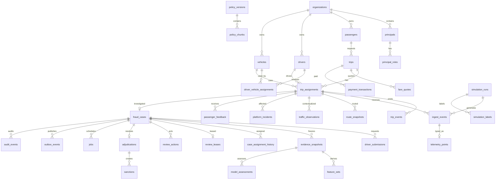

# PoC Canonical Data Model

## Purpose and source of truth

The executable schema is [`0001_poc_core.sql`](../../db/migrations/0001_poc_core.sql). This document defines its vocabulary and contracts. PostgreSQL and PostGIS are required for the relational/spatial store (Railway container/hosted); vector indexing is provided by Qdrant (ADR-019/ADR-022). Raw producer envelopes, typed operational facts, derived features, model assessments, analyst actions, and audit history are kept in one transactional system.

## T7 road telemetry dataset

`road-v1` is a synthetic, versioned corpus generated from pinned OSRM route responses with seed `42` and clock origin `2026-09-22T06:00:00Z`. Each assignment links one case, driver, vehicle, two route snapshots, and telemetry events. Variants are `normal_progress`, `stalled`, `reverse_travel`, `traffic_gridlock`, and `technical_dropout`.

Coordinates are WGS84 GeoJSON `[longitude, latitude]`; WKT/PostGIS uses `lon lat`. Producer fields are named `latitude`/`longitude`; timestamps are UTC `Z`; distance is metres; speed is metres per second. Speed is derived from distance and elapsed time. OSRM provenance, route leg, dataset version, and source status are retained. No fallback geometry, invented traffic, default GPS, or hidden interpolation is evidence.

Evaluation labels are held-out bookkeeping and excluded recursively from model input. Seed application preserves existing identities and unrelated historical rows; it performs no global delete. An identical ingest replay returns the prior result; the same event identity with changed payload returns `409 Conflict`.

The system uses **Passenger**, never “rider”, for the customer role. A case belongs to one accepted trip assignment. Assignment is durable responsibility; a review lease is only a short-lived exclusive submit right.

## Required architecture questions

| Question | Answer |
|---|---|
| System topology | Simulator and web call FastAPI; API and worker use Railway PostgreSQL (PostGIS) data plane and Qdrant vector store; the worker calls Jev through OpenRouter and emits redacted LangSmith traces. |
| State and graph lifecycle | Raw events create a durable job; preprocessing freezes an evidence snapshot; the bounded graph persists one assessment; deterministic rules set priority; an analyst separately adjudicates. |
| Tool contracts | Routes and optional read-only agent tools adapt the same typed application services. Tools receive trusted identity and snapshot context from runtime injection. |
| Data flow | Producer envelope → immutable ingest row → typed projection → snapshot/features → assessment → case queue → lease → human adjudication/audit/outbox. |
| Trade-offs | A dedicated relational/spatial store on Railway paired with Qdrant for policy vectors keeps transactions clean and performant; append-only raw and derived versions cost storage but preserve reproducibility. |
| Security boundaries | Browser roles cannot access `app`; migration, API, and worker need separate least-privilege roles; the worker/model cannot write adjudications or sanctions. |

## Entity groups and relationships



The migration tables are exactly: `app.organizations`, `principals`, `principal_roles`, `passengers`, `drivers`, `vehicles`, `driver_vehicle_assignments`, `trips`, `trip_assignments`, `fare_quotes`, `payment_transactions`, `trip_events`, `simulation_runs`, `ingest_events`, `telemetry_points`, `route_snapshots`, `traffic_observations`, `platform_incidents`, `passenger_feedback`, `policy_versions`, `policy_chunks`, `fraud_cases`, `driver_submissions`, `evidence_snapshots`, `feature_sets`, `model_assessments`, `case_assignment_history`, `review_leases`, `review_actions`, `adjudications`, `sanctions`, `jobs`, `outbox_events`, `audit_events`, `simulation_labels`, and `evaluation_runs`.

`organizations` scopes all operational identities. `principals` represent verified Clerk subjects within an organization. Public roles are `admin`, `member`, and `driver`, mapping to database roles (`admin`, canonical `fraud_analyst`, and `driver`), with legacy `analyst` supported as an alias for `fraud_analyst`. `passengers`, `drivers`, and `vehicles` hold domain entities. Synthetic dataset entities (e.g. benchmark/fixture trips and drivers) are domain simulation data and are never login principals or authenticated user accounts. Deterministic driver binding links a real Clerk driver subject within their organization to an `app.drivers` profile via UUID5(org, subject) with no invented personal information. `trips` contain PostGIS pickup/dropoff points and lifecycle status. `trip_assignments` represent driver pickup episodes; the partial unique index permits only one active assignment per trip. Fare and payment tables cover Uber-like commercial context without implementing a payment gateway.

## Event contracts

`ingest_events` is the canonical producer envelope. `trip_events` is the trip aggregate history. `telemetry_points` is the typed GPS/device projection keyed one-to-one by `ingest_events.event_id`.

```json
{
  "event_id": "018f2f4e-0000-7000-8000-000000000001",
  "schema_version": 1,
  "event_type": "telemetry.observed",
  "source": "simulator",
  "occurred_at": "2026-09-22T01:02:03Z",
  "correlation_id": "018f2f4e-0000-7000-8000-000000000002",
  "causation_id": null,
  "simulation_run_id": "018f2f4e-0000-7000-8000-000000000003",
  "trip_id": "018f2f4e-0000-7000-8000-000000000004",
  "assignment_id": "018f2f4e-0000-7000-8000-000000000005",
  "driver_id": "018f2f4e-0000-7000-8000-000000000006",
  "sequence": 12,
  "payload": {
    "position": {"latitude": 21.0285, "longitude": 105.8542, "accuracy_m": 8},
    "speed_mps": 0,
    "bearing_deg": 180,
    "app_state": "foreground",
    "network_state": "online",
    "gps_state": "valid",
    "mock_location_reported": false
  }
}
```

The JSON Schema contracts are [`telemetry-event.schema.json`](schemas/telemetry-event.schema.json) and [`domain-event.schema.json`](schemas/domain-event.schema.json). The API envelope calls the ordering field `sequence`; ingestion maps it to `ingest_events.producer_sequence`. The migration records `payload_hash`, source, sequence, event time, receive time, and foreign keys. Uniqueness on `(source, assignment_id, producer_sequence)` makes retries idempotent. Corrections are new events with causal references; raw events are not edited.

Supported simulation scenarios are `intentional_dic`, `traffic_gridlock`, `technical_dropout`, `fake_gps`, and `gps_jitter`. `technical_dropout` creates `platform_incidents` such as `app_crash`, `network_loss`, or `gps_unavailable`; no-report is represented by `driver_submissions.status = 'no_report'` or an observation gap. No-report is not technical error and is not an ERR category by itself.

## Feature semantics

`evidence_snapshots` freeze the case evidence at a policy version, cutoff time, and stage (`pre_cancellation` or `post_cancellation`). `feature_sets` are append-only, versioned preprocessing results with a coverage ratio, maximum gap, JSON features, and quality flags.

`stationary_duration_s` is the contiguous duration supported by valid samples below the configured speed/displacement threshold. It is null when samples or the window are insufficient. Null is not zero and is not a technical fault. `davi` is a directional alignment value in `[-1,1]`; it is null when stationary, route geometry/bearing is unavailable, or evidence is insufficient. A negative DAVI is meaningful only when movement, route, and sample quality support it.

`telemetry_coverage` and `max_gap_s` describe observation completeness. `traffic_observation_age_s` indicates staleness, not congestion. `traffic_observations` retain source, validity, simulated flag, and congestion (`clear`, `moderate`, `heavy`, `unknown`). `route_snapshots` retain required PostGIS LineString, provider, routing profile, and provenance. An unavailable external route must be recorded as unavailable by the service; the schema does not permit a fabricated route.

## Fraud taxonomy and model output

| Code | Meaning |
|---|---|
| `ERR-01` | Embezzlement |
| `ERR-02` | Driver Incentive Cheating (DIC) / deviation |
| `ERR-03` | Incentive exploitation |
| `ERR-04` | Phantom trips |
| `ERR-05` | Fake GPS |

The PoC supports model/case categories `ERR-02`, `ERR-05`, `no_violation`, and `insufficient_evidence`. The database accepts the full taxonomy for extension. Technical faults live in `platform_incidents` and quality flags; they do not receive an ERR code. They can explain missingness and block punitive actions.

`model_assessments.confidence` is a provider-returned per-case score. It is called confidence, never accuracy. `score_semantics` must say whether it is merely declared or calibrated; it is a calibrated probability only when that field and evaluation evidence support the claim. Accuracy, precision, recall, and calibration are computed from labels in evaluation tables, never from confidence alone. Assessments are append-only and retain provider, model, prompt/schema versions, reason codes, evidence references, brief, raw response, latency, and trace ID.

## Case, assignment, lease, and adjudication invariants

`fraud_cases.status` uses the exact lowercase values `ingested`, `processing`, `ready`, `in_review`, `evidence_requested`, `escalated`, `resolved`, and `processing_failed`. A case is unique per `trip_assignments` row. `priority_tier` is `0..2`, and `priority_score` plus `priority_rule_version` preserve the queue calculation. Supported case categories include the four PoC categories plus `ERR-01`, `ERR-03`, `ERR-04` for extension.

`fraud_cases.assigned_analyst_id` is durable responsibility. `case_assignment_history` records each assignment/reassignment, actor, reason, and required role. `review_leases` is separate: it binds one analyst to one case version and evidence snapshot for a short period, with a hashed token and expiry. A lease never changes durable assignment.

`review_actions` are nonterminal actions: `request_evidence`, `escalate`, or `defer`. They require a nonblank comment and evidence snapshot; they may transition the case but do not resolve it. `adjudications` are terminal, unique per case, and permit only `dismiss`, `warn`, `fine`, or `suspend`. They require nonblank rationale, policy version, analyst identity, evidence snapshot, request hash, idempotency key, and `explicit_human_approval = true`.

Sanctions are derived from an adjudication and remain simulated by default. Their constraints require warning, fine, or a bounded suspension shape, with a unique external effect key. No model assessment or job can create a terminal adjudication without an analyst transaction.

The adjudication transaction locks the case, verifies the active lease, analyst role, expected case version, evidence snapshot, and idempotency key, then inserts `adjudications`, optional `sanctions`, `audit_events`, and `outbox_events`, updates case status/version, and commits. A retry with the same analyst/idempotency key returns the existing result. A stale snapshot or expired lease is rejected. Append-only triggers protect evidence snapshots, feature sets, model assessments, adjudications, and audit events; privileged database-owner rewrites still require external checkpoints to detect.

## Jobs, outbox, access, and indexes

`jobs` provides durable preprocessing/model work with deduplication, retry state, attempts, and worker leases. `outbox_events` publishes committed aggregate changes after the transaction. Workers use `FOR UPDATE SKIP LOCKED`; no Kafka, Redis, or external broker is required for the PoC.

PostGIS is required for pickup/dropoff, telemetry positions, and route geometry. pgvector is required for `policy_chunks.embedding` and its HNSW index. The `app` schema is revoked from browser roles; FastAPI and workers use least-privilege database credentials. Analysts read through API authorization; model workers must not read `simulation_labels`.

Migration indexes cover driver assignment time, telemetry assignment/time, ingest receive-time BRIN, pickup/dropoff and telemetry-position GiST, queue ordering for exact active statuses, runnable jobs, and policy embeddings. Raw telemetry retention, anonymisation, and backups require a policy before real data. Synthetic PoC data may be reset; audit retention should exceed raw telemetry where governance requires it.

## Evaluation separation and traceability

`simulation_labels` are ground truth for simulator evaluation only, with expected category, guardrail, and outcome. `evaluation_runs` records dataset/model/preprocessing versions, sample count, and metrics. Detection workers must not use simulation labels as features. A simulation passing its expected label validates the pipeline contract, not production model accuracy.

| MVP requirement | Canonical tables and fields |
|---|---|
| P0/P1/P2 queue | `fraud_cases.priority_tier`, `priority_score`, `priority_rule_version`, queue index. |
| Synchronized GIS evidence | `ingest_events`, `telemetry_points`, `route_snapshots`, `traffic_observations`, `feature_sets.window_*`. |
| Brief and confidence | `model_assessments.category`, `confidence`, `score_semantics`, `forensic_brief`, `evidence_refs`. |
| Error/missingness guardrail | `platform_incidents`, telemetry states, `driver_submissions.no_report`, feature quality flags. |
| Analyst assignment and decision | `assigned_analyst_id`, `case_assignment_history`, `review_leases`, `review_actions`, `adjudications`. |
| Immutable audit | `audit_events`, append-only triggers, hashes, request IDs, and outbox event. |
| Three simulations | `simulation_runs`, `ingest_events`, `simulation_labels` with intentional DIC, gridlock, and dropout scenarios. |

The architecture decision is [`adr-002-relational-spatial-event-schema.md`](adr-002-relational-spatial-event-schema.md). Runtime design is in [`POC_DESIGN.md`](POC_DESIGN.md).

## Knowledge base and agent config (ADR-032, migration `20261120110000_kb_objects_and_agent_config.sql`)

| Table | Notes |
|---|---|
| `kb_object` | One row per version of a `parameter|motive|behavior|scenario|workflow`. `status` draft, ready_for_test, trial, published, retired; `body`/`scope`/`replay`/`history` jsonb; author and approver; partial unique index keeps one `published` row per `(organization_id, type, code)`. |
| `agent_config`, `agent_config_history` | Per-org values by `key` and `scope` (`global` or `rule:<code>`); history keeps old/new value, reason, kind (`change|revert|kill_switch`) and actor. Bounds are code constants. |
| `kb_policy_document` | Upload metadata, text excerpt, `indexing_status` (`not_indexed|indexed|embeddings_not_configured`). |
| `kb_proposal` | Review queue rows from analysis/help/closed case/monitoring/manual with mapping `reuse|extend|new`, similarity, decision and reason. |

Audit rows go to `audit_events` (`kb.*`, `agent_config.*`). The `kb_` prefix avoids the existing `workflow_*` analyst tables.
