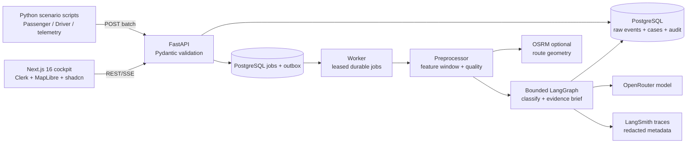

# GreenSentinel PoC Design

## Release authority and runtime boundary

The strict Phase 1 [PRD](../ba/PRD.md), adopted **2026-09-30 by @datamonsterr**, governs release scope. Recommendations and corroboration wait for **authorized analyst confirmation with written rationale**. No automatic dismissal is approved. All adverse sanctions, including warnings, require confirmation and rationale; blocking guardrails keep adverse sanctions blocked. Driver UI/mobile and appeal expansion are **deferred**.

[PR #40](https://github.com/AI20K-Build-Phase-Cohort-4/P-063/pull/40) is **MERGED historical runtime divergence**, commit `586caec05ddb7626a1f47066b55154e74d245cc0`, not accepted release scope. That baseline let traffic corroboration write `auto_dismissed` and return `needs_analyst_review=False`. Accepted upstream [PR #93](https://github.com/AI20K-Build-Phase-Cohort-4/P-063/pull/93), merged on 2026-10-02 at `16c1ad6bdc910badbe852418bc5de5b456759156`, removes the new automatic-dismissal transition and returns a recommendation awaiting analyst review. Legacy `auto_dismissed` records remain readable; this preserves history rather than authorizing a new autonomous outcome. [Issue #73](https://github.com/AI20K-Build-Phase-Cohort-4/P-063/issues/73) remains open for its independently accepted full DoD; merging #60/#86 does not close it by inference. Existing driver interfaces remain inherited baseline and do not approve driver/mobile/appeal expansion. This documentation correction changes no runtime and claims no separate hosted or database conformance proof.

## Approved Phase 1 analyst outcomes

The strict PRD `FR-04` requires **Dismiss False Alarm**, **Request More Evidence**, **Issue Warning**, **Approve Fine / Clawback**, **Suspend Driver (24h/48h)**, and **Escalate**. Dismissal and every adverse sanction require authorized analyst confirmation with written rationale (at least 10 characters). Junior analysts cannot suspend; suspension requires the Senior Analyst role or formal escalation. Blocking guardrails keep adverse sanctions blocked even after an attempted confirmation. Evidence requests and escalation do not themselves execute a sanction.

The compact inherited v1 vocabulary (`DISMISS`, `REQUEST_EVIDENCE`, fraud-confirming `APPROVE`) is historical implementation context, not a replacement for these approved human outcomes. `APPROVE` does not automatically issue a fine. The release flow must bind each confirmed action to actor, role, rationale, case version, and evidence snapshot. This document does not prove the full release action panel exists or that sanctions are delivered correctly.

## Purpose and scope

This document turns the approved [PRD](../ba/PRD.md) and supporting [MVP](../ba/MVP.md) into a buildable first proof of concept. The PoC is a small, deployable, end-to-end product: synthetic Passenger, Driver, trip, telemetry, and behavior signals enter an ingestion API; deterministic preprocessing creates an evidence window; a bounded LangGraph workflow classifies possible fraud; a rule-based priority policy orders the queue; and an authenticated analyst assigns, reviews, and records a human decision.

The PoC deliberately keeps one Python codebase with separate API and worker processes, one Next.js application, and one PostgreSQL database. Interfaces are explicit so the detector, ingestion source, and UI can later be separated without changing the domain model. The PoC is designed for local Docker Compose and an online deployment using Vercel, Railway, and Supabase. It does not claim live fleet integration, automatic enforcement, production scale, calibrated probabilities, or real-world model accuracy.

The MVP adds a concrete ingestion and analysis path to the dashboard scope in MVP: the synthetic generator is a real client of the same API used by future producers; preprocessing and detection are real services; and every finding is persisted before human adjudication. Passenger intervention, payment recovery, new driver/mobile evidence upload, appeals, and governance analytics remain deferred. Automatic dismissal and automatic sanctions are forbidden under the approved release. They are represented by extensible identifiers and statuses where that helps future migration.

## Inherited compact PoC v1 contract and historical delivery status

The following records the inherited compact v1 slice. Its omitted sanction controls do not supersede the approved PRD `FR-04` release scope:

- Cases are database-backed records created from a varied synthetic seed through the same ingestion path as producer events. Event IDs, payload hashes, and idempotency keys make retries safe; duplicate IDs with a changed body return `409 Conflict`.
- The analyst queue reads persisted cases and applies server-side status, priority, and availability filtering. A case held by another analyst's active review lease is excluded from the available queue; the holder can see it through the locked-case filter until the lease expires or is released.
- Route and telemetry evidence carries source, timestamp, provider, and quality metadata. Breadcrumbs render when present; OSRM geometry renders only when returned as valid. Routing, traffic, GPS, or telemetry gaps show `UNAVAILABLE` or an evidence gap and never create fabricated geometry.
- The cockpit combines the conversation pane, case evidence, and compact map controls in one case-scoped view. Map controls expose the available evidence layers without presenting synthetic or missing data as verified fact.
- The queue exposes `Available` and `Locked by me` filters. Loading uses a centered progress bar and status message while the real API is being read; the UI does not render a mocked queue before the response arrives.
- The case view replaces the conflicting-signal log with the driver/customer conversation. The map has a center-whole-trip GPS control and uses separate colors for the OSRM road route and telemetry breadcrumb evidence.
- Case-scoped Agents interaction uses authenticated SSE and persisted session messages. It stores user and assistant messages plus metadata needed to restore the session; chain-of-thought or hidden reasoning is never persisted or streamed.
- Human decision choices are `DISMISS`, `REQUEST_EVIDENCE`, and `APPROVE`. `APPROVE` means the analyst approves the finding as fraud; it does not mean automatic enforcement. Requesting evidence remains nonterminal and keeps the case open. The compact send control owns these actions; separate dismiss, evidence, warning, fine, suspension, escalation, and submit controls are not part of the v1 cockpit.
- The v1 cockpit has no standalone forensic-summary destination. Evidence, model assessment, conversation, policy citations, and decision controls stay attached to the selected case.

### Verification gates

The following are historical repository observations, not checks rerun by this documentation reconciliation. Verified gates were limited to repository evidence: 27 focused backend route/workspace tests, 51 frontend unit tests, TypeScript, and 5 local Playwright flows pass. Browser flows use test-only API fixtures and local auth bypass. The API suite reports 23 passed and 2 skipped because the local database lacks two additive migrations. The isolated full-suite attempt fails at `tests/test_agents/test_db_tools.py::test_get_driver_history_tool` because a legacy test expects seeded driver rows in a database. `bash scripts/check.sh` is not green: Mypy fails on a NumPy stub using Python 3.12 `type` syntax under the configured Python 3.11 target; a Python 3.12 run also exposed existing source typing errors. Hosted Vercel/Railway preview health, production URLs, external credentials, and cloud deployment remain unverified because isolated preview resources are unavailable. This document records no hosted deployment as complete.

## Assumptions and open product questions

The initial tenant is one GreenSM operating region, one currency (VND), and one analyst organisation. A trip has one Passenger and at most one active Driver assignment at a time; reassignment creates another pickup episode. GPS coordinates are WGS84 decimal degrees. Telemetry timestamps are event time in UTC; API timestamps are UTC as well. Retention, consent, and regional data residency need a product/legal decision before real Passenger data is enabled.

Recommended choices and their reasons are:

| Question | Recommendation | Alternatives and trade-off |
|---|---|---|
| Where does ingestion run? | FastAPI stores immutable raw events plus a durable PostgreSQL job in one transaction; a separate worker analyzes them. | Kafka is better for high volume but adds operations; in-process tasks can be lost during restarts; synchronous LLM calls make ingestion slow and fragile. |
| Which model API? | Python LangChain/LangGraph with an OpenRouter-compatible chat model and structured Pydantic output. | TypeScript AI SDK fits a JS-only team; the Python choice matches FastAPI, Pydantic, and analytical tooling. |
| What does confidence mean? | Store the provider-returned value and semantics. Display `model_confidence` unless held-out calibration proves probability semantics. Never call a per-case value accuracy. | Accuracy, precision, recall, and calibration require labelled evaluation data. A raw model self-score is only a triage signal. |
| How is priority computed? | Versioned deterministic tier rules from supported category, confidence, evidence quality, technical guardrails, and age. | Letting the LLM choose priority is less reproducible and harder to audit. A trained ranker can replace the rules after labels exist. |
| Which route baseline? | Optional OSRM route geometry, cached by origin/destination; show “unavailable” when routing or traffic data is absent. | Google/HERE add richer traffic but cost and vendor lock-in; a straight line must not be presented as a legal route. |
| Which traffic truth? | Store provider, observed time, and coverage; treat traffic as contextual evidence only. | Synthetic traffic is useful for demos but cannot validate real fraud performance. |
| Which database? | Supabase PostgreSQL with PostGIS and pgvector in cloud; matching PostgreSQL extensions in Compose; SQL migrations are canonical. | SQLite is faster for a toy demo but loses spatial, vector, and concurrency parity. |
| Authentication? | Clerk JWT proves identity; FastAPI loads analyst roles from PostgreSQL and enforces them server-side. | Supabase Auth reduces vendors; local development can use a seeded identity adapter. Never trust a role sent by the browser. |
| Streaming? | REST for commands and SSE over authenticated `fetch` for analysis progress/read-only updates. | Native `EventSource` cannot attach Clerk bearer headers; WebSockets suit bidirectional live dispatch, which is outside PoC scope. |

## Recommended technology stack

| Concern | Recommendation | Why it fits the PoC | Deferred alternative |
|---|---|---|---|
| Analyst web | Next.js 16 App Router, React, TypeScript, Tailwind, shadcn/ui | Fast Vercel deployment, typed UI, accessible primitives, and direct alignment with the checked-in design | A static SPA loses server-rendered authentication/layout benefits |
| Map | MapLibre GL JS with GeoJSON sources/layers | Distinct styled route, breadcrumb, stall, and quality layers without proprietary map lock-in | Leaflet is smaller for raster-only maps but less flexible for dense vector evidence |
| API | FastAPI async routes and Pydantic V2 | Typed OpenAPI contracts, existing repository conventions, and shared simulator/analytics language | A Next.js API consolidates languages but conflicts with the Python/LangGraph path |
| Workflow | LangGraph with bounded conditional edges; LangChain only for provider/retrieval adapters | Explicit state transitions, retry limits, and straightforward node tests | Free-form agents add latency and non-determinism |
| Model gateway | OpenRouter with a pinned Jev model ID and strict structured output | Provider abstraction, one server-side credential, and schema-constrained classification | Direct provider SDK gives tighter vendor features but increases coupling |
| Observability/evaluation | LangSmith for redacted traces and offline datasets; application metrics for operational health | Separates prompt/model evaluation from queue and API monitoring | Logs alone make prompt regression comparison difficult |
| Persistence | Supabase PostgreSQL, PostGIS, pgvector, SQLAlchemy 2 async, psycopg 3 | One transactional data plane for operational, spatial, retrieval, job, and audit needs | Chroma, Redis, Kafka, and a warehouse add services before load requires them |
| Identity | Clerk for sessions; PostgreSQL for roles and action limits | Fast hosted login while keeping authorization under server/domain control | Supabase Auth reduces vendors but is not the preferred stack |
| Packaging | `uv`, Python 3.11+, Docker, Docker Compose | Reproducible Python dependencies and local/cloud parity | Platform-only builds make local reproduction harder |
| Hosting | Vercel web; Railway API and worker; Supabase database | Fast managed deployment and independent API/worker scaling | One Railway project is a simpler viable fallback |
| Tests | pytest, pytest-asyncio, httpx, Testcontainers, React Testing Library, MSW, Playwright | Covers pure rules, real transactions, API contracts, UI states, and three demo flows | Broad snapshot tests provide little safety for concurrency and guardrails |

## Implementation structure and patterns

Use a modular monolith. Preserve repository layering: `src/api/` validates transport contracts; `src/services/` implements use cases and external adapters; `src/agents/` owns typed graph state and nodes; `src/models/` owns shared Pydantic schemas. Add repository interfaces under services and keep SQL in concrete persistence adapters. A future service split preserves these boundaries.

Apply these patterns only where they address a named failure mode:

- **State machine:** validate every case transition and reject impossible transitions.
- **Repository plus Unit of Work:** keep SQL outside routes and agent nodes; commit a domain change, audit record, and outbox event atomically.
- **Transactional outbox:** publish internal events only after their domain change commits.
- **Idempotent consumer:** event IDs, source sequence, job deduplication keys, and decision idempotency keys make retries safe.
- **Optimistic concurrency plus lease:** case versions prevent stale decisions; review leases permit one submitter without turning assignment into a lock.
- **Strategy/adapter:** Jev/OpenRouter, routing, policy retrieval, identity, and job repositories remain replaceable behind typed ports.
- **CQRS-lite:** use optimized read queries for the queue/dossier while all writes pass through explicit commands. Do not create a second read database for the PoC.
- **Anti-corruption layer:** map external Clerk, OpenRouter, OSRM, and producer payloads into canonical domain types before business rules use them.

## System topology



The API layer owns authentication, validation, transaction boundaries, and response shaping. Services own routing, model clients, and repositories. Agent nodes receive typed data and call tools through narrow interfaces; they do not issue SQL directly. The UI never writes a case decision without a server-side authorization and optimistic-lock check.

## Dataflow and lifecycle

1. A scenario script creates a trip, actor events, GPS breadcrumbs, and optional app/network/traffic signals with a stable `scenario_id` and idempotency key.
2. `POST /api/v1/telemetry/ingest` validates the envelope, rejects impossible coordinates or timestamps outside the configured clock-skew window, and inserts raw events with unique event IDs and source sequence constraints.
3. The ingestion transaction writes trip context, raw events, a case, and a durable job. A duplicate event with the same hash is idempotent; the same ID with a different body returns `409 Conflict`.
4. The preprocessor sorts event time, de-duplicates points, computes distance, speed, heading, stop duration, route deviation, GPS quality, network/app health, and missingness. It records the feature version and quality flags. OSRM and traffic failures become explicit evidence gaps.
5. The detector invokes the bounded graph with the feature summary and selected evidence. The model must return one supported category, confidence, score semantics, rationale, and timestamp references matching supplied events. Invalid output is trapped and persisted as `processing_failed`; it never creates a sanction.
6. A deterministic priority policy computes `P0`, `P1`, or `P2` and stores the formula version and inputs. The case becomes `ready` only after analysis output is committed.
7. An analyst claims the case using a short lease. The UI reads map geometry, evidence quality, brief, model metadata, and guardrails over REST; optional progress is streamed over SSE.
8. `POST /api/v1/cases/{id}/adjudicate` validates role, lease, evidence and policy versions, blocking guardrails, permitted outcome, mandatory rationale, and idempotency. It appends the immutable human decision, audit event, and outbox event in one transaction. No autonomous model or worker may create the decision; every approved human sanction needs the same explicit authorization, rationale, and guardrail checks.

## Bounded LangGraph design

The release target is a bounded classifier and evidence summarizer. The following TypedDict and stages are a design contract, not a claim that these nodes exist in the inherited runtime. The checked-in conversational [`AgentState`](../../src/agents/state.py) carries query, context, analysis, response, error, metadata, and messages; [`graph.py`](../../src/agents/graph.py) routes `agent` to `tools` when the reply contains tool calls and otherwise ends. Case lifecycle is separate and must never be resolved by an unconfirmed recommendation.

The proposed forensic state is a typed object:

```python
class FraudState(TypedDict):
    case_id: str
    feature_window: FeatureWindow
    evidence: list[EvidenceItem]
    quality_flags: list[QualityFlag]
    model_result: FraudAssessment | None
    brief: str | None
    errors: list[str]
    attempts: int
```

Nodes are `load_case`, `validate_features`, `classify_fraud`, `validate_model_output`, `retrieve_policy`, `write_brief`, and `persist_analysis`. Conditional edges allow `validate_features -> classify_fraud` only when minimum evidence exists, retry `classify_fraud -> validate_model_output` at most once on schema failure, and route any exception to a persisted failure result. The case-scoped Agents stream may emit compact tool-call and thought status events while the model uses approved tools and continues to its final reply; hidden chain-of-thought is neither exposed nor persisted. The graph always ends in either `ANALYZED`, `INSUFFICIENT_EVIDENCE`, or `ANALYSIS_FAILED`. Case lifecycle is persisted separately as `ingested`, `processing`, `ready`, `in_review`, `evidence_requested`, `resolved`, or `processing_failed`.

The PRD taxonomy is authoritative: `ERR-01` trip/order embezzlement; `ERR-02` route deviation and driver-induced cancellation; `ERR-03` incentive/policy exploitation; `ERR-04` phantom/virtual trips; and `ERR-05` technological manipulation or fake GPS. The first PoC has enough single-episode evidence to classify `ERR-02` and `ERR-05`. It also supports `no_violation` and `insufficient_evidence`. It must not assert `ERR-01`, `ERR-03`, or `ERR-04` without later cross-trip evidence. App crashes, network loss, GPS unavailability, and missing reports are guardrail evidence, not violation codes.

The model output schema includes `category`, `confidence` in `[0,1]`, `score_semantics`, `reason_codes`, `evidence_event_ids`, `missing_evidence`, and a short neutral brief. Pydantic validation rejects unsupported codes, out-of-range confidence, and references to events outside the snapshot. The classifier output contract defaults to `score_semantics = "uncalibrated_model_confidence"`. This is a documentation target, not proof that each inherited schema emits the field. Display per-case confidence as raw model confidence, never calibrated fraud probability or case accuracy absent provider evidence and held-out calibration. **Aggregate decision quality** (decision consistency/accuracy against analyst labels) is measured over a defined evaluation set; accuracy, precision, recall, F1, and calibration belong to separate evaluation records, not a per-case score. The PRD's aggregate acceptance criterion is not a classifier confidence threshold.

Top-k ROUTE alternatives are optional pending product scope; a single available source-backed route is the baseline. They are distinct from RAG retrieval top-k, the configured number of policy/precedent chunks retrieved by [`store.search`](../../src/rag/store.py), not a confidence measure or a requirement for multiple route widgets.

## Priority policy

Priority is reproducible and stored with its version. Recommended demo rules are:

1. Assign `P0` only to supported `ERR-02` or `ERR-05` cases with confidence at least `0.85`, evidence quality at least `0.80`, and no blocking technical guardrail.
2. Assign `P1` to supported cases with confidence at least `0.65` and evidence quality at least `0.60`.
3. Assign `P2` to every other case, including insufficient evidence and technical ambiguity.
4. Rank within each tier with `priority_score = round(1000 × confidence) + min(case_age_minutes, 180)`, then creation time and stable case ID.

Thresholds are versioned demo configuration until Fraud Operations approves policy. The rules rank work; they never determine guilt or authorize an outcome.

## Tool contracts and failure behavior

The proposed classifier tool contract exposes typed tools: `get_case_feature_window(case_id)`, `get_route_geometry(origin, destination, provider)`, `retrieve_policy(query, policy_version)`, and `save_analysis(result)`. Inputs use Pydantic models, IDs are authorization-scoped, and all outbound calls have timeouts. Tools return typed success/error values; exceptions are caught at the boundary and recorded with a correlation ID. Policy retrieval returns citations and a policy version; a missing policy citation cannot be presented as a rule. OSRM timeout yields `route_status=UNAVAILABLE`, never a fabricated route.

## HTTP API

The initial API is intentionally small:

| Method | Endpoint | Purpose |
|---|---|---|
| GET | `/health` | liveness/readiness without secrets |
| POST | `/api/v1/telemetry/ingest` | idempotent synthetic or future producer ingestion |
| POST | `/api/v1/simulations/{scenario}` | authenticated demo trigger; returns case ID |
| GET | `/api/v1/cases?status=&priority=` | analyst queue, server-side filtering |
| GET | `/api/v1/cases/{id}` | case, features, evidence, route, analysis, guardrails |
| POST | `/api/v1/cases/{id}/claim` | lease a review, with analyst identity |
| POST | `/api/v1/cases/{id}/actions` | append a nonterminal evidence request when the analyst uses the compact decision control |
| POST | `/api/v1/cases/{id}/adjudicate` | Confirmed authorized analyst outcome and audit append; inherited compact v1 exposes `DISMISS` / fraud-confirming `APPROVE`, not the complete FR-04 target |
| GET | `/api/v1/cases/{id}/stream` | SSE progress/read-only updates |
| GET | `/api/v1/cases/{id}/agent-session` | restore the persisted case-scoped Agents session |
| POST | `/api/v1/policy/chat/stream` | case-scoped Agents SSE; `PolicyChatRequest.case_id` binds the turn to its case and emits citations plus compact tool/thought status |

Request and response models live in `src/models/`; routes remain thin. Error responses carry `code`, `message`, and `correlation_id`. `GET /api/v1/cases/{id}/agent-session` restores the case session; `POST /api/v1/policy/chat/stream` appends user and assistant messages so switching cases does not clear history. Only final assistant text and compact tool metadata are persisted; hidden reasoning is not. The server enforces roles and policy limits. The inherited compact v1 omits direct warning/fine/suspension and escalation controls. These are approved human outcomes in strict PRD `FR-04`; their omission is a release implementation gap, not authority to defer them. This documentation correction supplies no runtime acceptance proof.

## Contracts and persistence

The canonical relational schema is [`0001_poc_core.sql`](../../db/migrations/0001_poc_core.sql). It covers organisations, principals/roles, Passengers, Drivers, vehicles, trips and pickup assignments, fares/payments, raw ingest events, telemetry, routes, traffic, incidents, policy versions, suspected-fraud cases, snapshots, features, assessments, durable analyst assignment, review leases, actions, adjudications, sanctions, jobs, outbox, simulations, evaluations, and audit events. JSON producer contracts are [`telemetry-event.schema.json`](schemas/telemetry-event.schema.json) and [`domain-event.schema.json`](schemas/domain-event.schema.json).

Raw telemetry and audit records are append-only at the application boundary. PostgreSQL permissions should prevent ordinary update/delete; corrections are compensating events. Hash-chain audit rows (`previous_hash`, `entry_hash`) make tampering evident, but database immutability still depends on privileges, backups, and operational controls. PII is minimised: display tokens in the cockpit, restrict raw contact data, and never send unnecessary PII to the model or LangSmith.

Telemetry envelope:

```json
{"schema_version":1,"event_id":"8c1d0a36-a82a-4bb0-8504-d977971c6448","event_type":"telemetry.observed","source":"simulator","occurred_at":"2026-09-22T01:02:03Z","correlation_id":"8c73998a-d160-456f-b5e8-ccfac38d3d63","trip_id":"486e39fd-c661-41e6-84d4-19492fc9336f","assignment_id":"558bcdf2-c875-48d3-a3be-0fa01cd9b8f4","driver_id":"a7bf8b0f-a53a-465c-9ba4-dfb37233df29","sequence":42,"payload":{"position":{"latitude":21.0285,"longitude":105.8542,"accuracy_m":8},"speed_mps":0,"bearing_deg":180,"app_state":"foreground","network_state":"online","gps_state":"valid","mock_location_reported":false}}
```

Domain events use a versioned aggregate envelope and event types such as `trip.requested`, `assignment.accepted`, `passenger.cancelled`, `assessment.completed`, `case.ready`, and `case.adjudicated`. A telemetry event is an observation; a domain event is a business transition. The server supplies receipt time, producer identity, and payload hash. Public ingestion cannot forge internal assessment, adjudication, or sanction events.

## UI and analyst workflow

Next.js 16, shadcn-ui, and MapLibre implement the compact light cockpit described in [`docs/design/Design.md`](../design/Design.md). The inherited compact V1 keeps a queue, case conversation/evidence view, and compact map controls in the selected-case flow; it does not expose a standalone forensic-summary screen. Use alignment, dense tables, 1px borders, clear P0/P1/P2 colors, keyboard navigation, and visible missingness. MapLibre draws actual breadcrumbs and a distinct OSRM geometry only when route status is valid; it must label synthetic traffic and unavailable data.

The release decision controls require authorization, a valid lease/version, and the applicable evidence policy. Technical-error guardrails block adverse sanctions; a suggested dismissal still waits for authorized analyst confirmation with written rationale. Server checks must enforce the same boundaries against forged requests. Every terminal decision requires analyst identity, outcome, rationale, policy version, model version, current evidence snapshot hash, and explicit confirmation.

## Inherited V2 baseline and deferred driver expansion

The historical V2 design ([ADR-008](adr-008-poc-v2-async-driver-agent-and-a2a-collaboration.md)) sought asynchronous driver intake and multi-agent investigation. PR #40 merged interfaces for that design; their existence does not approve new driver/mobile or appeal scope. The diagram below shows the corrected advisory boundary as a release target, not verified runtime behavior.

### 1. Advisory release target using inherited interfaces

```mermaid
flowchart TD
  subgraph DriverPlane["Inherited driver interfaces; new UI/mobile scope deferred"]
    DriverApp["Next.js Driver View\n/driver/dispute/[caseId]"] -->|POST /api/v1/driver/cases/{id}/chat| DriverAPI["FastAPI Driver Gateway\nRole: driver auth"]
    DriverAPI --> DriverGraph["Inherited driver intake\nstatements and advisory corroboration"]
    DriverGraph --> DriverTools["DRIVER_TOOLS\nread context, traffic, policy"]
    DriverTools --> Corroborate["Telemetry & OSRM\nCorroboration Engine"]
  end

  subgraph PersistencePlane["PostgreSQL & State Plane"]
    DriverGraph --> SessionDB[("app.case_agent_sessions\ndurable multi-turn transcript")]
    DriverGraph --> Dossier["Advisory dossier\nwait for analyst review"]
    CaseDB[("app.fraud_cases\nterminal writes via analyst gate only")]
    DriverGraph --> AuditDB[("app.audit_events\ntamper-evident audit trail")]
  end

  subgraph AnalystPlane["Cockpit & Sentinel Copilot"]
    SessionDB --> CopilotGraph["Sentinel Copilot (LangGraph)\nA2A dispute synthesis"]
    CopilotGraph --> AnalystTools["Inherited ANALYST_TOOLS\nread, claim, request evidence"]
    CockpitUI["Analyst Cockpit (/workplace)\nChatbox + Driver Synthesis Badge"] <-->|SSE stream| CopilotGraph
    Dossier --> CockpitUI
    CockpitUI -->|Authorized analyst confirmation + written rationale| AdjudicateAPI["FastAPI Adjudication\nrole, lease/version, guardrail checks"]
    AdjudicateAPI -->|Authorized human outcome per FR-04 after valid confirmation| CaseDB
    AdjudicateAPI --> AuditDB
  end
```

### 2. Analyst confirmation for every terminal decision

Telemetry corroboration can recommend dismissal; unsuccessful or unavailable corroboration leaves an undecided case for analyst review. Neither a model score nor a traffic check can resolve the case or issue an exoneration receipt. Every dismissal and adverse sanction requires authorized analyst confirmation with written rationale. Technical guardrails keep adverse sanctions blocked even when an analyst attempts confirmation; evidence requests remain nonterminal.

### Historical decision record

The V2 design previously authorized `auto_dismissed` when speed < 5 km/h, traffic duration ratio > 2.0x, valid GPS, and zero prior sanctions corroborated gridlock:

> Then the system autonomously exonerates the driver, marks the case `auto_dismissed`, and issues an immediate exoneration receipt. No human analyst review is required.

This release authorization is superseded by the strict PRD adopted 2026-09-30. PR #40 is merged historical divergence; PR #93 removes the new autonomous transition; #73 full acceptance remains separate from this documentation correction.

### 3. Agent-to-Agent (A2A) baseline and historical cockpit proposal

- **Durable Session Schema:** `app.case_agent_sessions` records messages tagged with role `driver`, `driver_agent`, `analyst`, and `assistant`.
- **Cockpit Synthesis Badge:** When opening a disputed case in [`cockpit-view.tsx`](../../src/webapp/components/views/cockpit-view.tsx), the Cockpit chatbox renders an expandable Driver Dispute Card showing:
  - Driver statement & selected claim category.
  - Corroboration status (Traffic congestion ratio, stall duration vs OSRM expectation).
  - Precedent matching score from similar past resolved cases.
  - One-click toggle to view full verbatim driver-agent chat dialogue.
- **Analyst Prompt Delegation:** The analyst can type instructions directly to the Driver Agent in the Cockpit chatbox (e.g., *"Ask driver for dashcam footage or parking receipt"*). Sentinel Copilot dispatches an asynchronous follow-up task to the Driver Agent, which prompts the driver on their next session.

### 4. Partitioned Tool Registries

Tools are partitioned into isolated modules to prevent privilege escalation:

| Registry | Module Path | Permitted Roles | Contained Tools |
|---|---|---|---|
| **`DRIVER_TOOLS`** | [`src/agents/tools/driver_tools.py`](../../src/agents/tools/driver_tools.py) | `driver`, `analyst` | `get_driver_dispute_context`, `corroborate_traffic_conditions`, `submit_driver_statement`, `query_driver_policy` |
| **`ANALYST_TOOLS`** | [`src/agents/tools/analyst_tools.py`](../../src/agents/tools/analyst_tools.py) | `analyst`, `senior_analyst`, `admin` | `get_case_detail`, `list_cases`, `claim_case`, `record_case_action`, `adjudicate_case`, `query_policy`, `trigger_simulation`, `get_driver_history`, `query_cases_db`, `check_driver_suspension` |

### 5. Inherited HTTP API surface (not new release scope)

| Method | Endpoint | Role | Purpose |
|---|---|---|---|
| `GET` | `/api/v1/driver/cases/{id}/dispute` | `driver` | Fetch driver dispute context, violation charge, and SLA deadline |
| `POST` | `/api/v1/driver/cases/{id}/chat` | `driver` | Multi-turn conversational intake and evidence submission with Driver Agent |
| `GET` | `/api/v1/driver/cases/{id}/chat/stream` | `driver` | SSE streaming for Driver Agent conversational replies |
| `POST` | `/api/v1/cases/{id}/delegate-inquiry` | `analyst` | Dispatch analyst follow-up instruction to Driver Agent |
| `GET` | `/api/v1/cases/{id}/dispute-dossier` | `analyst` | Fetch synthesized A2A dispute summary and corroboration score |

### 6. Historical database migrations (not new schema work)

- Historical migration [`20260926180000_poc_v2_driver_role_and_dispute.sql`](../../db/migrations/20260926180000_poc_v2_driver_role_and_dispute.sql):
  - Modifies `app.principal_roles` check constraint to include `'driver'`.
  - Seeds synthetic driver principals linked to `app.drivers.principal_id`.
  - Adds `dispute_deadline` and `dispute_status` columns to `app.fraud_cases`.
  - Extends `app.case_agent_sessions.role` to permit `driver` and `driver_agent`.

### 7. Historical dispute SLA proposal and adversarial boundary

- **48-Hour Dispute Window:** Historical V2 design proposed this response deadline and analyst triage on expiry. It is not a new Phase 1 SLA or authorization for an automatic verdict.
- **Neutral Deflection Guardrail:** The Driver Agent ignores jailbreak commands, social engineering, or demands to cancel sanctions by outputting neutral deterministic deflections: *"I can only record trip facts and check traffic conditions for human analyst review."*

### 8. Inherited precedent workflow design (historical V2)

- **TypeSafe Jev Precedent Matcher:** OpenRouter `~typesafe/jev-latest` computes semantic and situational similarity between incoming dispute context and historical precedent cases, returning a raw uncalibrated relevance score `[0.0, 1.0]`, matching factors, and an advisory procedure. A heuristic fallback must retain its provenance and explicit failure states; neither score is calibrated fraud confidence/probability or decision authority.
- **Workflow Trace Schema (`WorkflowTrace`):** Persists the complete case lifecycle JSON:
  - `agent_tools_called`: List of tools executed with timestamps, inputs, and outputs.
  - `human_actions_performed`: Chronological actions by driver and analyst (dispute statement, delegated inquiry, evidence upload, decision submit).
  - `driver_response_summary`: Synthesized driver rationale.
  - `related_policies`: Applied policy codes, clauses, and leeways.
  - `final_decision`: Terminal verdict (`exonerated`, `warning`, `penalty`), penalty amount, rationale, and analyst identity.
- **Post-Adjudication Cockpit View:** Displays synthesized workflow card immediately upon decision submission and publishes the workflow template to `app.precedent_workflows` for future case reuse.
- **Interactive Procedure Reuse (historical):** A precedent button may prefill an editable investigation draft. It does not submit or confirm a decision; analyst review and written rationale remain mandatory.

## Acceptance and use-case traceability

| Source requirement | Design target / historical boundary (not validation proof) |
|---|---|
| AC-MVP-01 | Queue endpoint, indexed priority/status, versioned deterministic formula, P0/P1/P2 thresholds. |
| AC-MVP-02 | Case response carries ordered GPS samples and optional OSRM geometry with timestamps and provider status; MapLibre renders both distinctly. |
| AC-MVP-03 | Bounded graph writes structured supported category, confidence semantics, brief, and event references for every analyzable case; failure states are visible. |
| AC-MVP-04 | Feature quality flags include app/network/GPS failures; server-side decision policy blocks punitive actions under guardrails. |
| AC-MVP-05 | Adjudication validates allowed outcome, role, lease/version, idempotency, explicit approval, and mandatory rationale. |
| AC-MVP-06 | Append-only decision and hash-chain audit rows persist the snapshot and analyst identity. |
| AC-MVP-07 | Three named simulation scenarios exercise intentional stall, traffic gridlock, and telemetry dropout through the same ingestion path. |
| FR-L06-10/11/12/17 | Evidence completeness, role authorization, mandatory human sign-off, and tamper-evident audit are enforced in API and schema. |
| NFR-L06-02 | No automatic dismissal or sanction is approved. Every dismissal and adverse sanction requires authorized analyst confirmation with written rationale; blocked adverse sanctions stay blocked. PR #40 automatic dismissal is historical divergence, with the upstream correction in PR #93 and independent #73 acceptance still open. |
| US-L06-04.AC1 | Adjudication links outcome, snapshot, policy, analyst, rationale, and approval time. |
| US-L06-04.AC2 | `driver_submissions.status=no_report` and `platform_incidents` remain independent facts; neither creates an automatic sanction. |
| US-L06-04.AC3 / UC-L06-04.EX.1 | Unauthorized adverse commands are denied and audited in a separate committed denial record; case and Driver state remain unchanged. |
| US-L06-09.AC1-AC3 | Historical V2 driver intake in `/driver/dispute/[caseId]`; inherited interfaces do not approve new driver/mobile/appeal expansion. |
| US-L06-10.AC1-AC3 | Historical A2A synthesis/delegation proposal; advisory reuse never bypasses analyst confirmation with rationale. |
| UC-L06-08.AC/EX | Historical driver session, corroboration, and SLA design; new driver product scope is deferred. |
| UC-L06-09.AC/EX | Inherited A2A interfaces; approved handoff waits for authorized analyst confirmation with written rationale. |
| UC-L06-04.AC.1/AC.2 | Evidence requests persist as nonterminal `review_actions`; escalation is deferred from the v1 cockpit. |
| UC-L06-04.EX.2 | New evidence or policy increments the case version and invalidates the bound lease/snapshot; stale adjudication returns `409`. |
| UC-L06-04.EX.3 | Required-source failure blocks adverse outcomes and exposes retry or escalation while preserving the undecided case. |
| UC-L06-04.EX.4 | Lease expiry or network timeout creates no decision; idempotency lookup resolves ambiguous client retries. |
| MVP Feature 6 | Case-scoped Agents stream cites a published policy version/chunk and abstains when retrieval lacks support; standalone policy chat remains a deferred integration surface. |

## TDD and quality gates

Unit tests cover event validation, idempotency, DAVI/stationary semantics, output validation, priority boundaries, guardrails, and graph transitions. API tests use `httpx.AsyncClient` against test PostgreSQL and verify authorization, concurrent claims, stale versions, duplicate submissions, denial audits, and decision persistence. Contract tests replay the three synthetic database-backed scenarios plus fake-GPS/jitter counterexamples and assert case state and evidence. Browser tests use test-only network fixtures; they cover queue loading and Available/Locked by me filters, case switching, map fallback and center control, fragmented Agents SSE, and decision controls. These browser fixtures do not claim fake-data-free production. Run Ruff, pytest, SQL migration checks, frontend type/lint/build checks, and Playwright smoke tests in CI.

## Local and online deployment

Docker Compose runs PostgreSQL, FastAPI, the worker, Next.js, and an optional local OSRM profile. `uv` manages Python dependencies. Migrations run explicitly before startup. Scenario scripts run as a separate one-shot container or local command. Local Clerk can use a development instance or a seeded identity adapter guarded by `ENV=development`; deployed startup fails if that adapter is enabled.

For online access, deploy Next.js to Vercel, FastAPI and the worker to Railway, and PostgreSQL to Supabase. Configure CORS to the Vercel origin, Clerk issuer/audience, OpenRouter key, LangSmith settings, database URL, and OSRM URL through secret stores. PostgreSQL jobs make analysis restart-safe for PoC volume. A managed queue can replace the job repository when contention or throughput requires it.

Pull request previews use separate Railway and Vercel resources. The Railway preview health check must pass before the Vercel preview is built, so browser checks exercise the matching API revision. Fork pull requests are validation-only because GitHub withholds repository secrets. Preview CI does not use the production database or production deployment credentials.

Preview workflow changes are isolated for review on branch `fix/poc-v1-preview-ci` under `.worktrees/poc-v1-preview-ci`; this local worktree is not evidence of a hosted deployment. Merge and hosted verification remain dependent on the normal pull request checks and configured external services.

## Security and operations

FastAPI verifies Clerk JWTs, maps the subject to a principal, and loads roles from PostgreSQL. Rate-limit ingestion and simulation endpoints by actor and IP, bound batch size and payload bytes, and reject unknown fields where appropriate. Sanitize policy queries and render model output as text. Set model timeouts, retry only idempotent calls, redact PII in traces, and log structured correlation IDs without secrets. Use separate least-privilege API, worker, and migration database roles, encrypted connections, backups, and migration review. Monitor ingestion latency, analysis failure rate, queue age, evidence missingness, model latency/cost, adjudication MTTR, and human override rate.

## ADR and glossary links

Design records (with their individual status and evidence limits) are recorded in [`ADR-002`](adr-002-relational-spatial-event-schema.md), [`ADR-004`](adr-004-bounded-jev-fraud-workflow.md), [`ADR-005`](adr-005-poc-runtime-and-deployment.md), [`ADR-006`](adr-006-shared-use-cases-for-api-and-agent-tools.md), [`ADR-007`](adr-007-qdrant-vector-database-migration.md), [`ADR-008`](adr-008-poc-v2-async-driver-agent-and-a2a-collaboration.md), and [`ADR-009`](adr-009-poc-v2-precedent-workflow-mining-and-jev-similarity.md). Existing [`ADR-003`](adr-003-subagent-delegation-architecture.md) covers development workflow, not runtime fraud decisions.

## Required architecture questions

| Question | Answer / evidence boundary |
|---|---|
| System topology | [Topology](#system-topology) separates Next.js, FastAPI, worker, PostgreSQL, model gateway, and optional routing. The [inherited V2 interfaces](#inherited-v2-baseline-and-deferred-driver-expansion) are not new driver product scope. |
| State and graph lifecycle | [Bounded graph design](#bounded-langgraph-design) distinguishes the proposed forensic TypedDict/stages from inherited conversational state/routing. Conditional failures remain visible; terminal case decisions require the analyst gate. |
| Tool contracts | [Contracts](#tool-contracts-and-failure-behavior) require validated/scoped inputs, timeouts, explicit errors, and no fabricated evidence. Existing registries are baseline, not a verification result. |
| Data flow | [Ingestion/lifecycle](#dataflow-and-lifecycle) covers persistence, analysis, queue, and adjudication; [analyst workflow](#ui-and-analyst-workflow) and the API cover authenticated token/status streaming without hidden reasoning. |
| Trade-offs | [Product questions](#assumptions-and-open-product-questions), [patterns](#implementation-structure-and-patterns), and linked ADRs explain alternatives. Advisory reuse retains human review; autonomous dismissal authorization is superseded. |
| Security boundaries | [Security requirements](#security-and-operations) keep keys server-side, sanitize input/output, and require authorization and request/rate bounds. Blocked adverse sanctions remain blocked. Historical local/fixture checks do not prove the #73 path or hosted deployment compliant. |

## External references

- [Next.js App Router](https://nextjs.org/docs/app)
- [Supabase PostGIS](https://supabase.com/docs/guides/database/extensions/postgis) and [Row Level Security](https://supabase.com/docs/guides/database/postgres/row-level-security)
- [Railway FastAPI deployment](https://docs.railway.com/guides/fastapi)
- [Clerk manual JWT verification](https://clerk.com/docs/guides/sessions/manual-jwt-verification)
- [OpenRouter structured outputs](https://openrouter.ai/docs/guides/features/structured-outputs)
- [LangSmith evaluation types](https://docs.langchain.com/langsmith/evaluation-types)
