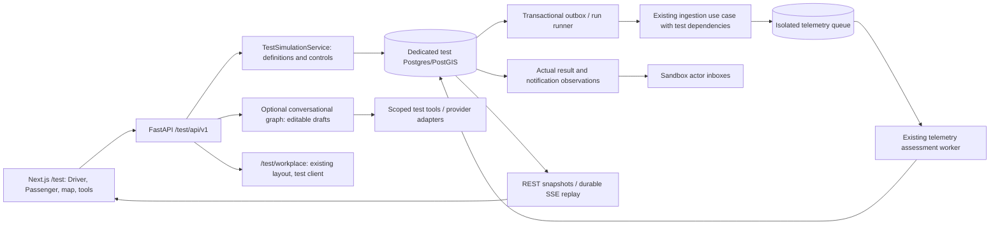
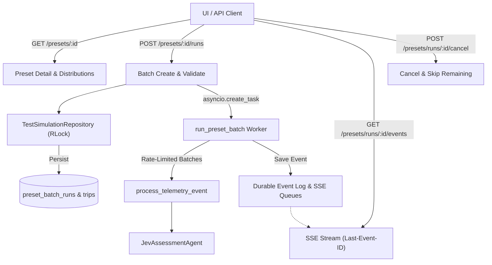

# Tester Simulation Architecture

**Status:** Proposed design for [Epic #130](https://github.com/AI20K-Build-Phase-Cohort-4/GreenSentinel/issues/130). The 2026-10-04 stakeholder decisions select isolated test storage/sandbox notifications, the existing Workplace layout, 1-second ordinary GPS with selectable slower cadence, and jump, offset/noise and dropout faults. These decisions do not prove runtime delivery or generator acceptance. [PRD §11](../ba/PRD.md#11-tester-trip-simulation-extension), [MVP §8](../ba/MVP.md#8-tester-trip-simulation-extension) and [glossary](../ba/TESTER_GLOSSARY.md) define product meaning.

## 2026-10-14 implementation boundary and redesign

The sections below preserve the earlier target design. They are not a current runtime inventory. The existing console and APIs have since shipped; [draft PR #345](https://github.com/AI20K-Build-Phase-Cohort-4/GreenSentinel/pull/345) now repairs their authorization and persistence boundaries. The requested visual refresh remains a preview awaiting stakeholder approval.

**Topology and state:** The existing three-column console keeps Driver/Customer conversations on the left, the map in the center, and compact trip controls on the right. The API and runner store plans, definitions, run states, samples and sandbox case snapshots in a separate test database. Operational submission uses the existing telemetry processor and operational database with explicit verified organization context. Run states remain `QUEUED`, `RUNNING`, `PAUSED`, `STOP_MOVEMENT`, `CANCELLING`, `CANCELLED`, `COMPLETED` and `FAILED`. This repair does not change conversational graph nodes, edges, state or adjudication authority.

**Contracts and flow:** Pydantic validates requests; the verified principal supplies ownership. The flow is owned plan, immutable definition, run, recorded samples, explicit submission, tenant validation, assessment and persisted outcome. Foreign identifiers are denied before control, observation or streaming. Idempotency is tenant-scoped and survives repository restart. Public API failures remain errors; they do not become fabricated success events. No new agent tools are introduced.

**Trade-offs and security:** Nullable ownership quarantines ambiguous legacy plans without inventing a tenant. Ownership is inherited from the plan rather than duplicated on every sample. A configured database is authoritative and its failure cannot fall back to memory. Published policy versions remain a shared catalog; drivers, passengers, vehicles, trips and assignments are tenant-owned. Dataset truth may select preset source examples, but cannot enter model input or determine case creation. Real Clerk, model-provider, Driver-delivery and hosted acceptance are separate evidence requirements.

**Requested preview:** Initial driver position, pickup and destination become compact address rows with car, passenger and pin icons. Coordinates and coordinate-entry/click modes are removed entirely. All three markers can be dragged during trip setup, with an address-based accessible alternative. Sidebar heading and route-mode features are removed; a small compass belongs inside the map. Run becomes Pause and then Resume. A collapsible Log/Overview dock occupies 40% of console height while expanded and reports observed processing stages rather than assumed model or Driver success. Presets, organization history and a centered editable title remain part of the requested refresh.

**Cancellation semantics awaiting implementation:** The preview offers Customer cancel and Driver cancel with a required reason for early termination. The customer-facing label maps to the existing canonical `cancellation_actor="passenger"`; Driver maps to `"driver"`. The eventual event must retain the actor, trimmed reason, lifecycle state, timestamps and actual recorded telemetry, and expose that evidence to the authorized agent and case views. The existing model-input projection already admits cancellation actor/reason, but the new console cancellation API and UI are not implemented by this security repair. The exact pre-destination completion interaction awaits preview confirmation.

**Known integration limits:** The draft submission contract requires explicit owned actor IDs. The existing page client does not yet send all of them. It must also store the three distinct stop snapshots: using the route's first coordinate as pickup loses the initial-position distinction. The redesign, actor selection, completion/cancellation actions, durable history presentation, preset replay and bottom dock need approved end-to-end implementation before this console can meet the requested DoD. A static preview and local fixtures are not acceptance evidence for those features.

**2026-10-14 approved redesign implemented:** The stakeholder approved the revised current-layout preview, and the requested features now ship through real `/test/api/v1` contracts. Cancellation accepts `actor` (`passenger` or `driver`) and a required trimmed reason; the run row persists `cancelled_at`, `cancellation_actor` and `cancellation_reason`, the `run.cancelled` stream event carries the same fields, and submission sends `lifecycle_state="cancelled"` with the actor and reason so downstream agents and cases read the evidence. Runs carry a generated or operator-edited title (`PATCH /runs/{id}`) and appear in org-scoped history (`GET /runs`). `GET /runs/{id}/overview` reports recorded pipeline stages and the classification-label split without inventing values. `GET /presets` serves the published `releases_v1` example trips (revision `914a3656…`) from the committed sample files; the wrong-direction preset stays unavailable until movement away from the pickup is verified. The console keeps its three-column composition, uses compact draggable icon stops, a read-only compass, one Run/Pause/Resume control, participant cancellation with a reasoned dialog, an editable centered title and a collapsible 40% Log/Overview dock. The three stop snapshots remain distinct: the initial position is no longer overloaded with the pickup coordinate. Verification: backend console-contract and publish-evidence tests plus the full frontend suite (357 passing) and TypeScript check. Real hosted Clerk, real model-provider quality and Driver-delivery acceptance remain separate evidence.

## 1. System topology and current code evidence

Extend the existing modular monolith. Thin [FastAPI routes](../../src/api/routes.py) validate transport; [services](../../src/services/case_service.py) own persistence/use cases; [models](../../src/models/schemas.py) own shared schemas; agent nodes invoke scoped tools. Keep simulator state separate from detector/agent state. Do not create a second fraud classifier, seed framework or mobile application.

| Existing module | Reuse | Gap requiring new implementation |
|---|---|---|
| [src/main.py](../../src/main.py) | Router composition | Dedicated `/test/api/v1` router, fail-closed test dependencies, no alias |
| [road_trip_generator.py](../../scripts/road_trip_generator.py), [road_scenarios.py](../../scripts/road_scenarios.py), [ADR-011](adr-011-versioned-road-telemetry-dataset.md) | Road arc-length interpolation, source conventions and validated fixture behavior | Arbitrary authored routes/cadence and bounded runtime controls; corpus presets do not implement unrestricted authoring |
| [routing_service.py](../../src/services/routing_service.py) | Existing routing integration patterns | Route candidate snapshots validated for arbitrary origin/pickup/destination; unavailable routes remain explicit |
| [TelemetryEventEnvelope](../../src/models/schemas.py), [CaseService](../../src/services/case_service.py) | Existing ingestion/idempotency/use-case behavior | Test-bound repository dependencies and run/evidence linkage, immutable whole definitions |
| [telemetry_queue.py](../../src/services/telemetry_queue.py), [telemetry_queue_worker.py](../../src/services/telemetry_queue_worker.py) | Queue claim/retry and actual telemetry assessment path | Durable simulation runner, checkpoint/outbox coordination and complete run-stage observations |
| [feature_engineering.py](../../src/services/feature_engineering.py) | Versioned actual feature semantics, unknown values | Shared preview/run adapters; no invented per-fix DAVI |
| [state.py](../../src/agents/state.py), [graph.py](../../src/agents/graph.py) | Conversational graph and scoped agent tools | Optional editable AI drafting integration, explicitly separated from detector execution |
| [MapLibreView](../../src/webapp/components/map/maplibre-view.tsx), [telemetry-playback.ts](../../src/webapp/lib/telemetry-playback.ts) | Map rendering, recorded telemetry playback, worker pipeline | Additive editor interactions; deliberate faults must not be snapped away |
| [CockpitWorkspaceView](../../src/webapp/components/views/cockpit-view.tsx), [api-client.ts](../../src/webapp/lib/api-client.ts) | Existing Workplace layout/typed transport patterns | Inject per-workspace test client throughout every fetch, stream, agent tool and navigation path; current global imports cannot provide isolation |



The diagram is the proposed wiring. The checked-in worker has its own assessment path; it is not proof that every telemetry event invokes the conversational graph or already produces complete notifications/assignment. Inventory unsupported seams and expose unavailable/pending stages until actual integration proves them.

## 2. State and graph lifecycle

[AgentState](../../src/agents/state.py) is a total-false TypedDict with query, context, analysis, response, error, metadata, messages using `add_messages`, runtime_context and case_context. The checked-in [graph](../../src/agents/graph.py) has `agent` and `tools` nodes. Tool-call output branches to `tools`, then returns to `agent`; otherwise it ends. This simulator adds no graph node or autonomous authority. Current bounded-runtime/tool policies remain applicable; input fixtures and expected evaluation labels never enter detector prompts.

A separate persisted Run state machine handles QUEUED, RUNNING, PAUSED, CANCELLING, COMPLETED, CANCELLED and FAILED. PAUSE suspends simulated time; STOP_MOVEMENT keeps stationary samples and clock advancing. Runtime speed/reroute/fault controls have acceptance and application records, ordered by control sequence. Sample sequence, event sequence and simulation clock are distinct. COMPLETED proves playback completion, not assessment/notification/case success. A failed downstream stage does not rewrite emitted evidence or turn a complete execution into invented no-case proof.

## 3. Tool and module interfaces

Proposed implementation paths are `src/api/test_routes.py`, `src/models/test_schemas.py`, `src/services/test_simulation_service.py`, `src/services/test_simulation_repository.py`, and `src/services/test_simulation_runner.py`. These names are design targets, not existing files. The service owns four deep-module operations: save/preview a definition, accept a run, append a validated runtime input, and read run evidence/results. Route resources in [API design](TESTER_API_SPECIFICATION.md) adapt those operations; no thin pass-through class is introduced merely to mirror every route.

Validate user/provider/configuration inputs at their seams. A route adapter accepts validated road geometry/provenance; an explicit unavailable response disables start instead of creating a straight line. Route/provider and sandbox-notification adapters are real varying seams (live capability versus deterministic test adapter); do not create abstractions for unobserved hypothetical variation. Database access stays in services/repositories, not agent nodes. Tools receive server-created organization/run/actor context and cannot select operational storage or trusted identities from prompt text. Trap failures as typed stage/error events; they never authorize a sanction.

## 4. Data flow and durable persistence

1. Tester opens `/test` with explicit test permission. Marker selection creates a blank unrestricted definition; routing preview returns validated origin-to-pickup and pickup-to-destination legs, source snapshots and honest metrics.
2. Save a whole immutable definition revision containing origin/pickup/destination, route snapshot, UTC start time, speed/cadence, planned dialogue, traffic/source settings and explicit faults. Optimistic expected revision prevents lost edits. Future edits create revisions and never rewrite a consumed run.
3. Start atomically stores an idempotency claim, run, test trip/assignment, immutable effective inputs and outbox intent. Return 202 only after commit. The approximately 60-second target ends at this accepted basic submission; playback and model latency are measured separately.
4. Durable runner claims a lease/checkpoint, applies ordered controls and emits explicit samples through the existing ingestion use case with test dependencies. Ordinary motion follows road geometry at configured cadence independent of playback speed. Simulated position and reported GPS differ when faults apply; dropout is explicit missingness, not fabricated fixes.
5. The test-bound queue/worker consumes actual telemetry. Existing assessment/case/assignment use cases write their normal `app.*` records in the **dedicated test database**, correlated to run/trip/assignment IDs. Generator/control labels describe authored inputs, never forced classifier answers.
6. Only actual system notification intents reach a sandbox sink. Persist attempt, recipient, delivery and replies; reconcile UNKNOWN outcomes before retry. If current runtime lacks an integration contract, report UNAVAILABLE and keep the corresponding acceptance item open.
7. Persist assessment versions, stage evidence, actual case/assignment references and observation window. Stream committed events to both actor windows/results and reload by consistent snapshot plus cursor. Optional AI drafts remain reviewable inputs; they do not send automatically.
8. `/test/workplace` mounts the existing analyst layout with test API dependencies. A case link proves neither assignment nor sanction: verify assignment rows and retain separate analyst role/lease/rationale/policy/evidence/audit checks. No mandatory visible TEST case badge is introduced.

Proposed simulator tables in the dedicated database are `test_plans`, `test_definition_revisions`, `test_runs`, `test_controls`, `test_samples`, `test_events`, `test_messages`, `test_notifications`, `test_result_links`, `test_idempotency_keys` and `test_outbox`. Existing domain `app.*` tables remain authoritative for trips/cases/assignments. Use UUIDs, timezone-aware timestamp columns, scalar indexed ownership/status columns, JSONB snapshots for versioned structured payloads, and foreign keys. Enforce uniqueness for `(plan_id,revision)`, `(run_id,event_sequence)`, `(run_id,sample_sequence)`, `(run_id,control_sequence)` and idempotency scope. Scope foreign keys/queries by organization and owner to prevent cross-run references; index unprocessed outbox rows and ownership/time access patterns. RLS and runtime credentials complement application checks. This is a schema proposal; no migration or shared database mutation is authorized by the document.

Runtime database credentials must not be superuser/BYPASSRLS roles or table-owner connections that silently bypass policy; use transaction-local authenticated organization/owner context and test the actual role. Index referenced ownership/plan/run foreign keys where existing composite indexes do not cover their leading columns. Outbox/runner claims use short atomic transactions and nonblocking locked-row claiming where supported; routing/LLM/notification calls happen outside database lock scope, with durable intent committed first. Pool sizes, statement timeouts and lease recovery limits are configured for test concurrency.

Outbox dispatch and queue delivery are at-least-once. Retries reuse effect identities. A crash between persistence/enqueue/ack must reconcile the checkpoint and committed event ledger without duplicate trip, sample, reply or notification effects. Retain idempotency tombstones and immutable source evidence under [the API retention/recovery contract](TESTER_API_SPECIFICATION.md#idempotency-and-durable-recovery). Exact input replay creates a new run; model output may vary and its versions are recorded.

## 5. Decisions, alternatives and metric semantics

[ADR-015](adr-015-isolated-tester-simulation.md) recommends additive `/test` interfaces, dedicated test infrastructure and reusable domain use cases over shared operational flags, a new classifier or an in-memory demo. Cost: additional durable records, injected dependencies and environment verification. Benefit: arbitrary composition, reproducible inputs and honest system outcomes without production contamination.

Use 1-second ordinary GPS as the selected design baseline, selectable slower cadence and explicit JUMP/OFFSET_NOISE/DROPOUT. Numeric profile/rate/duration limits remain proposals pending representative normal, stall, reroute and fault validation. Do not reuse the older corpus's ten-second jitter/scaled cadence as this default. Density-to-speed mapping requires an accepted version and independent segments; historical traffic is source-backed only when provider/time/coverage/licensing is verified. No vendor is selected here.

Radius is proposed as pickup-centred geometric placement, distinct from road distance. Source/time/version accompany ETA; planned simulation duration differs from historical/simulated traffic ETA. DAVI reuses feature-engineering window/reference semantics; insufficient movement remains unavailable, and legitimate one-way travel can have negative alignment. Metric/profile proposals require reviewer and Tester acceptance; synthetic results do not validate detection accuracy.

## 6. Security and boundary protection

A URL prefix is not a security or storage boundary. Use dedicated test Postgres, isolated Redis/queue/vector namespaces, graph checkpoints, object storage and notification sink credentials. Missing/mismatched configuration fails closed; do not fall back to operational URLs or fixture cases. Validate resource/account identity at startup without printing secrets. Explicit egress/sink configuration prevents real customer/driver delivery. Read-only policy/reference material may be shared only through a reviewed adapter that cannot write operational resources.

The 2026-10-14 request supersedes a separate Tester role requirement: all signed-in members of the active organization may use the console. Ownership is checked even outside production; permissive development identity behavior is not sufficient. Console access does not grant analyst decision authority. Provider/API keys remain server-side; sanitized errors carry request/run/effect IDs, not tokens or raw prompts. Apply configured payload, execution, connection and provider quotas. Authorization is checked on every REST read/mutation and stream reconnect; UI filters are never the only gate. Live revocation during an already-open stream remains a distinct acceptance check.

## UI and verification handoff

[UI/component design](../design/tester-simulation/design.md) specifies Driver upper-left and Passenger lower-left compact windows, largest map, separate tools and hover/focus icon explanations. Real `app/test` path segments implement `/test`; parenthesized route groups alone cannot. Test client injection spans every Workplace dependency and linked route. Stitch generation and visual approval remain required before application coding; available static preview is a draft, not hosted runtime evidence.

[Test strategy](../testing/TESTER_SIMULATION_TEST_STRATEGY.md) and [manual/UAT runbook](../testing/MANUAL_TEST_TESTER_SIMULATION.md) map every FR/NFR/AC to unit, contract, migrated-database, actual-worker, browser, provider and usability proof. Documentation tests do not prove the simulator exists. Acceptance must distinguish fixture behavior, actual persistence, hosted wiring, historical source availability and measured preparation timing.

Official guidance: [FastAPI router composition](https://fastapi.tiangolo.com/tutorial/bigger-applications/), [durable worker motivation](https://fastapi.tiangolo.com/tutorial/background-tasks/), [Next.js route-group semantics](https://nextjs.org/docs/app/api-reference/file-conventions/route-groups).

## Report assembly approval

On 2026-10-04 the stakeholder approved these drafts for standalone report assembly. [HTML report](TESTER_DESIGN_REPORT.html) embeds the [topology SVG](tester-simulation-topology.svg), UI preview and API/UI/test specifications without external rendering dependencies. This approval covers report assembly, not app implementation or acceptance of missing Stitch/operational proof.

## 2026-10-15 desktop runtime reconciliation

The desktop Client Component composes three explicit stop snapshots and selects organization-owned actors from `/test/api/v1/actors`. FastAPI derives organization identity from the verified principal; repository calls always retain that scope. Stops and actors remain transport inputs, while ownership validation precedes canonical operational writes. Arbitrary addresses no longer receive invented coordinates: coordinate queries use the configured reverse-geocoder and return an explicit unavailable response when it cannot resolve.

Simulation definitions persist `initial_snapshot`, `pickup_snapshot`, and `destination_snapshot` independently of road geometry. Terminal `COMPLETED` and `CANCELLED` runs submit only recorded samples. Cancellation retains canonical actor and reason; no LangGraph node, disposition edge, or adverse-action authority changes. Existing agent input projections consume the recorded cancellation and telemetry fields rather than console labels or evaluation truth.

Publication uses stable identities and an organization/run advisory lock around durable receipt lookup, canonical processing, and acknowledgement. Receipts preserve the actual classifier result, including normal trips with no fraud case, so Overview does not infer processing from sample existence. This bounded coordination was selected over a new queue implementation; cross-database crash atomicity and broader durable outbox replay remain outside #345's accepted scope.

Streams emit event IDs and accept a resume cursor. The client maintains one subscription, deduplicates replay, reconciles persisted run/sample state after gaps, retries with bounded backoff, and aborts on organization/run changes. Late history/run responses from prior organizations are ignored. Process-local replay is not represented as durable distributed event storage. All provider and persistence failures remain observable; no secrets or client tenant fields authorize a protected command.

The console supports desktop only. Mobile preview files, stacked adaptation CSS, and mobile acceptance targets were removed. Current test and browser evidence is recorded separately in [PR #345 verification](../testing/TEST_CONSOLE_PR345_VERIFICATION.md); real hosted membership and provider quality require their own evidence.

## 2026-10-16 console backend extension (Issue #457)

The backend extension implements discrete routing waypoints, initial position proximity constraints, run trace extraction, and enriched history projections for the test console.

1. **System Topology & Route Resolution:**
   `POST /test/api/v1/routes/resolve` accepts structured waypoints partitioned by leg (`pickup` and `destination` lists of coordinates) or legacy flat coordinate lists (`[[lon, lat], ...]`). `RoutingService.resolve_route()` normalizes both formats into ordered pickup-leg and destination-leg segments, resolving road geometry through OSRM with graceful line-string fallbacks.

2. **Proximity Constraint (4 km Start Rule):**
   `POST /test/api/v1/definitions` enforces a strict 4,000-meter maximum haversine distance between `initial_snapshot` and `pickup_snapshot`. Violations reject immediately with `422 Unprocessable Entity` (`Initial driver position must be within 4000m of pickup point`). `GET /test/api/v1/config` exposes `max_start_to_pickup_m: 4000` to allow client-side validation alignment.

3. **Run Lifecycle, Expected Labels, and Enriched History:**
   `POST /test/api/v1/runs` accepts an optional `expected_label` (`FRAUD` or `NORMAL`). Run persistence records `expected_label` and defaults `source` to `"custom"`. Database migration `20261016140000_tester_runs_expected_label_source.sql` adds `expected_label VARCHAR(32)` and `source VARCHAR(32)` to `test_runs`.
   `GET /test/api/v1/runs` returns an enriched summary model exposing `source`, `expected_label`, `predicted_label`, `error_type` (e.g. `FALSE_POSITIVE`, `FALSE_NEGATIVE`), `confidence`, `case_id`, `license_plate`, `driver_name`, `origin_address`, `pickup_address`, and `destination_address`. Un-published or un-enriched fields remain explicit `null`s without synthetic defaults.

4. **Ordered Pipeline Trace & Evidence-Only State:**
   `GET /test/api/v1/runs/{id}/trace` reports ordered pipeline execution stages: `created`, `driving_to_pickup`, `in_trip`, `telemetry_processed`, `risk_evaluated`, and `case_resolved`. Stage `done` status is strictly evidence-based:
   - `created`: `true` upon run initialization.
   - `driving_to_pickup`: `true` only when recorded movement evidence exists (`step_index > 0`, `len(samples) > 1`, or terminal `COMPLETED`).
   - `in_trip`: `true` when intermediate waypoints or destination leg telemetry have been recorded.
   - `telemetry_processed`, `risk_evaluated`, `case_resolved`: `true` only when backed by published receipts, model assessment records, or created case identifiers.
   Cancelled runs retain operator cancellation evidence (`cancelled_at`, `cancellation_actor`, `cancellation_reason`).

5. **Architectural Trade-offs & Concurrency:**
   - *Reentrant Repository Locking (`RLock`):* `TestSimulationRepository` uses `threading.RLock()` to prevent deadlocks when composite queries (such as `list_runs` iterating over runs and fetching related definitions, submissions, and cases) execute nested lookups while holding repository locks.
   - *Coroutine Cancellation vs Operator Cancellation:* Starlette `TestClient` task cancellation on connection teardown is separated from domain cancellation: `asyncio.CancelledError` exits cleanly without erroneously mutating run status to `CANCELLED` unless an explicit operator control was issued.
   - *Decoupled Integration Tests:* Integration suites use 2-point coordinates for standard lifecycle tests, decoupling fast local test suites from external network routing services while preserving multi-point OSRM expansion in dedicated unit tests.

6. **Security & Boundary Protection:**
   Organization tenancy checks (`organization_id`) are enforced across all new endpoints (`/routes/resolve`, `/runs`, `/runs/{id}/trace`). Unauthenticated requests fail closed with 401; cross-tenant resource queries return 404.

## 2026-10-16 Preset Detail and Persisted Batch Run Architecture (Issue #458)

### 1. System Topology
The preset batch execution pipeline extends `/test/api/v1` with preset detail, batch lifecycle, and per-trip event streaming:
- **Client & API Layer:** [src/api/test_routes.py](../../src/api/test_routes.py) provides endpoints for `GET /presets/{id}`, `POST /presets/{id}/runs`, `GET /presets/runs/{batch_id}`, `GET /presets/runs/{batch_id}/events` (SSE), and `POST /presets/runs/{batch_id}/cancel`.
- **Batch Service Layer:** [src/services/test_preset_batch.py](../../src/services/test_preset_batch.py) manages parameter validation, compact snapshot building, rate-limited scheduling (`schedule_rate_limited_batches`), and async trip processing (`run_preset_batch`).
- **Telemetry Pipeline:** Fast-publishes trips through [process_telemetry_event](../../src/services/telemetry_queue_worker.py) directly into the classifier without map replay.
- **Durable Persistence:** [src/services/test_simulation_repository.py](../../src/services/test_simulation_repository.py) manages `preset_batch_runs`, `preset_batch_trips`, `test_runs` with `source="preset_batch"`, and thread-safe event fan-out with `RLock`.
- **Database Schema:** Defined in `db/migrations/20261016200000_preset_batch_runs.sql` with rollback in `db/rollbacks/20261016200000_preset_batch_runs.down.sql`.



### 2. State & Graph Lifecycle
- **Batch Run States:** `QUEUED` -> `RUNNING` -> `COMPLETED` | `CANCELLED` | `FAILED`.
- **Batch Trip States:** `QUEUED` -> `RUNNING` -> `COMPLETED` | `SKIPPED` | `FAILED`.
- **Counters:** Aggregated live counts for `queued`, `running`, `completed`, `failed`, `skipped`, and `reached_classifier`.
- **Detector Integration:** Reuses the existing `JevAssessmentAgent` and guardrails pipeline without altering conversational LangGraph nodes or adding autonomous agent authority.

### 3. Tool & Endpoint Contracts
- `GET /test/api/v1/presets/{preset_id}`: Returns `TestPresetDetailResponse` including metadata (title, description, source release, revision, `trips_sha256`, license, trip count), `published_release_counts` (identity benchmark counts), rich sample trips (with driver, vehicle, coordinates, distance, duration, and cancellation fields), and computed distributions across labels (`fraud` ERR-01..05 vs `no_violation` vs `insufficient_evidence`), severities (`P0`, `P1`, `P2`), scenarios, cities, and cancellation actors.
- `POST /test/api/v1/presets/{preset_id}/runs`: Body `PresetBatchRunCreate(trip_limit, trips_per_batch, interval_s)`. Validates `1 <= trips_per_batch`, `interval_s > 0`, and `1 <= trip_limit <= available_trips` (null defaults to 100%). Returns `PresetBatchRunResponse` (HTTP 201).
- `GET /test/api/v1/presets/runs/{batch_id}`: Returns `PresetBatchRunDetailResponse` with run metadata, counters, and ordered trips including compact snapshots (conversation, GPS bounding box and accuracy, speed statistics).
- `GET /test/api/v1/presets/runs/{batch_id}/events`: Text/event-stream SSE endpoint resumable via `Last-Event-ID` header or `?last_event_id=` query param. Emits `connect`, `trip.queued`, `trip.started`, `trip.telemetry_loaded`, `trip.published`, `trip.classifier_received`, `trip.classified`, `trip.case_created`, `trip.skipped`, `trip.failed`, `batch.completed`, and `batch.cancelled`. Every event carries `reached_classifier: bool`.
- `POST /test/api/v1/presets/runs/{batch_id}/cancel`: Halts execution, sets batch to `CANCELLED`, marks pending `QUEUED` trips as `SKIPPED`, and emits cancellation events.

### 4. Data Flows
1. **Detail Query:** Client requests `/presets/{preset_id}`. Service dynamically calculates distribution buckets from committed JSON records and returns rich sample trip metadata.
2. **Batch Initiation:** Client posts run parameters. Service validates bounds, writes `preset_batch_runs` and `preset_batch_trips` records, and launches background task `run_preset_batch`.
3. **Trip Execution:** Scheduler releases chunks of `trips_per_batch` every `interval_s` seconds (using injectable sleep). Each trip generates a test plan, revision, and completed test run with `source="preset_batch"`.
4. **Classification & Eventing:** Telemetry points are ingested through `process_telemetry_event`. Events are logged and pushed to active SSE queues with `reached_classifier` status.
5. **Observation:** Batch trips appear in `GET /test/api/v1/runs` tagged with `source="preset_batch"`.

### 5. Architectural Trade-offs
| Decision | Option Selected | Alternative Considered | Rationale |
|---|---|---|---|
| Synchronization | Re-entrant `RLock` in `TestSimulationRepository` | Non-reentrant `threading.Lock` | Avoids deadlocks during recursive repository reads and stream subscription on the same thread. |
| Test Execution Speed | Injected fake sleep clock (`_sleep`) | Real `asyncio.sleep` | Allows deterministic, sub-second execution of rate-limited batches in unit and integration tests. |
| Event Distribution | In-memory `asyncio.Queue` fan-out per batch | Redis Pub/Sub | Preserves isolated, zero-dependency test console simulation without cross-test Redis pollution. |
| Classifier Testing | Offline Mock (`mock_assess`) | Live LLM invocation | Guarantees zero live API spend and deterministic CI test runs. |

### 6. Security & Boundary Protection
- **Tenant Isolation:** Every preset batch run, trip listing, event stream, and cancel action filters strictly on the authenticated `principal.organization_id`. Cross-tenant queries return 404 without leaking batch existence.
- **Fail-Closed Tenancy:** `_ensure_tenant_actors` auto-provisions synthetic actors within the caller's organization schema when database is active.
- **Input Validation:** Strict Pydantic schema validation rejects non-positive intervals or batch sizes and out-of-range trip limits with HTTP 422.


## 2026-10-17 Real Clerk-Linked Driver Directory & Batch Assignment Architecture (Issue #464)

### 1. System Topology
The driver directory extension removes hardcoded synthetic drivers (`drv-sim-001`) from test definitions and preset batch runs, enforcing authentic Clerk-linked driver identity with strict organizational tenancy:
- **Clerk Directory Client (`src/services/clerk_directory.py`):** Lightweight HTTP client for the Clerk Backend API (`https://api.clerk.com/v1/users`). Provides exact lookup (`email_address=`) and partial search (`query=`) with explicit request timeouts. Strictly enforces privacy hygiene: Clerk secrets and driver email addresses are never written to logs or error payloads. Returns HTTP 503 when `CLERK_SECRET_KEY` is unconfigured.
- **Driver Directory Service (`src/services/driver_directory.py`):** Abstraction layer providing `get_active_driver()`, `list_active_drivers()`, `search_drivers()`, and `assign_drivers_round_robin()`.
  - `HybridDriverDirectory`: Connects to PostgreSQL to verify `app.drivers` linked to `app.principals(external_subject)` with `account_status = 'active'`, joining `app.driver_vehicle_assignments` and `app.vehicles` for license plates. Merges in-memory registered fixtures for testability.
  - `InMemoryDriverDirectory`: Zero-dependency in-memory directory for deterministic unit and API tests.
- **Test Routes & Presets API (`src/api/test_routes.py`):** Exposes `GET /drivers/search` and `GET /drivers/linked`, validates driver identity on `POST /definitions` and `POST /presets/plan`, and enforces `driver_ids` round-robin assignment on `POST /presets/{preset_id}/runs`.
- **Durable Persistence & Batch Processor (`src/services/test_preset_batch.py` & `src/services/test_simulation_repository.py`):** Eliminates synthetic driver creation in `_ensure_tenant_actors`. Persists `driver_id` and `driver_name` onto `app.preset_batch_trips` (migration `20261017000000_preset_batch_drivers.sql`) and surfaces driver attribution in SSE stream events and `GET /runs`.

```mermaid
flowchart TD
  Client["UI / API Client"] -->|GET /drivers/search?email=| Search["Search Drivers API"]
  Client -->|GET /drivers/linked| Linked["Linked Drivers API"]
  Search --> Directory["DriverDirectory Service"]
  Linked --> Directory
  Directory -->|Verify Linkage & Tenancy| DB[("app.drivers & app.principals")]
  Directory -->|Batched User Lookup| Clerk["Clerk Backend API (/v1/users)"]
  Client -->|POST /definitions (driver_id)| DefValidation["Driver Validation (Active, Clerk-linked)"]
  Client -->|POST /presets/plan (optional driver_id)| PlanValidation["Resolve Active Linked Driver"]
  Client -->|POST /presets/:id/runs (driver_ids: list)| BatchValidate["Validate Driver List & Tenancy"]
  BatchValidate --> RoundRobin["Round-Robin Assignment (trips[i] -> driver_ids[i % n])"]
  RoundRobin --> BatchWorker["run_preset_batch"]
  BatchWorker --> BatchTrips[("app.preset_batch_trips (driver_id, driver_name)")]
  BatchWorker --> Events["SSE Events (driver_id, driver_name)"]
  BatchWorker --> History["GET /runs (driver_name)"]
```

### 2. State & Graph Lifecycle
- **Driver Lifecycle & Eligibility:** A driver is valid for manual simulation or preset batch assignment if and only if:
  1. Belonging to the authenticated caller's `organization_id`.
  2. `account_status == "active"` (suspended, pending, or closed drivers are rejected).
  3. `principal_id` is non-null and references an active `app.principals` record whose `external_subject` is a valid Clerk User ID (e.g. `user_2...`).
  4. Is not a mock string (e.g. `drv-sim-001`, `mock-*`).
- **Batch Trip Driver State:** Each trip in a preset batch run immutably records the assigned `driver_id` and `driver_name`. If the assigned driver has a vehicle assignment in `app.driver_vehicle_assignments`, the vehicle's `registration_ref` is used; otherwise, a tenant-scoped vehicle is provisioned without creating synthetic driver rows.
- **Truthful Classifier Labeling:** Removed artificial label invention in `test_preset_batch.py`: `predicted_label = result.get("category")` keeps `None` when the classifier returns no violation, preventing fabricated `"no_violation"` strings when no assessment category was assigned.

### 3. Tool & Endpoint Contracts
- `GET /test/api/v1/drivers/search?email={query}`:
  - Validates `email` query parameter has at least 3 characters; rejects shorter queries with 422.
  - Queries Clerk API (`GET /v1/users?query=...`) with limit 10 and explicit timeout.
  - Cross-references Clerk user IDs against active drivers in the authenticated caller's organization.
  - Returns `list[ClerkLinkedDriverResponse]` (`driver_id`, `display_name`, `email`, `vehicle_plate`, `clerk_user_id`).
  - Returns 503 Service Unavailable when `CLERK_SECRET_KEY` is not configured.
- `GET /test/api/v1/drivers/linked`:
  - Retrieves all active drivers with non-null `external_subject` for the authenticated organization.
  - Batches email lookups via Clerk API and returns `list[ClerkLinkedDriverResponse]`.
  - Returns 503 Service Unavailable when `CLERK_SECRET_KEY` is missing.
- `POST /test/api/v1/definitions`:
  - Enforces `driver_config.driver_id` validation: rejects unlinked, cross-tenant, suspended, or mock driver IDs with HTTP 422.
- `POST /test/api/v1/presets/plan`:
  - Accepts optional `driver_id: UUID`. Validates the driver is active and Clerk-linked in the caller's organization, or automatically selects the first active Clerk-linked driver in the organization.
  - Rejects with HTTP 422 if the provided `driver_id` is invalid or if no active Clerk-linked drivers exist in the organization.
- `POST /test/api/v1/presets/{preset_id}/runs`:
  - Requires `driver_ids: list[UUID]` (non-empty list of UUIDs).
  - Validates every driver in `driver_ids` is active and Clerk-linked in the caller's organization; rejects with 422 on foreign or invalid drivers.
  - Assigns drivers round-robin: trip `i` receives `driver_ids[i % len(driver_ids)]`, guaranteeing equal trip distribution within $\pm 1$.
  - Stores `driver_id` and `driver_name` on each trip record, event payload, and run summary.

### 4. Data Flows
1. **Operator Searches Driver:** Operator enters driver email substring in test console. API queries Clerk API, filters by caller's active org drivers in PostgreSQL, and returns matching candidates.
2. **Manual Run Creation:** Operator submits plan definition. API validates `driver_id` against `DriverDirectory`. Route and driver profile persist in `test_definition_revisions`.
3. **Preset Batch Launch:** Operator selects preset and selects one or more active Clerk-linked drivers. API validates all `driver_ids` and schedules batch.
4. **Execution & Event Streaming:** For each batch trip, `run_preset_batch` retrieves assigned driver and vehicle plate, constructs telemetry payload, and emits SSE events (`trip.started`, `trip.classifier_received`, `trip.classified`) containing `driver_id` and `driver_name`.
5. **Enriched History:** Completed batch trips appear in `GET /test/api/v1/runs` with `source="preset_batch"` and the assigned `driver_name`.

### 5. Architectural Trade-offs
| Decision | Option Selected | Alternative Considered | Rationale |
|---|---|---|---|
| Driver Storage & Linkage | Derive email via Clerk API on demand; link via `app.principals.external_subject` | Add `email` column to `app.drivers` | Respects existing single source of truth for identity and PII hygiene: email addresses reside exclusively in Clerk. |
| In-Memory Test Path | Injectable `DriverDirectory` with `InMemoryDriverDirectory` fake | Direct DB insertion in every test | Enables fast, deterministic unit and integration tests without network or Postgres dependencies, while `HybridDriverDirectory` supports live database environments. |
| Batch Driver Assignment | Strict round-robin (`trips[i] -> driver_ids[i % n]`) | Random / weighted assignment | Deterministic, reproducible test runs with provable balance ($\max - \min \le 1$). |
| Missing Driver Handling | Require explicit `driver_ids` on batch runs; 422 on missing/invalid | Auto-generate synthetic driver | Prevents synthetic driver accumulation in database; enforces test realism aligned with production tenancy. |

### 6. Security & Boundary Protection
- **PII & Secret Hygiene:** Clerk API secret key and driver email addresses are never logged. Clerk client uses sanitizing error types (`ClerkAPIError`, `ClerkTimeoutError`, `ClerkSecretMissingError`) that mask tokens.
- **Fail-Closed Tenancy:** Driver validation strictly verifies `driver.organization_id == caller.organization_id`. Cross-tenant driver selection is rejected with HTTP 422.
- **Service Availability Gate:** Missing Clerk credentials fail closed with HTTP 503 instead of falling back to insecure mock data.


