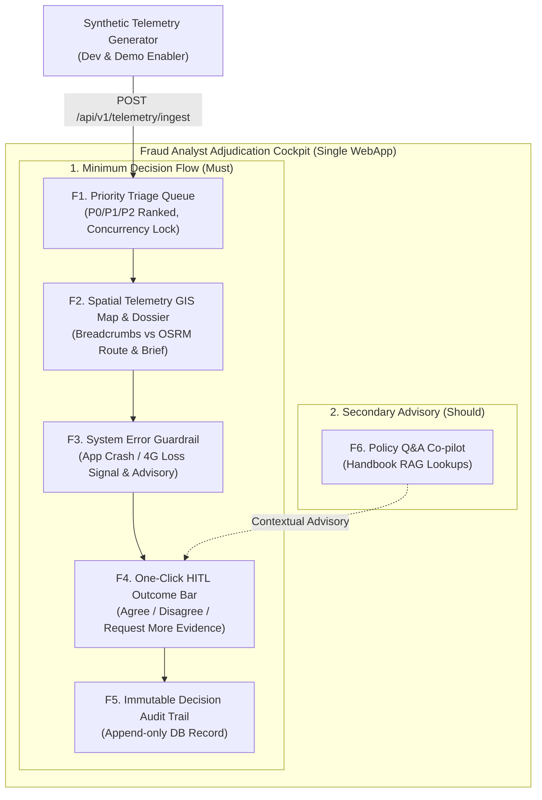

# MVP Specification: GreenSentinel — Fraud Analyst Adjudication Cockpit
## Scenario 6 (Release 1 HITL Enforcement) — Phase 1 Implementation Scope

> **Product identity:** The application is named **GreenSentinel**. GreenSM references below denote the initial data/policy source and example tenant. Future direction (outside MVP acceptance): trip-stream ingestion for any ride-hailing platform with multiple Clerk organizations onboarded, each with private data and workflows.

---

## 1. Executive Summary & Strategy

**Approved release scope:** @datamonsterr adopted the strict Phase 1 [PRD](PRD.md#1-document-control) on **2026-09-30**; metric, score, and optional top-k elaboration was approved on **2026-10-02**. **CV-01 baseline confirmation: pending; Operator UAT sign-off: pending.** These specifications define required behavior, not proof of runtime delivery.

**Scheduled extension, approved 2026-10-05:** [Driver-first requirements](DRIVER_FIRST_REQUIREMENTS.md) add Driver assistance before Analyst escalation and explicit **Driver confirmed resolution**, plus the accepted search/history, context-reset, metric-window and role defaults. This extension supersedes the historical Driver deferral and Analyst-only closure below only for that distinct disposition. Analyst dismissal/exoneration and all sanctions retain signed Analyst authority and existing guardrails. Pending explanation criteria are explicit; Tester UI implementation stays queued. [ADR-018](../architecture/adr-018-driver-first-resolution.md) is an implementation contract, not shipped behavior.

The retained Analyst baseline scopes project **P-063** down from the full 8-epic surface of Scenario 6 ([`PRD.md`](PRD.md), [`USE_CASES.md`](USE_CASES.md)) to **exactly one core epic and one high-density web dashboard**:

```
+----------------------------------------------------------------------------------------------------+
|                                      PHASE 1 MVP BOUNDARY                                          |
|                                                                                                    |
|   SELECTED EPIC:         Epic 5: Initial Adjudication                                              |
|   PRIMARY DASHBOARD:     GreenSentinel Workplace — Fraud Analyst Adjudication Cockpit (WebApp) |
|   PRIMARY PAIN POINT:    PP-1: Fraud Analyst Triage Overload (Target MTTR: < 45 seconds)            |
|   GOLDEN PATH (MUST):    Queue -> Case Dossier & GIS -> Error Guardrail -> Outcome Bar -> Audit    |
|   SECONDARY (SHOULD):    Policy Q&A Co-pilot (Non-blocking contextual advisory handbook RAG)      |
|   HUMAN CONTROL (HITL):  All dismissals and analyst Agree/Disagree outcomes require analyst sign-off|
|                          plus written rationale; no warnings, fines, or suspensions applied.       |
|   DEFERRED SCOPE:        Live Passenger prompts, dispatch reassignment, driver mobile app,         |
|                          and appeals remain outside Phase 1 acceptance (Phase 2+).                  |
+----------------------------------------------------------------------------------------------------+
```

---

## 2. Core Problem & Target Value Metric

* **The Core Bottleneck ([`PRD.md §4`](PRD.md#4-problem-statement--operational-hypotheses)):** GreenSM fraud operations receive high daily alert volumes. Analysts must manually inspect raw spatial-temporal GPS pings, correlate traffic jams, read driver dispute notes, and search through dense PDF policy handbooks across disjoint tools.
* **Operational Hypotheses (Pending `CV-01` Baseline Validation):**
  * Alert volume: Estimated at **~2,000+ alerts per day**.
  * Manual review duration: Estimated at **10–15 minutes per case** (mean 12.5 min).
  * Backlog: Estimated at **~75% triage backlog** aging $> 24$ hours.
  * False Alarm Ratio (FAR): Estimated at **> 35% wrongful penalties**.
  * *Note:* These figures represent operational hypotheses adopted for simulation stress-testing until live operational logs are connected.
* **Target MVP Value:** Compress Mean Time to Resolve (MTTR) to **< 45 seconds per case** while achieving **100% Human-In-The-Loop compliance** (the system only predicts violations and applies no penalties; zero automated closures) and **100% decision safety** on system outages.

### 2.2 5-Week Build Phase Scope & Team Capacity

| Dimension | Specification |
|---|---|
| **Build Duration** | 5 Weeks (Build Phase to Demo Day) |
| **Team Capacity** | 4 Engineers (1 Tech Lead / Architect, 1 Backend & AI Engineer, 1 Frontend & GIS Engineer, 1 Data & QA Analyst) |
| **Data Access** | Real-world logged GPS traces + calibrated synthetic spatial scenarios (no direct live Kafka stream in Phase 1) |
| **GIS Dependencies** | CartoDB Voyager keyless raster tiles over MapLibre GL to guarantee preview build stability |
| **Routing Access** | Containerized OSRM service instance computing legal shortest path, distance, and ETA |
| **Policy Source** | GreenSM Partner Handbooks and Code of Conduct indexed in Qdrant vector database |
| **UAT Schedule** | • **Weeks 1–2:** Ingestion schemas, spatial feature extraction (DAVI, SSD), and data pipeline.<br/>• **Week 3:** Cockpit UI golden path, GIS map rendering, and system error guardrails.<br/>• **Week 4:** 30-case benchmark UAT, MTTR timing validation, and error safety checks.<br/>• **Week 5:** End-to-end rehearsal, audit trail verification, and Demo Day presentation. |

---

## 3. Specification Traceability

The MVP defines the following Phase 1 requirements; [stable PRD acceptance IDs](PRD.md#101-phase-1-acceptance-and-test-traceability) govern validation. API paths below are specification targets and are not runtime-conformance claims.

| Level | Document | Identifier | Title / Scope |
|---|---|---|---|
| **Use Case** | [`USE_CASES.md`](USE_CASES.md#uc-l06-04-adjudicate-initial-case-phase-1-mvp-golden-path) | `UC-L06-04` | **Adjudicate Initial Case** |
| **User Story** | [`USER_STORIES.md`](USER_STORIES.md#us-l06-04--decide-an-initial-enforcement-case-phase-1-mvp-core) | `US-L06-04` | **Decide an Initial Enforcement Case** |
| **Functional Requirements** | [`PRD.md`](PRD.md#71-must-core-golden-path) | `FR-01/02` | Priority queue/lease, GIS map, and unified evidence dossier |
| | | `FR-03` | System Error & Missingness Guardrail |
| | | `FR-04` | Role-authorized outcomes, explicit confirmation, and mandatory rationale |
| | | `FR-05` | Tamper-evident immutable decision audit trail |
| **Policy Invariant** | [`PRD.md`](PRD.md#8-non-functional--safety-requirements) | `NFR-01/03/04` | Deny-by-default human control, role authority, and audit integrity |

---

## 4. MVP Detailed Feature Breakdown: The Minimum Decision Flow

The **GreenSentinel Workplace (Fraud Analyst Adjudication Cockpit)** organizes functionality into the core Golden Path (Must) and secondary advisory tools (Should):



### Feature 1 (Must): Priority Triage Queue & Session Concurrency Lock
* **Description:** Ingests prioritized suspected-DIC anomaly cases. Ranks them into severity tiers (`P0: Critical / Active DIC`, `P1: High Risk / Repeated Stalling`, `P2: Moderate Delay`).
* **Concurrency Protection:** When an analyst opens a case, the system acquires a review lock (`review_lock`) preventing duplicate simultaneous reviews by another analyst.
* **Auto-Timeout:** The lock auto-releases after 300 seconds of inactivity or upon case resolution.
* **Backend API:** `GET /api/v1/cases`, `POST /api/v1/cases/{case_id}/lock`

### Feature 2 (Must): Interactive Spatial Telemetry GIS Map & Case Dossier
* **Description:** Unified viewport displaying driver telemetry against legal shortest paths:
  * **Blue dashed path:** OSRM legal route from driver initial location to passenger pickup point.
  * **Orange solid trail:** Actual high-frequency GPS breadcrumbs ingested from the vehicle.
  * **Red flashing pins:** Stationary stall events ($SSD \ge 180s$) and reverse-vector drift ($DAVI \le 0$).
  * **Traffic overlay:** Current traffic density layer distinguishing traffic jams from deliberate refusal to move.
  * **AI Forensic Brief:** 2–3 sentence natural language synthesis summarizing speed, road conditions, elapsed time, and advisory classifier confidence. Per-case confidence is **[0,1]** with **`score_semantics=uncalibrated_model_confidence`** by default. It is **not accuracy, guilt probability, or authorization**. Calibration requires held-out evidence, a documented method, and a separate calibration/model version; see the [PRD score contract](PRD.md#94-per-case-classifier-confidence-and-route-alternatives).
* **Missingness Handling:** GPS dropouts $> 30$ seconds render as red dashed segments with explanatory tooltips.
* **Backend API:** `GET /api/v1/cases/{case_id}/telemetry`

**Top-k route alternatives are optional pending a scoped product decision.** They are not a Phase 1 Must feature, detector requirement, or score metric. Planned-route comparison remains required; retrieval top-k and classifier confidence are distinct.

### Feature 3 (Must): System Error & Missingness Guardrail
* **Description:** Scans for platform technical failures (driver app crashes, 4G ping losses $> 30s$, battery dropouts) coinciding with the stoppage.
* **System Error Signal (Advisory Only):**
  * Prominent warning banner appears: `⚠️ Hệ thống ghi nhận sự cố rớt mạng 4G lúc 08:14:20`.
  * The system marks the suggested outcome as `Disagree (System Error)`. The signal is advisory; it does not block or apply any outcome.
* **HITL Confirmation Invariant:** All dismissals and analyst `Agree`/`Disagree` outcomes require authorized analyst confirmation plus written rationale. The system never automatically dismisses or closes the case, including cases with corroborated congestion. For system errors, the analyst actively reviews diagnostics and submits `Disagree` (or another outcome) with their written rationale.

### Feature 4 (Must): Role-Based Analyst Outcome Bar (One-Click HITL)
* **Description:** High-density action panel enabling exactly three authorized analyst outcomes:
  * `[ Agree ]`: Confirms the predicted violation.
  * `[ Disagree ]`: Dismisses the prediction as a false alarm (e.g., severe ambient traffic, legitimate blockage, technical outage).
  * `[ Request More Evidence ]`: Records an analyst evidence request; existing non-terminal action (a new driver mobile intake or appeal flow is deferred).
  * No warning, fine, clawback, suspension, termination, or escalation outcome exists in Phase 1.
* **Mandatory Rationale Invariant:** Every `Agree` or `Disagree` submission requires non-empty justification text (`analyst_comment`, $\ge 10$ characters).
* **Role Enforcement:** Only authorized analysts can submit outcomes. The system never applies a penalty.
* **Backend API:** `POST /api/v1/cases/{case_id}/adjudicate`

### Feature 5 (Must): Immutable Decision Audit Trail
* **Description:** Persists an immutable, append-only record upon decision submission, recording `case_id`, `analyst_id`, `action`, `rationale`, `decided_at`, and `evidence_snapshot_hash`.
* **Database Protection:** Updates (`UPDATE`) and deletions (`DELETE`) on the audit table are blocked by database row-level security and trigger constraints.

---

### Feature 6 (Should — Secondary Advisory): Interactive Policy Q&A Co-pilot
* **Classification:** **Should** (Non-blocking auxiliary assistant).
* **Description:** Slide-out side-panel providing conversational RAG into versioned GreenSM Partner Handbooks and Code of Conduct.
* **Analyst Query Example:**
  * *Analyst asks:* "Tài xế giải trình bị kẹt xe ở ngã tư nhưng OSRM báo đường xanh, theo quy chế phạt mức mấy?"
  * *Co-pilot answers:* "Theo Điều 14.2 Quy chế Đối tác GreenSM: Nếu tài xế đứng yên >3 phút tại khu vực không có cảnh báo ùn tắc, vi phạm lần 1 tính mức Cảnh cáo, tái phạm trong 30 ngày phạt trừ 100% thưởng ngày."
* **Critical-Path Independence:** If the vector database or Q&A model is slow or unavailable, the core adjudication golden path remains 100% operational.
* **Backend API:** `POST /api/v1/chat`

---

### Feature 7 (Dev & Demo Tooling): Synthetic Telemetry Generator
* **Description:** Developer scripts provide reproducible synthetic telemetry without requiring live Passenger or Driver smartphone apps ([`ADR-002`](../architecture/adr-002-relational-spatial-event-schema.md)). The self-service visual Tester controls are specified in [§8](#8-tester-trip-simulation-extension); this specification does not assert that those controls are already implemented.
* **Legacy examples only (optional):**
  1. **Scenario A (Blatant Intentional DIC — Predicted Violation):** Driver stationary 210s, reverse DAVI moving away from passenger. Traffic clear, zero app crashes. *Expected outcome:* Analyst confirms `Agree` with rationale.
  2. **Scenario B (Innocent Driver in Traffic Gridlock — False Alarm Dismissal):** Driver progresses along route in heavy gridlock ($DAVI > 0$). Traffic overlay confirms congestion. *Expected outcome:* Analyst dismisses as `Disagree` with rationale.
  3. **Scenario C (Technical Telemetry Dropout — System Error Guardrail Signal):** Driver app disconnected during pickup. Guardrail alerts outage, advisory signal marks suggested outcome `Disagree (System Error)`. *Expected outcome:* Analyst confirms `Disagree (System Error)` with rationale.

These A/B/C entries are illustrative fixtures, not a required canned-scenario workflow or a restriction on Tester-created trips. The legacy generator remains useful for repeatable Demo Day examples. The self-service Tester extension is specified in §8 and [PRD §11](PRD.md#11-tester-trip-simulation-extension).

---

## 5. Phased Scope Allocation: Deferred Epics Matrix

All other epics from [`USE_CASES.md`](USE_CASES.md) and [`USER_STORIES.md`](USER_STORIES.md) are formally deferred to subsequent phases:

| Epic | Scenario 6 Reference | Phase | Justification & Simulation Strategy in MVP |
|---|---|---|---|
| **Epic 1: Live Intervention** | `UC-L06-01`, `US-L06-01` | **Phase 2** | Requires modifying the production Passenger mobile app to show real-time verification modals. In Phase 1 MVP, passenger responses are pre-seeded in synthetic test cases. |
| **Epic 2: Passenger Recovery** | `UC-L06-02`, `US-L06-02` | **Phase 2** | Requires deep integration with core dispatch and pricing/voucher services. In Phase 1 MVP, recovery status is treated as an external mock event. |
| **Epic 3: Service-Recovery Exception** | `UC-L06-06`, `US-L06-06` | **Phase 2** | Requires direct integration into bank payment gateways and automated refunds. Simulated via synthetic records. |
| **Epic 4: Driver Evidence Portal** | `UC-L06-03`, `US-L06-03` | **Phase 2** | Involves building mobile upload forms, video transcoding, and anti-malware quarantine pipes. In Phase 1 MVP, driver written excuses and video metadata are pre-populated in seed cases. |
| **Epic 5: Initial Adjudication** | `UC-L06-04`, `US-L06-04` | **Phase 1 (MVP)** | **SCOPED IN AS THE CORE MVP DELIVERABLE.** Solves PP-1, provides maximal Demo Day value, and hosts the LangGraph AI multi-agent synthesis. |
| **Epic 6: Appeals & Dispute Resolution** | `UC-L06-05`, `US-L06-05` | **Phase 3** | Secondary review queue with field-level blinding. In Phase 1 MVP, adjudication decisions record audit keys for future appeals. |
| **Epic 7: Quality Governance** | `US-L06-07` | **Phase 3** | Weekly overturned decision review and policy drift tracking. Belongs to post-launch governance. |
| **Epic 8: Release Governance** | `UC-L06-07`, `US-L06-08` | **Phase 3** | Canary rollout controls and automated gate rollbacks. Belongs to DevOps and operational scaling. |
| **Driver Agent Expansion** | `UC-L06-08/09`, `US-L06-09/10` | **Deferred (Phase 2+)** | Reference to existing implementation in MERGED [PR #40](https://github.com/AI20K-Build-Phase-Cohort-4/P-063/pull/40); not accepted release scope. Autonomous dismissal conflicts with the PRD and remains tracked under [#73](https://github.com/AI20K-Build-Phase-Cohort-4/P-063/issues/73). |

---

## 6. Standardized Evaluation Protocol & Demo Day Walkthrough

### 6.1 Evaluation Protocol for MTTR & Decision Quality

This is the metric definition approved by @datamonsterr on **2026-10-02**, not measured results. Follow the [PRD benchmark protocol](PRD.md#93-standardized-mttr--quality-evaluation-protocol).
* **Dataset:** 30 cases (10 Blatant DIC, 10 Traffic Gridlock False Alarms, 10 System Outages), with fixed gold decisions agreed and versioned before evaluation, hidden from reviewers.
* **Evaluators:** 3 independent reviewers each adjudicate all 30 cases in randomized sequences (90 decisions total). An incomplete benchmark cannot pass.
* **Timing:** Stop-watch timer begins on `case_loaded_at` (complete render) and ends on `decision_submitted_at` (HTTP 200 response).
* **Success Thresholds:**
  * Mean MTTR $< 45.0$ seconds.
  * Decision Concordance **> 90% for each reviewer**, measured as matching analyst decisions / 30 fixed gold decisions.
  * Each reviewer completes 30 cases and must match at least 28 gold decisions (93.33%); **27/30 fails** (90%).
  * Show the three reviewer totals separately, with matching decisions / 30 and concordance percentage. A pooled average cannot hide a failing reviewer.
  * **100% Guardrail Adherence**: 0 autonomous closures on technical outages across all reviewers; report every guardrail violation and cohort mean MTTR.

### 6.2 Demo Day 5-Minute Pitch Walkthrough

1. **Step 1: Anomaly Ingestion (00:00 - 01:00)**
   * Launch `POST /api/v1/telemetry/ingest` (or click *"Trigger DIC Stalling Anomaly"* on demo controller).
   * Critical P0 alert `#FC-8921` immediately populates top of Analyst Triage Queue.
2. **Step 2: Case Inspection & GIS Visualization (01:00 - 02:30)**
   * Analyst clicks the case; session lock engages.
   * GIS map renders OSRM planned route vs actual GPS breadcrumbs, highlighting 210s stall pin and reverse DAVI vector.
3. **Step 3: Forensic Brief & Guardrail Verification (02:30 - 03:45)**
   * Analyst reviews the AI Forensic Brief and an illustrative classifier confidence of 0.92 (`uncalibrated_model_confidence`); this is not guilt probability or permission to sanction.
   * Analyst verifies Guardrail status (confirms zero platform outages).
   * *(Optional)* Analyst opens Policy Q&A drawer to review relevant policy context.
4. **Step 4: HITL Execution & Audit Trail (03:45 - 04:30)**
   * Analyst selects `[ Agree ]`, enters mandatory rationale ($\ge 10$ characters), and clicks Submit.
   * Case resolves instantly; immutable audit record is created.
   * Target elapsed analyst time: **< 45 seconds**, subject to the complete benchmark; this walkthrough is illustrative, not measured evidence.

---

## 7. Acceptance Criteria for MVP Completion

These unchecked criteria describe required outcomes. [PRD §10.1](PRD.md#101-phase-1-acceptance-and-test-traceability) maps them to `AC-P1-...`, source stories/use cases, and real impacted tests. Runtime tests and operator validation are not completed by this documentation change; see the [verification boundary](PRD.md#102-runtime-divergence-and-verification-boundary) and [pending manual steps](PRD.md#103-manual-acceptance-steps--pending-execution).

- [ ] **AC-MVP-01 (Queue & Concurrency):** Priority Triage Queue correctly lists cases by risk severity (`P0`, `P1`, `P2`); opening a case acquires a session lock with a 300-second auto-release timeout.
- [ ] **AC-MVP-02 (GIS & Dossier):** Selecting a case renders OSRM planned path against GPS breadcrumbs within $\le 1.5$ seconds; GPS dropouts $> 30$ seconds render as dashed red gap indicators.
- [ ] **AC-MVP-03 (AI Forensic Brief):** Present a structured 2–3 sentence factual brief, suspected violation classification (`ERR-01` to `ERR-05`), and classifier confidence [0,1] with `score_semantics=uncalibrated_model_confidence` by default. Any calibrated interpretation requires separately versioned held-out evidence; the score never authorizes dismissal or sanctions.
- [ ] **AC-MVP-04 (Guardrail & Advisory Signal):** When system errors or 4G disconnects are detected, the system displays a prominent system error signal, marks suggested outcome `Disagree (System Error)` without blocking or applying any outcome, and requires authorized analyst confirmation plus written rationale.
- [ ] **AC-MVP-05 (HITL Outcome Execution):** Outcome bar requires explicit human selection of `Agree`, `Disagree`, or `Request More Evidence`, role-based authority checks, validates non-empty rationale text ($\ge 10$ characters) for `Agree` and `Disagree`, and ensures the product applies no warning, fine, clawback, suspension, termination, or escalation.
- [ ] **AC-MVP-06 (Immutable Audit Log):** Every adjudication persists an append-only record binding `case_id`, `analyst_id`, `action`, `rationale`, `decided_at`, and `evidence_snapshot_hash`.
- [ ] **AC-MVP-07 (Evaluation Benchmark):** Complete the prescribed 30-case benchmark for all 3 reviewers; demonstrate cohort mean MTTR $< 45$ seconds, Decision Concordance **> 90% for each reviewer** (at least 28/30; 27/30 fails), and 100% Guardrail Adherence. Report each reviewer's totals separately; this unchecked criterion is not a run result.

## 8. Tester Trip Simulation Extension

**Environment decision — 2026-10-04:** @datamonsterr confirmed isolated test storage and sandbox notification delivery, with the existing Workplace layout reused. The proposed frontend `/test` and backend `/test/api/v1` keep this extension separate; `/test/workplace` reuses the analyst view against the isolated test backend. No required visible `TEST` case badge is added. See [architecture](../architecture/TESTER_SIMULATION_ARCHITECTURE.md), [API contracts](../architecture/TESTER_API_SPECIFICATION.md), [UI design](../design/tester-simulation/design.md), and [test strategy](../testing/TESTER_SIMULATION_TEST_STRATEGY.md). Contract design and visual approval remain separate from runtime acceptance.


The extension addresses **PP-TST-01**: the Tester reports approximately one day preparing and checking data across maps, copied GPS, scripts, and AI-assisted database edits. The confirmed target is approximately one minute to visually prepare a new trip for system testing. This specified test capability around the actual Phase 1 pipeline does not claim runtime completion or authorize Passenger or Driver production mobile expansion. [#130](https://github.com/AI20K-Build-Phase-Cohort-4/P-063/issues/130) tracks delivery; [discovery findings](DISCOVERY_TESTER_TRIP_SIMULATION.md) retain confirmed input, assumptions and open questions.

### 8.1 Scope

The Tester composes the whole trip before execution: vehicle origin, pickup, destination, route, speed, time, and temporal GPS positions. Defaults follow plausible roads with dense explicit cadence; deliberate abnormal GPS is also supported. Jump, noise and dropout controls are candidate mechanisms; the precise catalogue is pending design. The Tester then controls the live run while retaining the saved plan and ordered controls.

One interface has distinct Passenger, Driver, map/generation tools and actual system-assessment regions. **The map and tools receive the largest usable area.** Context-sensitive hover/selection information includes pickup-to-destination distance, driver-placement radius, remaining distance, per-GPS distances/DAVI and source-aware ETA. Units and reference points are explicit; missing values are explained.

The Tester adds/edits both actors' messages and may request editable AI drafts, receives system notifications and submits replies while role-playing both actors. Dialogue provides evidence for advisory intent/deliberateness and reason checks, as well as Analyst review. The Tester can query supported historical traffic or deliberately mark congested route segments and set density individually. Persist the whole definition, emitted GPS, traffic context, dialogue, runtime controls and system results.

Resulting cases use the **current Workplace without a required visible `TEST` label** or a separate test Workplace. Internal run/source provenance is retained. Missing notification/assessment contracts must be resolved within the test-enablement integration scope; this does not promote deferred production mobile/intervention features into Phase 1 acceptance.

The current Workplace means the same application/assignment flow. The 2026-10-04 decision selects isolated test storage and sandbox notification delivery. Before run/notification integration, verify simulated identities, reporting boundaries and role permissions in that environment. Before GPS generator implementation, Engineering and the Tester must validate a sampling profile; ordinary inter-sample gaps must not exceed the selected interval, with deliberate faults recorded separately. The open cadence question is an implementation gate, not permission to accept sparse defaults.

### 8.2 Acceptance and verification boundary

- **FR-TST-01–08 / AC-TST-01–08:** [PRD §11](PRD.md#11-tester-trip-simulation-extension) is the normative requirement and acceptance anchor.
- **Target:** Measure approximately one minute to create and accept a new basic trip. Start/stop boundaries exclude full playback and detection-response latency; this target is unvalidated.
- **Evidence:** Verify realistic road-following GPS, explicit abnormal-fault provenance, editable Passenger/Driver dialogue, notification delivery, actual detection and case assignment, reload persistence, and source-aware metrics.
- **Traffic:** Historical retrieval must expose actual source/time; simulated congestion must be clearly labelled. Provider coverage/licensing and exact traffic behavior remain open.
- **Safety:** AI dialogue or assessments are advisory evidence for review. No automated guilt confirmation, dismissal, fine, suspension, or other penalty is introduced.
- **Deferred details:** GPS cadence/defaults, radius centers and distance references, role/storage mapping, notification contracts, interrupted/duplicate runs, replay/clone policy, and deterministic model-output expectations require operational UAT and owner decisions.
