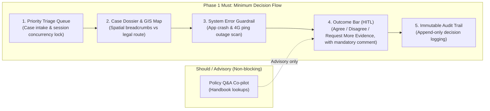

# Product Requirements Document (PRD) — GreenSentinel Phase 1: Fraud Analyst Adjudication Cockpit (HITL Enforcement)

> **Product identity:** The application is named **GreenSentinel** — a system that helps ride-hailing platforms detect fraud earlier, process it more efficiently, and improve over time. GreenSM references in this document denote the initial policy corpus and example tenant, not the product name. Future direction (outside Phase 1 acceptance): trip-stream ingestion that works as-is for any ride-hailing platform, with multiple organizations onboarded via Clerk organizations, each with private data, roles, and workflows.

## 1. Document Control

| Field | Specification |
|---|---|
| **Scenario** | Release 1 Human-in-the-Loop (HITL) Enforcement |
| **Status** | **Approved Phase 1 release scope**; operational validation remains separate |
| **Scope Adoption** | Strict Phase 1 PRD adopted by **@datamonsterr on 2026-09-30** |
| **Elaboration Approval** | Metrics, score semantics, and optional top-k clarification approved by **@datamonsterr on 2026-10-02** |
| **Tester Extension** | Requirements elicited from **@datamonsterr acting as Tester on 2026-10-03**; specified in §11. Implementation and Tester UAT remain pending. |
| **Operational Validation** | **CV-01 baseline confirmation: pending; Operator UAT sign-off: pending**. Scope approval does not complete either validation. |
| **Scope Amendment** | Team decision requested by @datamonsterr on **2026-10-16**: the system only predicts violations; analyst outcomes are limited to `Agree`, `Disagree`, and `Request More Evidence`. The product applies no warning, fine, clawback, suspension, termination, or escalation. Supersedes the sanction-outcome clauses of `DEC-P1-01` and `FR-03`/`FR-04` as recorded in [Decision Log](DECISION_LOG.md). Operational validation remains pending. |
| **Version / Date** | 1.4 / 2026-10-16; Scope amendment to prediction-only system and analyst outcomes; Analyst baseline plus scheduled Driver-first extension |
| **Scope** | Phase 1 MVP Scope: Primary Pain Point **PP-1 (Fraud Analyst Triage Overload)**, Minimum Decision Flow, Error Taxonomy (`ERR-01`–`05`), and Standardized Evaluation Protocol |
| **Traceability** | [Decision Log](DECISION_LOG.md), [Discovery Log](DISCOVERY_LOG.md), [Customer Interview Guide](CUSTOMER_INTERVIEW_GUIDE.md), [Phase 1 MVP](MVP.md), [Architecture Specification](../architecture/ARCHITECTURE.md) |

This PRD governs release acceptance. [PR #40](https://github.com/AI20K-Build-Phase-Cohort-4/GreenSentinel/pull/40), MERGED at `586caec05ddb7626a1f47066b55154e74d245cc0`, records historical runtime divergence (autonomous dismissal and driver expansion), not accepted release scope. [Issue #73](https://github.com/AI20K-Build-Phase-Cohort-4/GreenSentinel/issues/73) tracks runtime reconciliation, owned by [#86](https://github.com/AI20K-Build-Phase-Cohort-4/GreenSentinel/issues/86) / [#60](https://github.com/AI20K-Build-Phase-Cohort-4/GreenSentinel/issues/60); this documentation makes no runtime-conformance claim.

---

### 1.1 Scheduled extension and precedence

On 2026-10-05 @datamonsterr approved and scheduled the [Driver-first resolution and workspace extension](DRIVER_FIRST_REQUIREMENTS.md), governed by [#147](https://github.com/AI20K-Build-Phase-Cohort-4/GreenSentinel/issues/147). Its `driver-first-v1` contract supersedes Driver deferral and Analyst-only closure **only for explicit Driver-confirmed resolution**. This disposition does not assert exoneration or apply a sanction. Analyst dismissal and every adverse sanction still require authorized Analyst confirmation with rationale; failures and confidence boundaries escalate. The remaining reasonableness criterion is recorded openly in the extension.

Sections 2–10 preserve the approved Analyst baseline and its historical traceability; global-looking Driver deferral and Analyst closure statements in that baseline must be read with this scoped precedence. Legacy mobile uploads and blinded appeals remain deferred. Tester UI implementation stays queued. Scheduling is not runtime, migrated-database, hosted or UAT proof. See the [glossary](DRIVER_FIRST_GLOSSARY.md) and [ADR-018](../architecture/adr-018-driver-first-resolution.md).

## 2. Business & Operational Context

[Green Smart Mobility (GreenSM / GSM)](https://www.greensm.com/) operates an all-electric mobility platform in Vietnam, deploying company-managed fleets alongside driver-partner ecosystems powered by VinFast electric vehicles (EVs).

### 2.1 Driver Operational Models
1. **Fleet Drivers (Company Salaried):** Fixed salary + KPI bonuses tied to Acceptance Rate (AR), Completion Rate (CR), and service ratings. Fleet maintenance, capex, and charging are platform-managed.
2. **Owner-Driver Partners:** Drivers own/finance VinFast vehicles, retaining ~90% of trip gross revenue. Drivers bear charging, maintenance, and vehicle finance liabilities.
3. **Rent-to-Own (RTO) Partners:** Periodic rental/financing payments leading to eventual title transfer upon contractual fulfillment.

### 2.2 Vehicle Telemetry & Sensor Asymmetry
A core operational vulnerability stems from vehicle telemetry disparity across fleets:

| Dimension | Electric Cars (Xanh SM Taxi / Luxury) | Electric Bikes (Xanh Bike) |
|---|---|---|
| **Telematics Hardware** | Onboard Telematic Control Unit (TCU), CAN-bus integration | Commercial smartphone only (consumer GPS/accelerometer) |
| **Visual Oversight** | Dual interior cabin and exterior safety cameras | No dashcams, cabin cameras, or fixed sensors |
| **Signal Quality** | Factory-grade dual-frequency GPS antennas | High urban jitter, reflection, and cell-tower handoff loss |
| **Fraud Vulnerability** | Low (continuous vehicle telemetry stream) | **High (Fake GPS mock providers, app kills, offline tampering)** |

---

## 3. Taxonomy of Violations & Fraud Patterns

GreenSM categorizes partner misconduct and operational abuse into five standard violation codes:

| Code | Violation Class | Operational Description | Severity | Platform Sanction | Phase 1 Guardrail Scope |
|---|---|---|---|---|---|
| **ERR-01** | **Trip & Order Embezzlement** | Driver cancels trip on-platform upon arrival and takes passenger for unmetered cash payment. | Critical | Permanent ban & financial clawback | Monitored |
| **ERR-02** | **Route Deviation & Induced Cancellation** | Driver stalls, parks, or travels in opposite direction to force passenger cancellation (*Driver-Induced Cancellation - DIC*), avoiding AR/CR penalties. | **High** | **Temporary suspension, bonus clawback & warning** | **PRIMARY PHASE 1 FOCUS** |
| **ERR-03** | **Incentive & Policy Exploitation** | Gaming promotional milestones, ride streaks, or peak-hour incentive campaigns via fictitious bookings. | Critical | Permanent ban & bonus clawback | Batch / Phase 3 Scope |
| **ERR-04** | **Phantom / Virtual Trips** | Collusive ghost rides created between driver and mock passenger accounts without physical transit. | Critical | Permanent ban & legal escrow | Graph / Phase 3 Scope |
| **ERR-05** | **Technological Manipulation & Fake GPS** | Mock location apps, rooted devices, GPS spoofing, and modified APK clients to fake positions or leapfrog queues. | **Critical** | **Permanent account termination & bonus clawback** | **CORE DETECTION SIGNAL** |

---

## 4. Problem Statement & Operational Hypotheses

### 4.1 Primary Phase 1 Focus: Fraud Analyst Triage Overload (PP-1)

The Phase 1 release focuses exclusively on solving the operational bottleneck faced by GreenSM fraud teams:

1. **Manual Investigation Bottleneck:** Fraud analysts must manually correlate raw GPS breadcrumbs, cellular pings, traffic reports, and driver dispute notes across disconnected internal tools to determine if a stationary vehicle was genuine traffic gridlock or deliberate stalling.
2. **Operational Hypotheses (Pending `CV-01` Baseline Validation):**
   * *Alert Volume:* Estimated at **~2,000+ alerts/day** across metropolitan hubs.
   * *Manual Handling Duration:* Estimated at **10–15 minutes per case** (mean 12.5 minutes).
   * *Triage Backlog:* Estimated at **~75% unreviewed alerts aging > 24 hours**.
   * *False Alarm Ratio (FAR):* Estimated at **> 35% wrongful penalties overturned on initial review**.
   * *Status:* As recorded in the [Discovery Log](DISCOVERY_LOG.md), these figures remain **operational hypotheses** for capacity modeling until verified against live operational data.
3. **Downstream Impacts & Future Vision (Deferred to Phase 2+):**
   * *Passenger Experience Crisis (PP-2):* Mitigating passenger churn via in-ride prompts, live rebooking, and fare preservation is deferred to **Phase 2 (Epics 1–3)**.
   * *Driver Procedural Justice:* Mobile stationary evidence portals and blinded multi-tier appeals are deferred to **Phase 2 & Phase 3 (Epics 4 & 6)**.
   * *Release Governance:* Canary gating and automated drift governance are deferred to **Phase 3 (Epics 7 & 8)**.

### 4.2 5-Week Build Phase Scope & Team Capacity

| Dimension | Boundary / Specification |
|---|---|
| **Sprint Duration** | 5 Weeks (Build Phase leading to Demo Day) |
| **Team Capacity** | 1 Tech Lead / Architect, 1 Backend & AI Engineer, 1 Frontend & GIS Engineer, 1 Data & QA Analyst |
| **Data & Telemetry Access** | Real-world pre-recorded GPS logs combined with calibrated synthetic spatial scenarios (traversing production-shaped ingestion pipelines without live production Kafka bindings). |
| **GIS Map Dependencies** | Keyless raster map tiles to prevent preview build failures (Vercel/Railway) and authorization lockouts. |
| **Routing Engine Access** | Dedicated routing service instance for legal shortest route, ETA, and distance calculations. |
| **Policy Knowledge Base** | Official GreenSM Partner Handbooks and Code of Conduct indexed for contextual policy cross-referencing. |
| **UAT & Delivery Milestones** | • **Week 1–2:** Ingestion schemas, spatial feature extraction, and baseline data pipeline. • **Week 3:** Cockpit UI golden path, GIS map rendering, and system error guardrails. • **Week 4:** Benchmark dataset evaluation (30 cases), MTTR timing validation, and internal UAT. • **Week 5:** End-to-end rehearsal, audit trail verification, and Demo Day presentation. |

---

## 5. Goals and Non-Goals

### 5.1 Phase 1 Primary Goals
1. **Compress Analyst MTTR:** Reduce Mean Time to Resolve from hypothesized 12.5 minutes to **< 45 seconds per case** by presenting a pre-synthesized evidence dossier and spatial GIS map.
2. **Enforce 100% Human-In-The-Loop (HITL):** The system only predicts violations. Every analyst outcome (`Agree`, `Disagree`) requires **authorized analyst confirmation plus written rationale**. The product applies no penalties; zero automated dismissal or outcome execution.
3. **No Automatic Closure on System Failures:** Implement automated System Error Signals that detect platform outages, app crashes, and telemetry dropouts, showing them to the analyst before any outcome. A detected failure never closes a case.
4. **Complete Audit Immutability:** Record 100% of adjudication actions into an append-only, tamper-evident audit log binding case UUID, evidence snapshot, analyst ID, decision, and rationale text.
5. **Standardized Decision Quality:** Attain **> 90% Decision Concordance** for each reviewer against fixed gold decisions on the prescribed benchmark; this measures analyst decisions, not model accuracy.

### 5.2 Non-Goals
- **No Penalty Execution:** The platform shall never warn, fine, claw back, suspend, or terminate driver accounts. The Phase 1 cockpit records only `Agree`, `Disagree`, and `Request More Evidence`; penalty handling stays outside this product.
- **No Automated Case Dismissal:** For every dismissal, including corroborated congestion and technical outages, the system may predict and flag but requires authorized analyst confirmation plus written rationale. The system never silently closes cases autonomously.
- **No Passenger Mobile App Modifications in Phase 1:** In-ride passenger verification modals and automated dispatch reassignments belong to Phase 2.
- **No Driver Mobile App Development in Phase 1:** Driver stationary video submission forms and mobile dispute portals belong to Phase 2.
- **No Self-Modifying Decision Thresholds:** Rule thresholds and anomaly weights require explicit human review and approval.

---

## 6. Stakeholders and Personas

| Role | Operational Scope in Phase 1 | Accountability |
|---|---|---|
| **Fraud Analyst** | Primary end-user operating the Adjudication Cockpit. Triage alerts, inspect GIS trajectories, review evidence dossiers, verify guardrails, and execute signed adjudication decisions. | Primary Operator |
| **Senior Fraud Analyst** | Handles escalated complex cases, reviews conflicting evidence, and governs weekly calibration queues. | Escalation & QA |
| **Passenger** | Contextual entity in trip data. (Interactive mobile prompts deferred to Phase 2). | Entity / Future Persona |
| **Assigned Driver** | Partner subject to adjudication. (Mobile dispute portal and stationary video upload deferred to Phase 2). | Entity / Future Persona |
| **Product Owner** | Bounded scope management, acceptance sign-off, and metric governance. | System Owner |
| **Tester (acting @datamonsterr)** | Creates and executes source-aware trip simulations in the same workspace to test the actual detection, notification, dialogue, and case-assignment pipeline. | Test Operator |

The Tester extension is documented separately in [Tester trip simulation discovery](DISCOVERY_TESTER_TRIP_SIMULATION.md). It extends test preparation and execution tooling around the approved Phase 1 analyst flow; it does not expand the approved production Passenger or Driver mobile scope.

---

## 7. Feature Scope: Minimum Decision Flow (Must vs Should)

The cockpit strictly isolates the **Minimum Decision Flow (Must)** from secondary advisory features:

### 7.1 Must (Core Golden Path)

#### `FR-01`: Priority Triage Queue & Session Concurrency Lock
* **Function:** Ingests prioritized suspected-DIC anomaly cases ranked by severity (`P0: Critical / Active DIC`, `P1: High Risk / Repeated Stalling`, `P2: Moderate Delay`).
* **Concurrency Lock:** Opening a case claims an exclusive review lease for the analyst with an automatic 300-second inactivity timeout. Other analysts receive a read-only lock notification.

#### `FR-02`: Spatial Telemetry GIS Map & Unified Evidence Dossier
* **Function:** Renders driver GPS trajectory alongside the planned legal shortest path to pickup. Highlights prolonged stationary stalls ($\ge 180s$) and reverse movement vectors away from pickup.
* **Contextual Brief:** Synthesizes vehicle speeds, road limits, elapsed times, and passenger notes into a concise 2–3 sentence factual brief and advisory classifier confidence under the [score contract](#94-per-case-classifier-confidence-and-route-alternatives).
* **Missingness Handling:** Telemetry gaps exceeding 30 seconds render as dashed warning segments with explanatory tooltips.

#### `FR-03`: System Error & Missingness Guardrail
* **Function:** Scans for technical outages (driver app crashes, cellular network disconnects $> 30$ seconds, dispatch server errors) coinciding with the stoppage.
* **System Error Signal:** When technical outages are detected, the cockpit shows a prominent system-error signal and marks the suggested outcome as `Disagree (System Error)`. The signal is advisory; it does not block or apply any outcome.
* **Confirmation Invariant:** The authorized analyst must actively review diagnostics and submit `Disagree` (or another outcome) with written rationale; the case is never silently auto-closed.

#### `FR-04`: Role-Based Analyst Outcome Bar (One-Click HITL)
* **Function:** Enables exactly three analyst outcomes: `Agree` (confirms the predicted violation), `Disagree` (dismisses the prediction as a false alarm), and `Request More Evidence`. No warning, fine, clawback, suspension, termination, or escalation outcome exists in Phase 1.
* **Mandatory Rationale:** Every submission requires non-empty justification text ($\ge 10$ characters).
* **Role Governance:** Only authorized analysts can submit outcomes. The system never applies a penalty.

#### `FR-05`: Immutable Decision Audit Trail
* **Function:** Persists an append-only audit record binding case ID, analyst ID, action taken, rationale text, decision timestamp, and evidence snapshot. Protected against direct modification or deletion.

### 7.2 Should (Secondary Advisory)

#### `FR-06`: Interactive Policy Q&A Co-pilot
* **Function:** Non-blocking auxiliary side-panel providing conversational search into GreenSM Partner Handbooks and Code of Conduct. The core adjudication workflow remains fully functional if this tool is offline.

---

## 8. Non-Functional & Safety Requirements

| ID | Category | Requirement Specification |
|---|---|---|
| `NFR-01` | **Human Control (HITL)** | All dismissals and analyst `Agree`/`Disagree` outcomes require authorized analyst confirmation plus written rationale; the system never applies warnings, fines, clawbacks, or suspensions; algorithmic closure is deny-by-default. |
| `NFR-02` | **Safety & Policy** | Cautious wording throughout; moving-vehicle recording banned; system technical errors visible and prioritized over driver fault. |
| `NFR-03` | **Security & RBAC** | Principle of least privilege; separation of duties between Junior Analysts and Senior Escalation leads. |
| `NFR-04` | **Audit Integrity** | Append-only storage recording evidence snapshots, decision rationales, analyst IDs, and policy versions. |
| `NFR-05` | **Data Privacy** | Driver and passenger personal identifying information (PII) masked by default; unmasked only upon authorized escalation. |
| `NFR-06` | **Cockpit Performance** | Initial case dossier and GIS map rendering time $\le 1.5$ seconds (p95). |
| `NFR-07` | **Reliability** | Idempotent adjudication submissions with duplicate-submit guards. |

---

## 9. Data, Metrics, and Standardized Evaluation Protocol

### 9.1 Primary Phase 1 MVP Metrics

| Metric | Definition | Current Working Estimate | Phase 1 MVP Target |
|---|---|---|---|
| **Mean Time to Resolve (MTTR)** | Average duration from case dossier load to analyst decision submission | 12.5 min (*Hypothesis pending `CV-02`*) | **< 45 seconds** |
| **HITL Outcome Integrity** | Proportion of `Agree`/`Disagree` outcomes submitted by an authorized human analyst with written rationale | Not yet measured | **100.0% (Zero tolerance)** |
| **Guardrail Adherence** | Rate of zero autonomous case closures on cases with suspected system errors | Not yet measured | **100.0% (Zero autonomous closures on tech errors)** |
| **Audit Trail Completeness** | Percentage of finalized cases possessing a valid append-only audit snapshot | Not yet measured | **100.0%** |
| **Decision Concordance** | Matching analyst decisions / 30 fixed gold decisions, calculated separately for each reviewer | Not yet measured | **> 90% per reviewer** |

### 9.2 Downstream & Future Vision Metrics (Phase 2 & Phase 3)
The following metrics belong to deferred epics (reassignment, mobile dispute, canary rollout) and are tracked as future roadmap indicators:
* *Pickup Completion Rate:* Completed assigned rides / Total dispatches (Phase 2 Target: +2.5%).
* *Passenger DIC Churn:* Passenger churn attributed to unhandled DIC stalling (Phase 2 Target: -50%).
* *Appeal Overturn Rate:* Proportion of first-tier sanctions reversed upon secondary blinded review (Phase 3 Target: < 5%).

### 9.3 Standardized MTTR & Quality Evaluation Protocol
This protocol defines acceptance; it does not report benchmark results. The metric elaboration was approved by @datamonsterr on **2026-10-02**.
* **Dataset:** 30 cases (10 Blatant DIC, 10 Traffic Gridlock False Alarms, 10 Technical Outages), with fixed gold decisions agreed and versioned before evaluation. Gold decisions are hidden from reviewers.
* **Evaluators:** 3 independent reviewers each adjudicate all 30 cases in randomized sequences (90 decisions in total). An incomplete benchmark cannot pass.
* **Timing:** Stop-watch timer begins on complete case dossier render and ends upon successful adjudication submission.
* **Passing Thresholds:** Overall cohort mean MTTR $< 45$ seconds; Decision Concordance **> 90% for each reviewer**; and **100% Guardrail Adherence** (0 autonomous closures on technical outages across all reviewers).
* **Integer boundary:** Each reviewer completes 30 cases and must match at least 28 fixed gold decisions (28/30 = 93.33%); **27/30 fails** (90%).
* **Reporting:** Show the three reviewer totals separately, with matching decisions / 30 and concordance percentage. A pooled average cannot hide a failing reviewer. Report cohort mean MTTR and every guardrail violation alongside those totals.

### 9.4 Per-Case Classifier Confidence and Route Alternatives

Approved by **@datamonsterr on 2026-10-02**. Per-case classifier confidence is a model output in **[0,1]**. Its default is **`score_semantics=uncalibrated_model_confidence`**. It is **not accuracy, guilt probability, or authorization** to dismiss or sanction; benchmark Decision Concordance measures analyst decisions separately. Any calibrated probability claim requires held-out calibration evidence, a documented method, and separately versioned model/calibration artifacts before changing the stated semantics.

**Top-k route alternatives are optional pending a scoped product decision.** They are not a Phase 1 Must feature, detector requirement, or score metric. The required planned-route comparison in `FR-02` remains distinct from alternative-route retrieval; neither the number of retrieved routes nor policy retrieval top-k measures classifier confidence.

---

## 10. Traceability Matrix

| Source Need | Decisions | Requirements | User Story | Use Case | Phase Allocation |
|---|---|---|---|---|---|
| **Analyst Overload (PP-1)** | `DEC-L06-15`–`17` | `FR-01`–`05` | [`US-L06-04`](USER_STORIES.md#us-l06-04--decide-an-initial-enforcement-case-phase-1-mvp-core) | [`UC-L06-04`](USE_CASES.md#uc-l06-04-adjudicate-initial-case-phase-1-mvp-golden-path) | **Phase 1 (MVP)** |
| **Policy Advisory** | `DEC-L06-16` | `FR-06` | [`US-L06-04`](USER_STORIES.md#us-l06-04--decide-an-initial-enforcement-case-phase-1-mvp-core) | [`UC-L06-04`](USE_CASES.md#uc-l06-04-adjudicate-initial-case-phase-1-mvp-golden-path) | **Phase 1 (Should)** |
| **Live Prompting (PP-2)** | `DEC-L06-03`–`09` | Deferred | [`US-L06-01`](USER_STORIES.md#us-l06-01--choose-a-response-to-a-suspected-dic-prompt) | [`UC-L06-01`](USE_CASES.md#uc-l06-01-choose-passenger-recovery) | Phase 2 |
| **Preserved Recovery** | `DEC-L06-10` | Deferred | [`US-L06-02`](USER_STORIES.md#us-l06-02--receive-a-preserved-replacement-trip) | [`UC-L06-02`](USE_CASES.md#uc-l06-02-receive-preserved-reassignment) | Phase 2 |
| **Driver Evidence** | `DEC-L06-12`–`14` | Deferred | [`US-L06-03`](USER_STORIES.md#us-l06-03--submit-safe-evidence-for-review) | [`UC-L06-03`](USE_CASES.md#uc-l06-03-submit-driver-evidence) | Phase 2 |
| **Blinded Appeals** | `DEC-L06-18`–`20` | Deferred | [`US-L06-05`](USER_STORIES.md#us-l06-05--obtain-a-blinded-second-review) | [`UC-L06-05`](USE_CASES.md#uc-l06-05-appeal-enforcement-decision) | Phase 3 |
| **Quality Governance** | `DEC-L06-21` | Deferred | [`US-L06-07`](USER_STORIES.md#us-l06-07--review-conflicting-decisions) | [`UC-L06-05`](USE_CASES.md#uc-l06-05-appeal-enforcement-decision) | Phase 3 |
| **Rollout & Rollback** | `DEC-L06-01/23`–`26`| Deferred | [`US-L06-08`](USER_STORIES.md#us-l06-08--control-release-1-rollout-and-rollback) | [`UC-L06-07`](USE_CASES.md#uc-l06-07-govern-release-phase) | Phase 3 |

### 10.1 Phase 1 Acceptance and Test Traceability

Stable IDs below map the approved release contract to source requirements and tests. They are not completion results. Unless stated otherwise, the flow is [US-L06-04](USER_STORIES.md#us-l06-04--decide-an-initial-enforcement-case-phase-1-mvp-core) / [UC-L06-04](USE_CASES.md#uc-l06-04-adjudicate-initial-case-phase-1-mvp-golden-path). [DEC-P1-01–06](DECISION_LOG.md#approved-phase-1-decision-baseline) preserve approval provenance. The [public documentation contracts](../../tests/unit/docs/test_phase1_ba_docs.py) validate documentation only.

| Acceptance ID | Required outcome | Source requirements / MVP criteria | Docs contract / impacted runtime reference |
|---|---|---|---|
| `AC-P1-01` | Only the analyst cockpit's minimum decision flow is core; scope approval retains CV-01/operator UAT as pending. Queue lease and GIS dossier remain required. | PP-1; `FR-01/02`; `AC-MVP-01/02`; DEC-P1-02 | [test_release_scope_approval_keeps_operator_validation_pending](../../tests/unit/docs/test_phase1_ba_docs.py); [test_case_claim_lease_management](../../tests/integration/api/test_poc_api.py) (lease seam only) |
| `AC-P1-02` | No automatic dismissal, including congestion/system-error cases; authorized analyst confirms `Agree`/`Disagree` with written rationale. | `FR-03/04`; `NFR-01/03`; `AC-MVP-04/05`; DEC-P1-01 (sanction clause superseded by DEC-P1-06) | [test_dismissal_and_adverse_actions_need_authorized_analyst_rationale](../../tests/unit/docs/test_phase1_ba_docs.py); obsolete exoneration tests in §10.2 |
| `AC-P1-03` | Every analyst outcome (`Agree`, `Disagree`, `Request More Evidence`) requires authority checks; `Agree` and `Disagree` require rationale of at least 10 characters. No penalty outcome exists. | `FR-04`; `NFR-01/03`; `AC-MVP-05`; DEC-P1-06 | [test_dismissal_and_adverse_actions_need_authorized_analyst_rationale](../../tests/unit/docs/test_phase1_ba_docs.py); [test_adjudication_blocked_for_unassigned_analyst](../../tests/integration/api/test_poc_api.py) (assignment seam only) |
| `AC-P1-04` | System errors show a system-error signal and never close a case or apply an outcome; the case stays open until an analyst confirms an outcome. | `FR-03`; `NFR-01/02`; `AC-MVP-04`; DEC-P1-01/06 | [test_guardrail_is_advisory_and_does_not_block_adjudication](../../tests/integration/services/test_queue_worker.py) |
| `AC-P1-05` | Driver mobile/dispute expansion and appeals are deferred; existing implementation does not make them Must. | §5.2; DEC-P1-02; deferred `US-L06-03/05/09/10`, `UC-L06-03/05/08/09` | [test_driver_expansion_is_deferred_reference](../../tests/unit/docs/test_phase1_ba_docs.py); [test_v2_autonomy_is_explicitly_superseded_history](../../tests/unit/docs/test_phase1_ba_docs.py) |
| `AC-P1-06` | Complete 30 cases for each of 3 reviewers; >90% concordance each (at least 28 matches), cohort MTTR <45s, 100% guardrail adherence; report each reviewer separately. | §9.1/9.3; `AC-MVP-07`; DEC-P1-03 | [test_concordance_requires_strictly_more_than_ninety_percent](../../tests/unit/docs/test_phase1_ba_docs.py); [test_benchmark_requires_fixed_gold_and_separate_reviewer_totals](../../tests/unit/docs/test_phase1_ba_docs.py). Human benchmark pending. |
| `AC-P1-07` | Classifier confidence [0,1] defaults to uncalibrated semantics; it is not accuracy, guilt probability, or authorization. Separate calibration evidence/version required. | `FR-02`; §9.4; `AC-MVP-03`; DEC-P1-04 | [test_classifier_confidence_is_advisory_and_uncalibrated_by_default](../../tests/unit/docs/test_phase1_ba_docs.py); [test_output_rejects_invalid_confidence_and_empty_evidence](../../tests/unit/agents/test_forensic_baseline.py) (range/evidence seam only) |
| `AC-P1-08` | Top-k route alternatives remain optional pending a scoped product decision, outside Must/detector/score acceptance. | `FR-02` boundary; §9.4; DEC-P1-05 | [test_top_k_route_alternatives_are_optional_pending_product_decision](../../tests/unit/docs/test_phase1_ba_docs.py) |
| `AC-P1-09` | Every decision has an append-only evidence snapshot, analyst identity, rationale, timestamp, and policy version. | `FR-05`; `NFR-04`; `AC-MVP-06` | [test_case_terminal_adjudication](../../tests/integration/api/test_poc_api.py) (existing service/API seam; database immutability proof still required) |

### 10.2 Runtime Divergence and Verification Boundary

Existing runtime tests below are **impacted references, not proof of this release contract**. The human benchmark and operator UAT were **not run** by this documentation reconciliation; automated CI results are recorded separately in the [verification record](../testing/ISSUE_72_VERIFICATION.md). Passing fixture/service checks would not prove a migrated database, hosted browser behavior, or the human benchmark. CV-01 and operator UAT remain pending. PR #93's upstream correction removes the new autonomous-dismissal path from the corroborated-claim flow; this documentation PR records that correction and does not accept or close [#73](https://github.com/AI20K-Build-Phase-Cohort-4/GreenSentinel/issues/73), or claim full runtime DoD.

The following PR40 autonomous-exoneration expectation is **historical identity only**: the old test name and behavior are preserved in the immutable [PR40 source snapshot](https://github.com/AI20K-Build-Phase-Cohort-4/GreenSentinel/blob/586caec05ddb7626a1f47066b55154e74d245cc0/tests/test_services/test_driver_dispute_service.py). It is obsolete under [#73](https://github.com/AI20K-Build-Phase-Cohort-4/GreenSentinel/issues/73) and is not a current test link. Current impacted-test links below point to the upstream replacement functions; they describe selected upstream regressions rather than complete Phase 1 acceptance proof:

| Test reference | Current or historical behavior |
|---|---|
| `test_autonomous_exoneration_on_corroborated_traffic` (PR40 historical identity) | Former expectation: `auto_dismissed`, receipt, audit event without analyst confirmation |
| [test_corroborated_traffic_claim_awaits_analyst_review](../../tests/integration/services/test_driver_dispute_service.py) | Current service replacement: corroboration stays pending review; no automatic dismissal |
| [test_submit_driver_statement_corroborated](../../tests/integration/agents/test_driver_tools.py) | Current tool replacement: corroboration returns `pending_review` and no receipt |
| [test_driver_chat_response_corroborated_claim](../../tests/integration/api/test_driver_api.py) | Current API replacement: corroborated claim requires analyst confirmation |
| [test_flow_c_corroborated_claim_over_sse_stream](../../tests/e2e/backend/test_poc_v2_flow.py) | Current SSE replacement: terminal event reports no automatic dismissal and pending review |

Other relevant seams: [test_agree_records_violation_without_sanction](../../tests/integration/services/test_case_workspace.py) covers the existing `approve` action, which records a violation without executing the PRD sanction set; [test_worker_blocked_trip_short_circuits_agent](../../tests/integration/services/test_guardrail_integration.py) covers technical-error guardrail handling. Neither establishes full authorized dismissal, sanction, rationale, or persistence conformance. Runtime changes remain outside this documentation task.

### 10.3 Manual Acceptance Steps — Pending Execution

1. Open a queued case as an authorized analyst; inspect the dossier and lease. Confirm another analyst cannot submit concurrently (`AC-P1-01`).
2. Load congestion and technical-outage cases; verify both stay open until analyst confirmation with written rationale. On outage, verify the system-error signal shows and no outcome applies automatically (`AC-P1-02/04`).
3. Submit an outcome without authority or with a blank/short rationale; verify denial. Submit an authorized `Agree`, `Disagree` or `Request More Evidence` and inspect the append-only audit record (`AC-P1-03/09`).
4. Inspect confidence semantics and unavailable calibration evidence; verify the UI does not present guilt probability or authorize an action. Confirm route alternatives do not gate core acceptance (`AC-P1-07/08`).
5. Run the complete randomized human benchmark in §9.3 and report three reviewer totals, timing, and every guardrail violation. Record operator sign-off separately (`AC-P1-06`).

## 11. Tester Trip Simulation Extension

**Environment decision — 2026-10-04:** @datamonsterr confirmed isolated test storage and sandbox notification delivery, with the existing Workplace layout reused. The proposed frontend `/test` and backend `/test/api/v1` keep this extension separate; `/test/workplace` reuses the analyst view against the isolated test backend. No required visible `TEST` case badge is added. See [architecture](../architecture/TESTER_SIMULATION_ARCHITECTURE.md), [API contracts](../architecture/TESTER_API_SPECIFICATION.md), [UI design](../design/tester-simulation/design.md), and [test strategy](../testing/TESTER_SIMULATION_TEST_STRATEGY.md). Contract design and visual approval remain separate from runtime acceptance.

This extension addresses the confirmed Tester preparation bottleneck. It is a test-workspace capability around the Phase 1 pipeline, not runtime proof and not approval for Passenger or Driver production mobile expansion. Full discovery is in [DISCOVERY_TESTER_TRIP_SIMULATION.md](DISCOVERY_TESTER_TRIP_SIMULATION.md).

**PP-TST-01 — Test preparation bottleneck:** The Tester reports approximately one day to select pickup/destination and a plausible vehicle origin in Google Maps, copy GPS coordinates, generate Python scripts, ask AI to alter database records, and check the resulting trip. Sparse GPS, unintended off-road/in-river positions and implausible movement make input quality difficult to trust. Reliable real-trip inputs are unavailable for this workflow. The confirmed goal is approximately one minute to visually prepare a new trip for system testing; the exact measurement boundary is an assumption, not a measured result.

The user confirmed that resulting cases may enter the **existing Workplace without a required visible `TEST` label**. Internal trip/run and source provenance supports persistence and diagnosis; it does not require a case badge or a separate Workplace. The product outcome is tracked in [#130](https://github.com/AI20K-Build-Phase-Cohort-4/GreenSentinel/issues/130); implementation outcomes and dependencies remain in GitHub, not a parallel document backlog.

“Existing Workplace” identifies the application and assignment flow. The 2026-10-04 decision selects isolated test storage and sandbox delivery, with no permission to write to a live operational database. Simulated actor identities, reporting boundaries and role provisioning still require verified implementation under `Q-TST-05`. This requirement does not add a visible test badge.

### 11.1 Functional Requirements

- **FR-TST-01:** Let the Tester compose and persist a complete trip plan: vehicle origin, pickup, destination, route, speed, time, and GPS cadence. Default output follows realistic roads with explicit temporal positions; the Tester may deliberately author abnormal GPS.
- **FR-TST-02:** Let the Tester review and edit the whole plan before execution, then change vehicle speed, stop/resume movement and alter the intended route during the run while retaining the plan and ordered runtime controls. These controls implement the confirmed live-control need; exact control bounds remain subject to design.
- **FR-TST-03:** Let the Tester act as Passenger and Driver in the same workspace, manually adding or editing messages for either actor; optional AI-generated drafts remain editable. Dialogue supplies evidence for advisory inference of violation intent/deliberateness, checking the Driver's stated reason against available trip/traffic facts, and Analyst review. Preserve speakers and message timing.
- **FR-TST-04:** Show prominent map and generation controls, distinct Passenger/Driver regions, and actual system assessments/results in one workspace.
- **FR-TST-05:** Show context-sensitive metrics in real time on map hover/selection and during movement: pickup-to-destination distance, driver-placement radius, remaining travel distance, per-GPS distances to explicitly identified reference points, DAVI and source-aware ETA. Distinguish routing distance from geometric radius; identify units, route leg and references. Explain unavailable DAVI when movement/context is insufficient. Equivalent information must be available without hover.
- **FR-TST-06:** Support past-time selection and prioritize traffic retrieval for the matching historical time where a supported source exists. Also let the Tester mark congested route segments and set congestion level/density separately on each segment, with explicitly simulated traffic/ETA provenance. Provider coverage is unverified; current observations must not silently substitute for historical observations.
- **FR-TST-07:** Persist the complete trip, generated run data, source/provenance, notifications, dialogue, assessments, and resulting case assignment to the current Workplace.
- **FR-TST-08:** Exercise actual suspected-violation detection, notification receipt, Passenger/Driver responses and case-assignment flows. Display correlated system results, pending/failed/unavailable stages and no-case outcomes without fabricating detection or assignment. Tester role-play does not automatically grant Analyst authority; all adjudication retains existing authorized human confirmation and rationale requirements.

### 11.2 Non-functional Requirements

- **NFR-TST-01:** Optimize for approximately one minute from start of composition to accepted basic-trip submission; timing scope excludes full playback and detection-response latency and remains a target to validate.
- **NFR-TST-02:** Preserve provenance for GPS, routes, traffic, simulated congestion, dialogue drafts, model outputs, and run events; expose source and time where available.
- **NFR-TST-03:** Handle missing/insufficient movement as explicit unknowns; never invent a zero metric or silently substitute live traffic for historical or simulated traffic.
- **NFR-TST-04:** Keep interrupted and duplicate runs, role mapping/storage, notification contracts, evaluation leakage, and model stochasticity auditable and recoverable subject to open design decisions.
- **NFR-TST-05:** Provide usable map-first controls for unrestricted test creation; no canned-scenario selection is required as the workflow.

### 11.3 Acceptance Criteria

- **AC-TST-01:** Tester creates, reviews, edits, and accepts a new basic trip with origin, route, pickup, destination, speed, time, and dense temporal GPS positions; target timing is measured with stated exclusions.
- **AC-TST-02:** Default generated GPS follows a plausible road route and the maximum unintentional gap between samples does not exceed the configured interval. Deliberate dropouts/faults are explicitly recorded exceptions. Engineering and the Tester must choose and validate the default/minimum supported sampling profile on representative movement before generator implementation or acceptance; leaving cadence unresolved does not pass this criterion. Authored abnormal GPS is retained with explicit fault classification/provenance.
- **AC-TST-03:** Tester can run as both Passenger and Driver, edit both dialogues, receive system notifications, and submit responses in one workspace.
- **AC-TST-04:** Map shows configured and live state plus source-aware distance/radius/remaining-distance metrics with units and references; DAVI is absent when insufficient context exists.
- **AC-TST-05:** Historical traffic retrieval reports actual source/time when available. The Tester can mark at least two route segments with independently set congestion levels/densities, inspect the resulting ETA context and reload those settings; simulated congestion is separately labelled and never masquerades as observed historical evidence.
- **AC-TST-06:** Reloading the workspace restores the complete trip and run data, including provenance, dialogue, notifications, assessments, and case assignment.
- **AC-TST-07:** For a run that produces a case, the Tester can inspect actual persisted assignment in the existing Workplace without a required visible `TEST` label. Runs with no case, pending detection or failed assignment show those observed states. Advisory AI output does not confirm guilt or bypass authorized human adjudication.
- **AC-TST-08:** After reviewing the complete saved plan, the Tester starts a run and can alter vehicle movement while it executes. Reloading retains both the original plan and ordered controls/emitted inputs; edits do not silently rewrite historical run evidence.

Operational UAT, exact preparation timing, replay/clone policy, cadence/defaults, radius references, traffic provider coverage/licensing and interrupted/duplicate-run recovery remain explicitly pending where unresolved. Owners and required decision stages are recorded in the [discovery open questions](DISCOVERY_TESTER_TRIP_SIMULATION.md#13-open-questions). No new source provider, schema/API contract or runtime completion is asserted by this extension.
