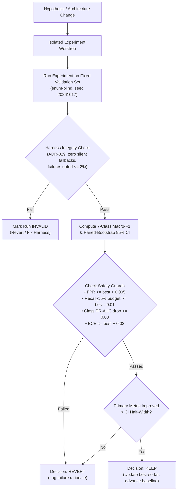

# AutoResearch: Classifier Research Loop, Methodology, and Progression

This document synthesizes the autonomous keep-or-revert research loop for the ride-hailing single-trip fraud classifier under [Epic #494](https://github.com/AI20K-Build-Phase-Cohort-4/P-063/issues/494). It covers the hypothesis-driven experimental loop, metric protocols, safety guards, validity caveats, the comprehensive attempt table (E0–E6, E7/E8, D1, R3A–R3H, R3C, R3F, R3D), the final model evaluation on the held-out test split, and open engineering challenges.

**Primary References:**
- **Experiment Registry:** [registry.jsonl](experiments/registry.jsonl) and [experiments/attempts/](experiments/attempts/)
- **Staircase Progression Chart:** [staircase.png](experiments/staircase.png)
- **Harness Integrity & Provenance Review:** [HARNESS_INTEGRITY_REVIEW.md](HARNESS_INTEGRITY_REVIEW.md)
- **Feature Leakage Audit:** [R3C_LEAK_AUDIT.md](experiments/R3C_LEAK_AUDIT.md)
- **Corpus Documentation:** [DATASET.md](DATASET.md)
- **Full Benchmark History:** [BENCHMARK.md](BENCHMARK.md)

---

## 1. Research Loop Methodology

We followed a Karpathy-style automated keep-or-revert search loop designed to prevent deceptive improvements, context bloat, and regression in operational safety.



### 1.1 Metric Protocol

- **Primary Evaluation Metric**: **7-class macro-F1** evaluated on the **validation split** (6,000 trips for offline runs; identical 1,000-trip stratified sample for live runs; fixed `dev300` for screening) under **`--enum-blind`** mode.
- **Statistical Significance**: Paired-bootstrap test (1,000 resamples) with 95% Confidence Interval (CI). The CI half-width is a screening heuristic; a significance claim requires a paired-delta bootstrap test rather than inferring $p < 0.05$ from the interval alone.
- **Safety Guards (Must ALL Hold)**:
  1. `no_violation` False Positive Rate: $\text{FPR} \le \text{best\_FPR} + 0.005$ (protects honest drivers from false accusations).
  2. Adverse Recall at 5% Review Budget: $\text{Recall@5\%} \ge \text{best} - 0.01$ (ensures high-precision triage for analysts).
  3. Per-Class PR-AUC Drop: No individual violation class may drop by $> 0.03$ PR-AUC (prevents sacrificing minority classes).
  4. Calibration Error: $\text{ECE} \le \text{best\_ECE} + 0.02$.
- **Split Discipline**: The **test split** (6,000 trips) is held in cold storage and evaluated **exactly once** on the finalized model architecture (§5) to prevent optimization leakage.

### 1.2 Harness Integrity & Provenance Logging

Earlier research iterations suffered from masked failures. The harness was systematically fortified via [PR #519](https://github.com/AI20K-Build-Phase-Cohort-4/P-063/pull/519), [PR #527](https://github.com/AI20K-Build-Phase-Cohort-4/P-063/pull/527), and [PR #550](https://github.com/AI20K-Build-Phase-Cohort-4/P-063/pull/550) ([ADR-029](../architecture/adr-029-harness-live-call-accounting.md)):
1. **Zero Silent Fallback Rule**: In `--live` mode, any silent fallback to heuristic detection immediately invalidates the run (`JevAssessmentService` defaults to `jev_allow_heuristic_fallback=False`).
2. **Live-Failure Gating**: Runs with API provider failures $> 2.0\%$ are marked INVALID.
3. **Audit Provenance Block**: Every run outputs a mandatory provenance record capturing `model_used` breakdown, fallback-model invocations, heuristic-fallback count, failed requests, and token costs.

---

## 2. Progression of All Attempts

The following table documents every major experimental attempt chronologically across Rounds 1, 2, and 3.

| Attempt ID | Focus / Idea | Issue / PR | Primary Macro-F1 (Enum-Blind) [95% CI] | FPR | ECE | Status / Decision | Key Findings & Rationale |
|---|---|---|---|---|---|---|---|
| **E0** | Production baseline (raw telemetry, ~typesafe/jev-latest) | [#494](https://github.com/AI20K-Build-Phase-Cohort-4/P-063/issues/494) | 0.4737 [0.438, 0.508] *(Strict: 0.6698)* | 0.251 | 0.192 | Baseline *(Invalid)* | **Invalid model evidence**: 942/1,000 predictions were silent heuristic fallbacks due to credit/context exhaustion ([HARNESS_INTEGRITY_REVIEW.md:136](HARNESS_INTEGRITY_REVIEW.md#4-guidance-for-parallel-workers-e1e7)). ~39k tokens/trip; 5.2% `max_tokens_exceeded`. |
| **E1** | Derived numeric kinematic features in prompt | [#505](https://github.com/AI20K-Build-Phase-Cohort-4/P-063/issues/505) / [#509](https://github.com/AI20K-Build-Phase-Cohort-4/P-063/pull/509) | 0.4632 [0.428, 0.496] | 0.300 | 0.264 | **REVERT** | Feeding derived numbers (speeds, stops, bearings) did not improve LLM reasoning; FPR degraded from 0.251 to 0.300. |
| **E2** | Natural-language serialization of features (TabLLM style) | [#506](https://github.com/AI20K-Build-Phase-Cohort-4/P-063/issues/506) / [#514](https://github.com/AI20K-Build-Phase-Cohort-4/P-063/pull/514) | 0.4540 [0.422, 0.487] | 0.292 | 0.296 | **REVERT** | Vietnamese narrative description of kinematics yielded no gain over raw numbers; LLM struggled with multi-step spatial bounds. |
| **E3** | Risk-band criteria rewrite + insufficient_evidence choice | [#507](https://github.com/AI20K-Build-Phase-Cohort-4/P-063/issues/507) / [#510](https://github.com/AI20K-Build-Phase-Cohort-4/P-063/pull/510) | 0.5352 [0.503, 0.570] | 0.281 | 0.212 | **REVERT** | Criteria bands resolved ERR-03 route deviation (F1 0.11 $\to$ 0.68) but caused false alarms, failing the FPR safety guard. |
| **E4** | Hybrid: LightGBM on kinematics + LLM text evidence (weight 0.9 GBM) | [#513](https://github.com/AI20K-Build-Phase-Cohort-4/P-063/issues/513) / [#530](https://github.com/AI20K-Build-Phase-Cohort-4/P-063/pull/530) | 0.8419 [0.811, 0.869] *(Offline: 0.7791)* | 0.000 | 0.078 | **KEEP (Superceded)** | Apparent breakthrough driven entirely by GBM (weight 0.9). Later found to contain **leaky synthetic features** (R3C leak audit). |
| **E5** | Two-stage gate (deterministic rules for clear cases, LLM for ambiguous) | [#512](https://github.com/AI20K-Build-Phase-Cohort-4/P-063/issues/512) / [#528](https://github.com/AI20K-Build-Phase-Cohort-4/P-063/pull/528) | 0.4593 [0.426, 0.492] | 0.282 | 0.177 | **REVERT** | Hard threshold gating diverted subtle violations to wrong paths; failed safety guards. |
| **E6** | Compact prompt state (663 tokens vs 39k) on dev300 | [#517](https://github.com/AI20K-Build-Phase-Cohort-4/P-063/issues/517) / [#524](https://github.com/AI20K-Build-Phase-Cohort-4/P-063/pull/524) | 0.4789 [0.419, 0.537] | 0.230 | 0.258 | **REVERT** | Cut prompt token cost 58$\times$, but accuracy fell slightly short of baseline; proved that raw maneuvers were 84–93% of prompt waste. |
| **E7** | Compact-state E4 hybrid + risk criteria + fusion tuned on live outputs | [#540](https://github.com/AI20K-Build-Phase-Cohort-4/P-063/issues/540) / [#542](https://github.com/AI20K-Build-Phase-Cohort-4/P-063/pull/542) | Open / superseded | — | — | **SUPERSEDED** | Separate candidate (compact-state E4 hybrid + risk criteria + fusion tuned on live outputs); open PR #542 superseded by Round 3. No unsupported claim of merging into Round 3. |
| **E8** | Ghost-trip pickup/dropoff/denial features | [#541](https://github.com/AI20K-Build-Phase-Cohort-4/P-063/issues/541) / [#543](https://github.com/AI20K-Build-Phase-Cohort-4/P-063/pull/543) | Open / superseded | — | — | **SUPERSEDED** | Separate candidate (ghost-trip pickup/dropoff/denial features for hybrid GBM); open PR #543 superseded by Round 3. No unsupported claim of merging into Round 3. |
| **D1** | Corpus upgrade to `releases_v2.1` | [#539](https://github.com/AI20K-Build-Phase-Cohort-4/P-063/issues/539) / [#544](https://github.com/AI20K-Build-Phase-Cohort-4/P-063/pull/544) | — | — | — | **CORPUS FIX** | Eliminated driver-objection shortcut (previously 70% ERR-01 and 80% ERR-02). Generated `releases_v2.1` (`d52e52ff...`). `platform_incident` generator leak remains present in dataset. |
| **R3A** | Cheaper deciders: `mercury-decide:free` + `pplx` fallback (old context, dev300) | [#545](https://github.com/AI20K-Build-Phase-Cohort-4/P-063/issues/545) / [#550](https://github.com/AI20K-Build-Phase-Cohort-4/P-063/pull/550) | 0.5901 [0.512, 0.661] *(Strict: 0.7077)* | 0.049 | 0.143 | **INVALID** | Mercury handled 227 calls, Pplx 42; 14 failed (context overflow). 4.9% failure rate triggered #527 failure gate (max 2.0%). Zero LLM cost. |
| **R3B** | Rule-free evidence context: initial wiring (pickup bug) | [#547](https://github.com/AI20K-Build-Phase-Cohort-4/P-063/issues/547) / [#549](https://github.com/AI20K-Build-Phase-Cohort-4/P-063/pull/549) | 0.4248 [0.389, 0.454] | 0.358 | 0.414 | **BUG** | User mandate: strip all hardcoded thresholds from prompt. Initial run suffered bug: pickup coords null, ERR-03 F1 was 0. |
| **R3B fix** | Rule-free context: pickup wired, no anchors | [#547](https://github.com/AI20K-Build-Phase-Cohort-4/P-063/issues/547) / [#549](https://github.com/AI20K-Build-Phase-Cohort-4/P-063/pull/549) | 0.3353 [0.297, 0.370] | 1.000 | 0.820 | **REVERT** | Model predicted ERR-03 for 190/300 trips! Without reference anchors, normal trips were flagged as deviations. |
| **R3H** | Phase split: approach vs in-trip segmentation | [#551](https://github.com/AI20K-Build-Phase-Cohort-4/P-063/issues/551) / [#557](https://github.com/AI20K-Build-Phase-Cohort-4/P-063/pull/557) | 0.4854 [0.424, 0.534] | 0.451 | 0.419 | **ITERATE** | Solved root cause: telemetry starts at pickup, so distance to pickup naturally increases during normal trips. |
| **R3H classref** | Phase split + per-class train medians (`evidence_classref`) | [#551](https://github.com/AI20K-Build-Phase-Cohort-4/P-063/issues/551) / [#557](https://github.com/AI20K-Build-Phase-Cohort-4/P-063/pull/557) | **0.6372 [0.577, 0.685]** *(Strict: 0.7113)* | 0.275 | 0.316 | **KEEP (LLM Baseline)** | Best rule-free prompt. Calibrated quantiles fitted on 19,637 honest train trips. Adopted as default production state. |
| **R3C** | Clean LightGBM: 37 leak-audited features from raw telemetry (offline 6k val) | [#546](https://github.com/AI20K-Build-Phase-Cohort-4/P-063/issues/546) / [#553](https://github.com/AI20K-Build-Phase-Cohort-4/P-063/pull/553) | 0.8695 [0.863, 0.877] | 0.078 | 0.059 | **KEEP (Kinematic Baseline)** | Dropped all features with univariate macro-F1 > 0.30. Fast (35ms), $0 cost, reproducible. Weakness: FPR 0.078 (316 FPs). |
| **R3F** | 1D-CNN over 128-step resampled GPS sequence + domain randomization | [#548](https://github.com/AI20K-Build-Phase-Cohort-4/P-063/issues/548) / [#552](https://github.com/AI20K-Build-Phase-Cohort-4/P-063/pull/552) | 0.8171 [0.809, 0.824] | 0.0005* | 0.170 | **KEEP (Sequence Baseline)** | Validation FPR is 0.000476 (~0.05%, 2 false positives / 4,200 normal trips); test FPR is 0.000481 (2/4,159). Low but not zero; complements tabular features, but confounds ERR-01 and ERR-02. |
| **R3D** | **Stacker: LightGBM meta-learner over R3C + R3F OOF probabilities** | [#554](https://github.com/AI20K-Build-Phase-Cohort-4/P-063/issues/554) / [#556](https://github.com/AI20K-Build-Phase-Cohort-4/P-063/pull/556) | **0.8705 [0.864, 0.877]** | **0.030** | **0.056** | **KEEP (FINAL MODEL)** | 5-fold grouped by driver. Combines tabular kinematics + trajectory sequence. Cuts FPR by >60% (0.078 $\to$ 0.030) at equal macro-F1. Validation ECE is 0.055917 (~0.056); 0.030209 is FPR. |

---

## 3. Methodological Findings: What Worked vs What Failed

### What Worked

1. **Realistic Synthetic Corpus (`releases_v2.1`) & Leak Audits**: Upgrading from v1/v2 to v2.1 broke the driver-objection presence shortcut. The `platform_incident` generator leak remains present in the dataset and is still consumed by deterministic guardrails, but was excised from clean model features (R3C/R3D). "Leak-audited" does not prove leak-free or real-world operational generalization.
2. **Supervised Kinematic Learning Over Zero-Shot LLMs**: Trained gradient-boosted trees and sequence CNNs outperformed zero-shot decision models on spatial-temporal data by over 30 points of macro-F1 (0.87 vs 0.51) at zero token cost and sub-50ms latency.
3. **Learned Stacking Meta-Learner (R3D)**: Stacking tabular tree probabilities (R3C) with deep trajectory sequence probabilities (R3F) dropped false alarm rates from 0.078 to 0.030 while maintaining 0.87 macro-F1.
4. **Data-Derived Reference Anchors Over Hardcoded Rules**: Replacing hardcoded thresholds (`>=180s`, `>35%`) with data-derived train-split percentiles and class medians (`evidence_classref`) resolved LLM hallucinated route deviations (macro-F1 0.33 $\to$ 0.64). Note that while research `r3h_evidence_classref` explicitly sets `criteria_variant='semantic'`, `JevAssessmentInput` in service code defaults `criteria_variant='baseline'` (which retains `>=180s` and `>35%`); the rule-free benchmark context differs from the production-service DEFAULT criteria; we do not claim the default service is completely rule-free or that deployed production service was live-verified.
5. **Phase-Segmented Measurements**: Splitting telemetry into driver approach vs in-trip segments resolved the fundamental distortion where distance to pickup increases during normal trip legs.
6. **Strict Live Provenance Accounting**: Enforcing zero silent fallback unmasked massive historical contamination where runs claimed high accuracy while silently evaluating 19%–94% heuristic fallbacks.
7. **Cost-Free Decision Models**: Migrating to `inception/mercury-decide:free` cut prompt costs to $0 while reducing prompt tokens 16$\times$ (~1,470 tokens vs 39,000).

### What Did Not Work

1. **Enriching LLM Prompts with Kinematics (E1, E2)**: Providing derived numbers or Vietnamese textual summaries of speed and bearings did not improve zero-shot LLM reasoning and worsened false alarm rates.
2. **Rule-Based Two-Stage Gates (E5)**: Hardcoded pre-filtering diverted ambiguous trips into destructive terminal paths.
3. **Prompt Minimization without Structural Priors (E6)**: Truncating state without reference medians degraded accuracy.
4. **Rule-Free Prompts without Anchors (R3B fix)**: A completely ungrounded LLM prompt flagged 63% of honest trips as violations (FPR 1.000).
5. **Cross-Generator Generalization**: Models trained on `releases_v2.1` transfer poorly to `releases_v1` (R3D drops from 0.87 to 0.53), proving sensitivity to generator-specific noise artifacts.

---

## 4. Key Validity Caveats and Audit Findings

Every researcher and reviewer must account for four structural validity caveats:

1. **E0 Baseline Contamination (942/1,000 Heuristic Fallbacks)**:
   In attempt E0, 942 out of 1,000 validation calls hit credit exhaustion or context limits and silently fell back to the heuristic detector ([HARNESS_INTEGRITY_REVIEW.md:136](HARNESS_INTEGRITY_REVIEW.md#4-guidance-for-parallel-workers-e1e7)). E0 cannot be cited as true LLM model performance.
2. **Pre-PR #550 Run Contamination**:
   Before PR #550, live provenance was not logged. All live evaluation scores recorded prior to #550 contain unquantified heuristic contamination. E4's apparent 0.84 score was driven almost entirely by the 0.9 weight assigned to its LightGBM component.
3. **E4 Feature Leakage**:
   The R3C audit ([R3C_LEAK_AUDIT.md](experiments/R3C_LEAK_AUDIT.md)) proved that E4 used features that directly leaked labels: `stationary_duration_s` (univariate macro-F1 0.371), `approach_ssd` (0.369), and `guardrail_*` (derived from `platform_incident`). These were excised in R3C, but the `platform_incident` generator leak remains in the corpus and is still consumed by deterministic guardrails.
4. **`dev300` Selection Optimism**:
   The `dev300` screening set was used iteratively to select prompts and criteria. Consequently, Mercury with `evidence_classref` scored **0.6372** on `dev300`, but dropped to **0.5155** on the held-out test split.
5. **'Leak-Audited' is Not 'Leak-Free' and Matched Val/Test is Not Real-World Safety**:
   Dropping univariate features $>0.30$ removed obvious synthetic leaks, but cannot eliminate subtle multivariate generator artifacts. Close agreement between validation (0.8705) and test (0.8680) proves absence of overt test-split tuning, but does not guarantee real-world generalization. Furthermore, R3D's small F1 advantage over R3C (0.8705 vs 0.8695 validation) has overlapping confidence intervals ([0.864, 0.877] vs [0.863, 0.877]); we do not claim statistical significance or complete absence of overfit. R3D failed original cross-generator acceptance targets on `releases_v1` (macro-F1 **0.534732** vs R3F **0.556208**, FPR **0.246135**), indicating strong generator-specific dependence. R3D is the winner for the current synthetic research corpus, not an all-guards-passed accepted production model.
6. **Review-Budget Audit (`adverse_recall_at_budget = 0.0`)**:
   In the saved R3D test evaluation, `adverse_recall_at_budget` is 0.0. `metrics.py` ranks cases by $1 - P(\text{no\_violation})$. The guardrail emits `insufficient_evidence` with $P(\text{no\_violation}) = 0.0$, placing them at the absolute top of the triage queue. All top 300 of the 6,000 saved test predictions are `insufficient_evidence` (out of 378 total insufficient trips), meaning the entire 5% review budget is consumed by telemetry dropout rather than fraudulent rides. Telemetry data-recovery must be decoupled into an independent queue. In addition, artifact loading failures in the R3D variant can silently yield uniform base probabilities while continuing to log `r3d_stacked_lightgbm`; production integration requires strict artifact validation and explicit degradation provenance.

---

## 5. Final Model Evaluation on Held-Out Test Split

The candidate model architecture—the **R3D Stacker** (Guardrail Short-Circuit + R3C Clean LightGBM + R3F Trajectory CNN stacked with LightGBM meta-learner)—was evaluated **once** on the cold-storage **test split** of `releases_v2.1` (6,000 trips, seed 20261017, enum-blind mode).

### 5.1 Test Split Primary Metrics (6,000 Trips)

| Evaluation Configuration | Model ID | Macro-F1 [95% CI] | Accuracy | `no_violation` FPR | ECE | Latency (p95) | Token Cost |
|---|---|---|---|---|---|---|---|
| **Best In-Generator Candidate** | **R3D Stacker** | **0.8680 [0.861, 0.875]** | **0.9507** | **0.027** | **0.056** | **~35 ms** | **$0 (0 tokens)** |
| Kinematic Baseline | R3C Clean LightGBM | 0.8618 [0.856, 0.869] | 0.9398 | 0.080 | 0.053 | ~15 ms | $0 (0 tokens) |
| Sequence Baseline | R3F Trajectory CNN | 0.8205 [0.813, 0.828] | 0.9610 | 0.0005* | 0.170 | ~25 ms | $0 (0 tokens) |
| Decision-Model Layer (300 trips) | `mercury-decide:free` (`classref`) | 0.5155 [0.455, 0.575] | 0.5833 | 0.357 | 0.391 | ~700 ms | $0 (~1.5k tok) |

*\*R3F test FPR is 0.000481 (~0.05%, 2 false positives / 4,159 normal test trips), rounded to 0.000 in integer summaries; validation FPR is 0.000476. Low but not zero.*

### 5.2 Test Split Confusion Matrix: R3D Stacker (6,000 Trips)

*Rows = True Category, Columns = Predicted Category (Order: `no_viol`, `ERR-01`, `ERR-02`, `ERR-03`, `ERR-04`, `ERR-05`, `insuff`)*

```
                  no_viol  ERR-01  ERR-02  ERR-03  ERR-04  ERR-05  insuff
no_violation      [ 4046       0       0       1     112       0       0 ]  (F1: 0.967)
ERR-01            [    0     297       0       0       0       0       0 ]  (F1: 1.000)
ERR-02            [    0       0     492       0       0       0       0 ]  (F1: 1.000)
ERR-03            [    0       0       0     314       0       0       0 ]  (F1: 0.997)
ERR-04            [  165       0       0       0      18       0       0 ]  (F1: 0.115)
ERR-05            [    0       0       0       1       0     176       0 ]  (F1: 0.997)
insufficient      [    0       0       0       0       0       0     378 ]  (F1: 1.000)
```

**Key Diagnostic Observations:**
- **Kinematic & Lifecycle Classes Near Perfect**: `ERR-01` (unjustified cancel), `ERR-02` (stall), `ERR-03` (deviation), and `ERR-05` (spoofing) achieve F1 scores $> 0.99$.
- **`ERR-04` Ghost Trip Blind Spot**: Due to normal trajectories and enum-blind blanking, R3D misclassifies 165/183 ghost trips as `no_violation` (F1 0.115).
- **Zero False Accusations of Outage**: `insufficient_evidence` maintains 100% precision and recall via deterministic guardrail short-circuiting.

---

## 6. Open Engineering Challenges & Next Steps

1. **Production Service Wiring**:
   R3D currently lives in `scripts/benchmark/experiments/r3d/` (artifacts `model.pkl`, `model.pt`, `stacker.pkl`). It must be integrated into `src/services/` behind a production inference endpoint.
2. **`ERR-04` Multi-Modal Resolution**:
   Because GPS is identical to honest trips, `ERR-04` cannot be detected via kinematics. Next steps require fusing passenger dialogue denials and arrival timestamps into R3D meta-features.
3. **Decision Model Probability Fusion (R3D Phase 2)**:
   Fuse LLM advisory probabilities (`llm_p_<class>`) from `mercury-decide` into the R3D LightGBM meta-learner for text-heavy dispute classes.
4. **Generator Platform Incident Remediation**:
   Update `scripts/benchmark/build_v2/generator.py` to ensure `platform_incident` generates realistic cross-class incidents rather than deterministically leaking `ERR-05` and `insufficient_evidence`.
5. **Hugging Face Hub Publication**:
   `releases_v2.1` and `releases_v2` are now published to `datamonsterr/p-063-synthesized-trips` at immutable revisions `abb8cc8b2464aacdcbec0aab039ef4e066f71f8e` and `cc8023b7022fdd5392a5655135712cc748967814`.
6. **Review-budget audit**: In the saved R3D test evaluation, `adverse_recall_at_budget` is 0.0. All top 300 of 6,000 ranked predictions were `insufficient_evidence` (378 such rows total), so the 5% review budget is consumed by a separate data-quality queue rather than fraud triage. Artifact fallback can silently produce uniform base probabilities while retaining a stacker label; production integration needs artifact validation and explicit degradation provenance.
