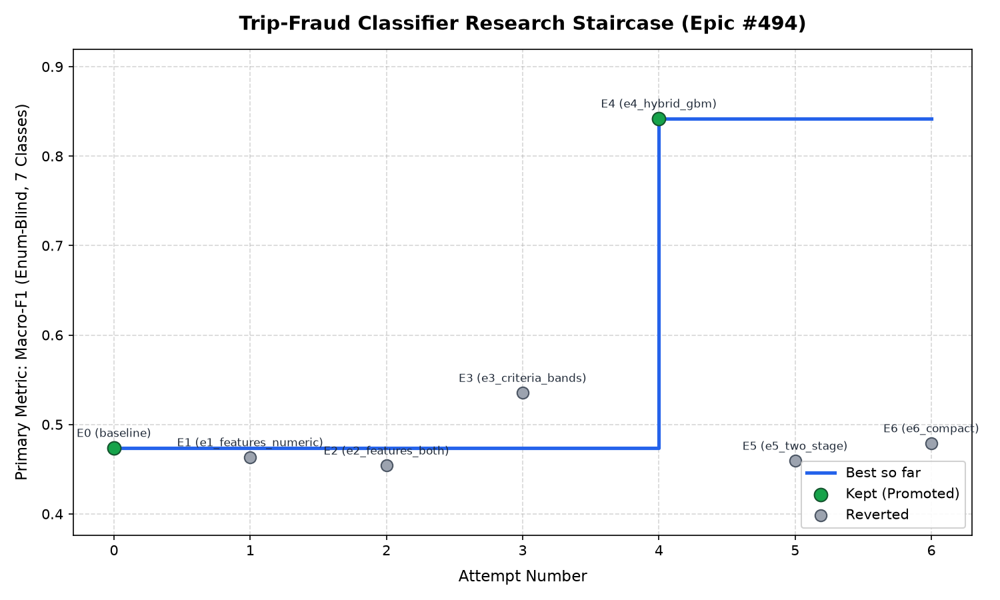

# Classifier Research Registry & Staircase

Tracking the keep-or-revert research loop for the trip-fraud classifier per [Epic #494](https://github.com/AI20K-Build-Phase-Cohort-4/P-063/issues/494).

## Staircase Progress

## Decision Rule

A candidate is **KEPT** if and only if:
1. Primary metric (Macro-F1, enum-blind, 7 classes) improves by more than the paired-bootstrap 95% CI half-width on the same validation trips.
2. All guard criteria hold:
   - True `no_violation` FPR <= best + 0.005
   - Adverse recall at top 5% alert budget >= best - 0.01
   - No class PR-AUC drops by > 0.03
   - ECE (10-bin) <= best + 0.02

Otherwise, the candidate is **REVERTED**.

## Registry Log

| Attempt | Exp ID | Variant | Issue | PR | Primary (Macro-F1) | 95% CI | Guards | Decision | Best so far | Date |
|---|---|---|---|---|---|---|---|---|---|---|
| 0 | E0 | baseline | #494 |  | 0.4737 | [0.4378, 0.5082] | PASS | **KEEP** | 0.4737 | 2026-10-17 |
| 1 | E1 | e1_features_numeric | #505 | #509 | 0.4632 | [0.4277, 0.4958] | FAIL | **REVERT** | 0.4737 | 2026-10-17 |
| 2 | E2 | e2_features_both | #506 | #514 | 0.4540 | [0.4217, 0.4873] | FAIL | **REVERT** | 0.4737 | 2026-10-17 |
| 3 | E3 | e3_criteria_bands | #507 | #510 | 0.5352 | [0.5026, 0.5698] | FAIL | **REVERT** | 0.4737 | 2026-10-17 |
| 4 | E4 | e4_hybrid_gbm | #513 | #530 | 0.8419 | [0.8108, 0.8688] | PASS | **KEEP** | 0.8419 | 2026-10-17 |
| 5 | E5 | e5_two_stage | #512 | #528 | 0.4593 | [0.4263, 0.4919] | FAIL | **REVERT** | 0.8419 | 2026-10-17 |
| 6 | E6 | e6_compact | #517 | #524 | 0.4789 | [0.4193, 0.5374] | FAIL | **REVERT** | 0.8419 | 2026-10-17 |
