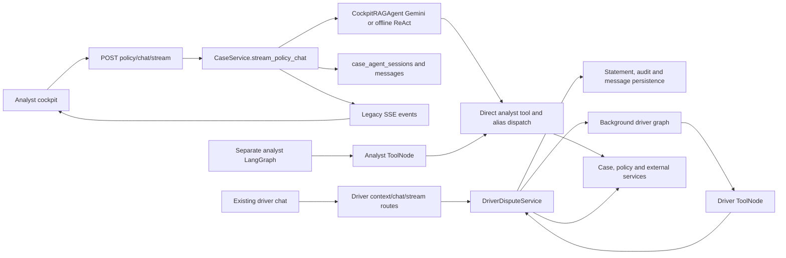

# Reliable Agent Tool Runtime Implementation Plan

> **For agentic workers:** REQUIRED SUB-SKILL: Use `subagent-driven-development` or `executing-plans` to implement this design task by task. Track checkbox steps in the linked GitHub issue; do not create a parallel Markdown backlog.

**Goal:** Harden the existing analyst and driver tool runtimes with authorized, typed, source-backed results and correlated execution events.

**Architecture:** Keep the cockpit Gemini/ReAct executor and the driver LangGraph separate. Make both call the same small catalog, authorization, execution, and event services; keep adjudication behind authenticated human commands. Extend the existing event contract through explicit negotiation, preserving the legacy citation and history paths.

**Tech Stack:** Python 3.11+, FastAPI, Pydantic V2, LangGraph, Gemini, PostgreSQL/Supabase, Clerk, Next.js/React, pytest, Vitest, Playwright.

---

## Authority and inspected baseline

The authoritative requirements, implementation steps, dependency graph, and acceptance checklist live in [issue #60](https://github.com/AI20K-Build-Phase-Cohort-4/P-063/issues/60). This document supplies source evidence, interface decisions, and test recipes for that issue. It does not record task status.

Analysis baseline: `f175f9682b9e9b3d5a8ce535bd49569eef2ea30e`, the merged completion of [issue #63](https://github.com/AI20K-Build-Phase-Cohort-4/P-063/issues/63) / [PR #82](https://github.com/AI20K-Build-Phase-Cohort-4/P-063/pull/82). The original delivered agent baseline is [PR #40](https://github.com/AI20K-Build-Phase-Cohort-4/P-063/pull/40), merge `586caec05ddb7626a1f47066b55154e74d245cc0`. The primary checkout was still at `8ed87d6`; the conductor created an isolated documentation worktree on current `origin/main` before recording this design.

Required reading: [PRD](../../ba/PRD.md), [MVP](../../ba/MVP.md), [user stories](../../ba/USER_STORIES.md), [ADR-006](../../architecture/adr-006-shared-use-cases-for-api-and-agent-tools.md), [ADR-008](../../architecture/adr-008-poc-v2-async-driver-agent-and-a2a-collaboration.md), and [chat event contract](../../CHAT_UI_EVENT_CONTRACT.md).

The strict PRD baseline in #60 governs conflicting ADRs and tests. FR-03 requires human-confirmed dismissal; FR-06 makes policy assistance optional and requires the core review workflow to remain usable during provider failure. US-L06-10 is contextual driver work, not authorization to expand deferred driver flows. ADR-006 is **Proposed**, and ADR-008's autonomous exoneration is a confirmed divergence. [Issue #72](https://github.com/AI20K-Build-Phase-Cohort-4/P-063/issues/72) owns broad documentation reconciliation; [issue #73](https://github.com/AI20K-Build-Phase-Cohort-4/P-063/issues/73) owns removal of automatic dismissal.

## Existing topology and actual entry points



The cockpit does **not** invoke the analyst LangGraph on its policy SSE path. Hardening only `src/agents/graph.py` misses the application users actually call.

| Boundary | Current source | Observed behavior |
|---|---|---|
| Cockpit request and stream | [routes.py](../../../src/api/routes.py), [case_service.py](../../../src/services/case_service.py), [api-client.ts](../../../src/webapp/lib/api-client.ts) | API passes organization/actor to persistence, but dispatch does not bind tool authority to that principal. |
| Cockpit execution | [cockpit_agent.py](../../../src/rag/cockpit_agent.py) | Independent Gemini declaration list, direct dispatch, and offline routing. |
| Analyst graph | [graph.py](../../../src/agents/graph.py), [state.py](../../../src/agents/state.py) | `agent -> ToolNode -> agent`; permissive shared state; broad registry. |
| Driver execution | [driver_agent.py](../../../src/agents/driver_agent.py), [driver_tools.py](../../../src/agents/tools/driver_tools.py) | Separate graph; authority is embedded in prompts/metadata rather than enforced by services. |
| Driver request and stream | [driver_dispute_service.py](../../../src/services/driver_dispute_service.py) | Stream first executes the command, then divides the final response into text chunks. Background graph execution is not joined to the stream. |
| Authentication | [auth.py](../../../src/api/auth.py) | Driver path/header shortcut precedes bearer verification; header roles and `driver-guest` can bypass real identity checks. |

### State and graph lifecycle

`AgentState` has query/context/analysis/response/error/metadata/messages. It lacks a trusted principal, case organization, execution identity, deadline, idempotency state, and typed provenance. Both graphs loop on `tool_calls`; provider wrappers have separate retry settings, but the complete run has no common bounded execution policy. Driver statement processing schedules the driver graph, whose submission tool can re-enter statement processing. Remove that recursive write capability from model selection; keep the explicit authenticated driver command.

Keep graph topology and existing provider integration. Add a server-created `runtime_context` and run limits. Never infer authority from prompts, model-generated IDs, role headers, or LangSmith metadata. LangGraph `InjectedState`/runtime wrappers can carry trusted context; the cockpit requires explicit adapter injection because it does not use `ToolNode`.

## Complete exposed-surface inventory

| Surface | Current names |
|---|---|
| Analyst registry, 16 tools | `get_case_detail`, `list_cases`, `claim_case`, `record_case_action`, `adjudicate_case`, `query_policy`, `trigger_simulation`, `get_driver_history`, `query_cases_db`, `check_driver_suspension`, `check_weather_condition`, `check_traffic_situation`, `write_ticket_for_driver`, `check_related_cases_to_vehicle`, `get_driver_card`, `search_policy_documents` |
| Cockpit declarations, 15 names | `search_policy`, `search_policy_documents`, `get_driver_card`, `get_driver_trip_history`, `check_driver_suspension`, `list_cases`, `get_case_information`, `get_driver_profile`, `get_telemetry`, `get_case_list_priority`, `get_audit_log`, `check_weather_condition`, `check_traffic_situation`, `write_ticket_for_driver`, `check_related_cases_to_vehicle` |
| Driver registry, 6 tools | `get_driver_dispute_context`, `corroborate_traffic_conditions`, `inspect_trip_telemetry`, `verify_exoneration_rules`, `submit_driver_statement`, `query_driver_policy` |

Catalog every name above, including disabled entries and aliases. Deduplicate semantic operations through canonical IDs; do not equate different callable signatures automatically. Export a machine-readable mapping with surface, canonical ID, callable name, alias, actor, enabled/disabled state and owner. Generate Gemini declarations, cockpit offline/manual dispatch allowlists and LangGraph bindings through explicit surface adapters; a single shared callable list cannot bridge their incompatible signatures. A schema export must retain human-readable purpose, input/output schema, actor capabilities, side effects, error codes, source semantics, timeout and retry policy.

Disable model-selectable `claim_case`, `record_case_action`, `adjudicate_case`, `trigger_simulation`, `write_ticket_for_driver`, unrestricted SQL, and driver statement mutation. Retain their existing human command paths where authorized. Treat `verify_exoneration_rules` as advisory only after #73's correction; it must never authorize closure. A catalog entry may document an operation without granting it to the model.

## Concrete gaps and proposed boundaries

| Gap | Source evidence | Responsible change |
|---|---|---|
| Sanction-like ticket reachable from chat | `cockpit_agent.py:477-497,838-856,1291-1339`; `analyst_tools.py:640-678` | Remove mutation from selectable declarations, offline dispatch, and graph registration. Do not issue success if audit persistence failed. |
| Caller can select actor or unrelated driver | `auth.py:86-114,278-292`; `driver_dispute_service.py:405-451` | Verify signed identity first, bind trusted server context, and enforce ownership/organization at the shared service boundary. |
| Fabricated evidence during failure | `analyst_tools.py:514,537-551,618-635,768` | Return a typed unavailable result with source failure; preserve explicit dataset labels and recorded coordinates. OSRM supplies route geometry, not live congestion evidence. |
| Repeated statement/audit writes | `driver_dispute_service.py:670-730,370-403,851-892` | Transactional turn key, request fingerprint and stored result; deduplicate both persisted and in-memory transcript. |
| Tool starts synthesized after execution | `case_service.py:2838-2947` | Emit at the actual call boundary through a thread-safe async bridge; emit one matched result/error per invocation. |
| Errors/EOF leave pending UI state | `api-client.ts:420-485`; `cockpit-view.tsx:580-623` | Typed transport parser and per-run reducer with exactly one terminal callback, interrupted EOF handling and stale-run suppression. |
| Automatic closure encoded in runtime/tests | `driver_dispute_service.py:732-777`; [driver tests](../../../tests/test_agents/test_driver_tools.py) | Preserve #73 ownership. #60 acceptance must use the corrected pending-review behavior and must not treat obsolete green tests as conformance proof. |

## Proposed file responsibilities

These paths identify interfaces and ownership, not a second task register.

| Path | Responsibility |
|---|---|
| `src/models/tool_contracts.py` (new) | Strict result, error, provenance, catalog and trusted-context types; no dependency on `src/api`. |
| `src/services/tool_catalog.py` (new) | Explicit canonical operations, aliases, schemas and actor-specific allowed registries. |
| `src/services/tool_authorization.py` (new) | Shared actor/case/organization/driver/capability checks used by API and agent adapters. |
| `src/services/tool_execution.py` (new) | Validation, bounded transient retry, timeout, safe result normalization and actual invocation callbacks. |
| `src/services/agent_turn_repository.py` (new) | Durable command/run identity, duplicate fingerprint validation, stored result and terminal state. |
| `src/services/chat_event_writer.py` (new) | Serialized event allocation, matched tools, terminal state, safe projection and negotiated SSE frames. |
| Existing tool/graph/cockpit/service/API files | Thin adapters to these interfaces; retain established business services instead of duplicating rules. |
| `src/webapp/lib/chat-event-stream.ts` (new) | Chunk framing, schema guards, deduplication and lifecycle state; no UI redesign. |
| Existing API client, types and two chat consumers | Adopt correlation and recoverable terminal states while preserving citations/history. |
| Timestamped `db/migrations/*_agent_turn_execution.sql` (new) | Minimal idempotency/run persistence extension only if existing constraints cannot represent the required key. Preserve historical messages/audit rows. |

`case_service.py` is approximately 2,957 lines and `cockpit_agent.py` 1,492 lines at this baseline. Extract only the new executor/event responsibilities; do not perform a broad restructuring.

## Contract decisions for implementation

Use Pydantic models with `extra="forbid"`. Model-facing inputs exclude `actor_id`, organization, roles, permissions, runtime context and idempotency identity. Client-selected resource IDs remain validated against server context. Proposed interface:

```python
from typing import Any, Literal
from pydantic import BaseModel, ConfigDict, Field


class ToolExecutionContext(BaseModel):
    model_config = ConfigDict(extra="forbid", frozen=True)
    actor_id: str
    organization_id: str
    roles: frozenset[str]
    case_id: str
    driver_id: str | None = None
    request_id: str
    run_id: str
    tool_call_id: str
    turn_id: str


class ToolError(BaseModel):
    model_config = ConfigDict(extra="forbid")
    code: Literal[
        "VALIDATION_ERROR",
        "UNAUTHENTICATED",
        "FORBIDDEN",
        "NOT_FOUND",
        "CONFLICT",
        "SOURCE_UNAVAILABLE",
        "PROVIDER_TIMEOUT",
        "PROVIDER_UNAVAILABLE",
        "PERSISTENCE_UNAVAILABLE",
        "RUN_LIMIT",
        "INTERRUPTED",
        "INTERNAL_ERROR",
    ]
    message: str
    retryable: bool


class EvidenceProvenance(BaseModel):
    model_config = ConfigDict(extra="forbid")
    kind: Literal["database", "provider", "dataset", "unavailable"]
    source: str
    record_ids: list[str] = Field(default_factory=list)
    observed_at: str | None = None
    retrieved_at: str
    dataset_version: str | None = None
    citation_ids: list[str] = Field(default_factory=list)
    provider_request_id: str | None = None


class ToolResult(BaseModel):
    model_config = ConfigDict(extra="forbid")
    status: Literal["succeeded", "failed"]
    tool_id: str
    tool_call_id: str
    data: dict[str, Any] | None
    error: ToolError | None
    provenance: list[EvidenceProvenance]
```

Add validators enforcing exactly one successful domain payload or failure error. The catalog supplies operation-specific output models; this envelope does not justify unrestricted arbitrary result dictionaries. All adapters must return the envelope, including errors; raw `{"error": str(exception)}` results are prohibited. A failed source must not yield a successful empty list or invented values. Empty authorized DB results are distinguishable from unavailable DB access. `retrieved_at` is an actual retrieval time; never replace missing observation time with it. Database evidence requires actual record references when records exist; dataset evidence requires its recorded version and references; policy evidence retains citation IDs. Provider provenance records the provider and an actual request/response reference, with observation time only when the response supplies it. Unavailable evidence has no observation time or domain metrics.

Proposed executor entry point: `async execute_tool(tool_id, arguments, context, *, on_event=None) -> ToolResult`. `context` is never parsed from model arguments. Catalog policy uses at most two attempts for explicitly transient read failures, with bounded provider timeout and a total run deadline. Validation, authorization, missing resources and version conflicts are permanent. Existing SDK retries must count toward the same total budget, including the sync cockpit bridge and post-tool `continue_from_tool_result()` model synthesis. A test must prove all dispatch surfaces consume the same budget. Timing out a waiting thread does not cancel its underlying I/O; apply provider timeouts at the actual I/O boundary and never permit a late model-selected mutation. Mutation retries remain disabled until the durable command identity is in place; then retries return the stored result, not another mutation. Suggested initial bounds are 10 seconds per external attempt, 250 ms retry backoff, 30 seconds per assistant run and eight tool invocations; these are engineering defaults to validate, not new PRD performance promises.

For the existing one-statement-per-turn flow, the mutation idempotency key is `(organization_id, actor_id, case_id, operation, turn_id)`. The client preserves its original turn ID for submission retries; read-tool invocations are not deduplicated by this command key. Distinct commands within one turn require a distinct `command_id`, rather than reusing the statement key. Store a fingerprint of canonical validated input with a unique database key. Same key/same input returns the recorded result; same key/different input returns `CONFLICT`; concurrent duplicates commit once. An unknown commit outcome is reconciled by key before retry. Do not roll back valid historical audit records or treat memory state as a durable-success substitute.

### Event extension and compatibility

Reuse [CHAT_UI_EVENT.schema.json](../../CHAT_UI_EVENT.schema.json) and its existing lifecycle validator. Existing v1.0 is a strict eight-field envelope; it lacks required request/case correlation and cannot carry the current citation events. It is unaccepted handoff design, not runtime proof.

Introduce explicit `event_schema_version: "1.1"` negotiation in both request adapters; leave unnegotiated legacy consumers working. The existing raw named SSE frames are not the proposed strict v1.0 envelope; preserve them with a separate tested legacy serializer. Limit 1.1 integration to the existing case-bound policy and driver chat endpoints; generic case-free chat/queue integration is outside this slice. Extend the schema for 1.1 with required `request_id`, `case_id`, `session_id`, `turn_id` alongside existing `run_id`, `message_id`, `event_id`, `sequence`, `timestamp`, `type`, `payload`. Add a strictly typed `citation` event using the current policy citation data contract. Preserve legacy rich/history widgets through explicit compatibility tests, including allowed evidence XML widgets; forbidden mutation/ticket widgets are excluded. Do not enable route renderer changes; GIS belongs to #61.

Use `tool.start` and `tool.end` with `status="succeeded"|"failed"`, stable canonical `tool_id`, and unique `tool_call_id`. This represents the requested start/result/error lifecycle without inventing incompatible event names. Only safe summaries and stable errors reach the UI; full typed evidence remains available through authorized service results and persisted references. Do not expose raw arguments, prompts, stack traces, credentials or private reasoning.

Sequence allocation is serialized across concurrent tools. One start and one terminal tool event per actual invocation; one `run.completed` or `run.error` per run; no events afterward. Persist terminal outcome before declaring success. While the connection remains usable, cancellation/error emits a matched failed `tool.end` with `error.code="INTERRUPTED"` for each pending tool before the run terminal. At an actual network disconnect, the server cannot deliver a new frame; the client marks interrupted, then fetches durable turn/session state with fresh ownership authorization. Recovery reads prior state/results; it does not claim replay or regenerate a response without a new run. Repeated command requests reuse their turn key; a deliberate new generation gets a new run ID. Do not claim a new event-replay protocol: existing v1 does not promise it.

## Concrete RED test recipes

These tests specify observable behavior for the issue's implementation slices. New imports are deliberate RED targets; first create the smallest type/interface skeleton needed for collection, then prove a behavioral assertion fails. Import/collection errors alone are not accepted RED evidence.

### Catalog and forbidden capabilities

Create `tests/test_agents/test_tool_catalog.py`:

```python
from src.services.tool_catalog import get_tool_catalog, model_tool_names


def test_model_registry_excludes_human_commands():
    forbidden = {
        "claim_case",
        "record_case_action",
        "adjudicate_case",
        "trigger_simulation",
        "write_ticket_for_driver",
        "submit_driver_statement",
    }
    for actor in ("analyst", "driver"):
        assert forbidden.isdisjoint(model_tool_names(actor))
    catalog = get_tool_catalog()
    assert all(entry.purpose for entry in catalog)
    assert all(entry.input_schema and entry.output_schema for entry in catalog)
    assert all(entry.error_codes and entry.provenance_kind for entry in catalog)
```

Run `rtk uv run pytest tests/test_agents/test_tool_catalog.py -v`. Expected first behavioral RED: forbidden names remain model-selectable or catalog metadata is missing. GREEN must cover both Gemini declarations/offline dispatch and both ToolNodes, not only this helper.

### Trusted input isolation

Extend the same file:

```python
from src.services.tool_catalog import model_input_schemas


def test_authority_is_not_in_model_input_schemas():
    forbidden = {"actor_id", "organization_id", "roles", "permissions", "runtime_context"}
    for schema in model_input_schemas():
        assert forbidden.isdisjoint(schema.get("properties", {}))
```

Then add direct-executor and HTTP tests in `tests/test_api/test_clerk_auth.py` / `tests/test_api/test_driver_api.py`: a signed driver A token plus spoofed driver B/analyst headers still cannot read B's case, transcript, telemetry or invoke analyst tools. A valid principal from another organization is denied before DB/provider access. Use explicit dependency overrides for fixture tests; production auth tests must not rely on the driver header shortcut. Seeded database tests repeat these denials against real assignment rows.

### Existing corroboration cannot close a case

The following expected behavior is owned by #73 in `tests/test_services/test_driver_dispute_service.py`. Consume that fix during final integration; #60 does not silently replace #73's implementation ownership:

```python
assert response.is_auto_dismissed is False
assert response.needs_analyst_review is True
assert case_service._cases[case_id]["status"] != "auto_dismissed"
assert response.exoneration_receipt is None
```

Run `rtk uv run pytest tests/test_services/test_driver_dispute_service.py tests/test_agents/test_driver_tools.py tests/test_api/test_driver_api.py -v`. Record the actual fixture setup, no autonomous audit event, and preserved corroboration references. Do not claim #73 is solved by registry exclusion alone; its explicit driver/API/service paths require independent proof.

### Provider errors and unavailable evidence

Create `tests/test_services/test_tool_execution.py` using `httpx.MockTransport` at the actual weather/traffic client-construction seam and real executor/adapters. Current tools instantiate `AsyncClient` locally, so install the transport there rather than testing a disconnected generic client. Return HTTP 503 once, then the provider's documented valid payload: verify two attempts and real returned provenance. Return 400 or deny authorization: verify one attempt. Cover 429 explicitly: honor a valid `Retry-After` only when catalog policy and the remaining attempt/deadline budget permit it. Exhaust 503/timeout: assert the stable failed result below and assert absent weather/congestion/coordinate metrics.

```python
assert result.status == "failed"
assert result.data is None
assert result.error.code in {"PROVIDER_TIMEOUT", "PROVIDER_UNAVAILABLE"}
assert result.error.retryable is True
assert all(source.kind == "unavailable" for source in result.provenance)
```

Also test a working DB while policy provider is down: dossier and explicit human review commands remain usable. Use a controlled clock/awaitable at the timer seam to verify bounded timeout and cancellation; never make tests wait 30 seconds. Include malformed-success JSON and an empty authorized database result, which must have different outcomes.

### Actual multi-tool lifecycle and terminal state

Create `tests/test_services/test_chat_event_writer.py`; extend `tests/test_services/test_case_agent_sessions.py`. Gate a real adapter invocation with `asyncio.Event`: read its start frame before releasing the adapter, then verify its end frame. Invoke the same tool twice and a second tool concurrently; all call IDs must pair, sequence values must be contiguous, and every frame must carry the same request/case/run/turn identity. Validate the generated stream against the negotiated schema, not a prewritten success fixture.

```python
starts = [event for event in events if event["type"] == "tool.start"]
ends = [event for event in events if event["type"] == "tool.end"]
assert {event["payload"]["tool_call_id"] for event in starts} == {event["payload"]["tool_call_id"] for event in ends}
assert len({event["payload"]["tool_call_id"] for event in starts}) == len(starts)
assert [event["sequence"] for event in events] == list(range(len(events)))
terminals = [event for event in events if event["type"] in {"run.completed", "run.error"}]
assert len(terminals) == 1
assert events[-1] == terminals[0]
```

Verify provider failure, invalid tool input, denied access, cancellation, exhausted call budget, persistence failure, empty results, and saved-turn recovery. Saved answers must not invent fresh tool execution. Add stream API contract tests in `tests/test_api/test_tool_runtime_api.py` for both legacy and 1.1 requests. Preserve citations and existing compact progress behavior.

### Duplicate-write proof

Create `tests/test_services/test_agent_turn_repository.py` for migrated isolated Postgres. Submit the same statement/turn concurrently over POST and stream adapters; count one `driver_submissions` row, one logical driver message, one associated audit action and one persisted result. Repeat after service reconstruction to prove restart survival. Reuse the key with different text and assert 409/`CONFLICT`. Inject audit/DB failure inside the transaction and assert no committed success, no phantom in-memory append, no misleading `ISSUED` result. An executor retry must reconcile an already committed key rather than issue another write.

The analogous analyst saved-turn test must prove incomplete turns have recoverable terminal state and that a provider generation is not run twice for a completed turn. Do not use an in-memory dictionary to claim concurrency or crash durability.

### Frontend parser and reducer

Create `src/webapp/tests/chat-event-stream.test.ts` and extend `api-client.test.ts`, `cockpit-live.test.tsx`, `driver-dispute.test.tsx`. Use real encoded SSE frames split inside JSON strings, CRLF boundaries and multibyte Vietnamese text. Exercise two tools, repeated tool names, replayed event IDs, conflicting duplicates, sequence gaps, EOF before terminal, abort, stale runs and unauthorized response. Assert exactly one terminal callback, retained partial text, cleared pending indicators and an explicit retry/recovery state.

```typescript
expect(state.status).toBe("interrupted");
expect(state.text).toBe("Partial answer");
expect(Object.values(state.tools).every(tool => tool.status !== "pending")).toBe(true);
expect(onTerminal).toHaveBeenCalledTimes(1);
```

Run `pnpm --dir src/webapp exec vitest run tests/chat-event-stream.test.ts tests/api-client.test.ts tests/cockpit-live.test.tsx tests/driver-dispute.test.tsx`, then `pnpm --dir src/webapp exec tsc --noEmit`. This changes existing stream behavior, not the layout; a future layout redesign would require the separate design/preview workflow.

## Worker execution and stop conditions

The conductor fetches issue/ancestor/native blocker state, supplies this source context, checks the graph for cycles and file conflicts, formats the task checklist, and dispatches only an accepted frontier. AGY owns a bounded slice in an isolated worktree and must not revert another worker's edits. Shared `schemas.py`, `routes.py`, `case_service.py`, `driver_dispute_service.py` and `api-client.ts` require serialized integration even where semantic dependency edges permit parallel work.

For every behavior, record the smallest passing baseline, write its regression, capture **behavioral RED**, implement the minimal change, run focused GREEN and relevant neighboring regressions, then commit. A green baseline that asserts automatic dismissal is evidence of the defect, not acceptance. Do not create mechanical sub-issues or a new driver skeleton. Keep the slices in #60; separately assigned and independently accepted outcomes can be promoted to native sub-issues only if scope changes.

AGY preflight must verify the selected registered worker/harness, worktree path, environment and current `origin/main`. `jev-dispatch --dry-run` is suitable for routing inspection, but routing may select another harness; it is not proof that an AGY worker ran. No implementation worker was launched during planning.

Use `Refs #60` for partial PRs. Use `Closes #60` only when every DoD item, pending safety acceptance, required integration and staging smoke has evidence. Do not merge or deploy as part of this planning handoff.

## Validation boundary and observed baseline

Conductor ran these checks on the isolated `f175f96` source with the existing project virtual environment:

```bash
python -m pytest tests/test_services/test_case_agent_sessions.py tests/test_chat_ui_contract.py tests/test_agents/test_driver_tools.py -q
python -m eval.validate_chat_ui_events
```

Observed: **16 tests passed, 7 subtests passed**; all three existing event fixture streams validated (10/4/3 events). This proves the baseline/fixture harness works; it does not prove #60's missing behavior. Driver tests still encode forbidden auto-dismissal. The initial exploratory system-Python test attempt lacked `pytest_asyncio`; using the existing project interpreter resolved that harness issue without changing dependencies.

Installed packages observed: LangGraph `1.2.11`, langchain-core `1.6.3`, Pydantic `2.13.5`, pytest `9.1.1`, pytest-asyncio `1.4.0`. Confirm the worker environment independently; do not assume an unconstrained `>=` manifest locks these versions. Locally inspected `ToolNode` supports `awrap_tool_call` and `InjectedState`.

Required implementation checks: focused pytest and Vitest; schema plus lifecycle validation; `bash scripts/check.sh`; full backend suite against a migrated/seeded isolated database; TypeScript, production build, relevant Playwright and manual browser flows. A Docker fixture test is not hosted staging acceptance. Retain #63's dataset versions and source coordinates; never replace missing provider/DB evidence with mocks in the staging smoke.

Prior #63 evidence reports the repository Mypy blocker at `numpy/__init__.pyi:737`: `Type statement is only supported in Python 3.12 and greater` under the configured Python 3.11 target. That gate was **not rerun during this planning-only change**. AGY must rerun and report the actual current result. Hosted Clerk/database/provider acceptance and #60 staging smoke were not performed during planning.

The staging acceptance record must name environment URL, deployed commit, authenticated actors, dataset/seed version, case and turn/run IDs, exact commands, denied cross-driver attempt, provider-outage observation, duplicate-write counts and artifacts. A blocked credential/environment is a disclosed remaining DoD item, never a green result.

## Architecture trade-offs and sources

Shared services prevent API/model authorization drift; replacing both agents with one graph would broaden the task and is unnecessary. Strict catalog metadata is preferable to automatically exposing all OpenAPI endpoints. Negotiated 1.1 events preserve legacy behavior; silently adding fields to strict v1.0 would break its validator. Durable command keys add persistence work but are required before write retries can be safe. These are proposed implementation decisions; this plan does not change ADR status.

Authoritative library references: [LangGraph graph API: retry policies, timeouts and runtime context](https://docs.langchain.com/oss/python/langgraph/use-graph-api), [LangGraph ToolNode source](https://github.com/langchain-ai/langgraph/blob/main/libs/prebuilt/langgraph/prebuilt/tool_node.py), and [PostgreSQL INSERT / ON CONFLICT](https://www.postgresql.org/docs/current/sql-insert.html). Context7 and local installed signatures were checked; adapt to the installed version rather than copying unverified documentation snippets. Supabase schema changes require its project skill and PostgreSQL best-practice review before mutation.

The [scoped architecture graph](../../architecture/issue-60-knowledge-graph.json) contains explicit source/import/test relationships for the relevant existing runtimes. It is a scoped analysis artifact, not a claim that every repository file was inspected or that proposed code already exists.

## Business capability discovery after the initial handoff

The [agent tool catalog](../../ba/AGENT_TOOL_CATALOG.md) maps proposed tools to PRD violation codes, analyst/driver/operations usage and existing implementation foundations. It records the user's confirmed final-minutes flow: a recorded analyst decision precedes Vietnamese minutes; the case's assigned analyst approves sending; delivery uses the existing driver conversation with honest status. It also adds reusable choice/yes-no/text questions for both agents and mandatory initial role-scoped case context.

These are explicit new business requirements, not capabilities delivered by the original runtime-hardening slices. The catalog keeps read/draft/question/approval-request capabilities separate from authenticated human commands and records current ERR-code inconsistencies. Its new product outcomes need reviewed scope/ticket integration before AGY implementation; no current dependency or acceptance state is changed by this design note.
