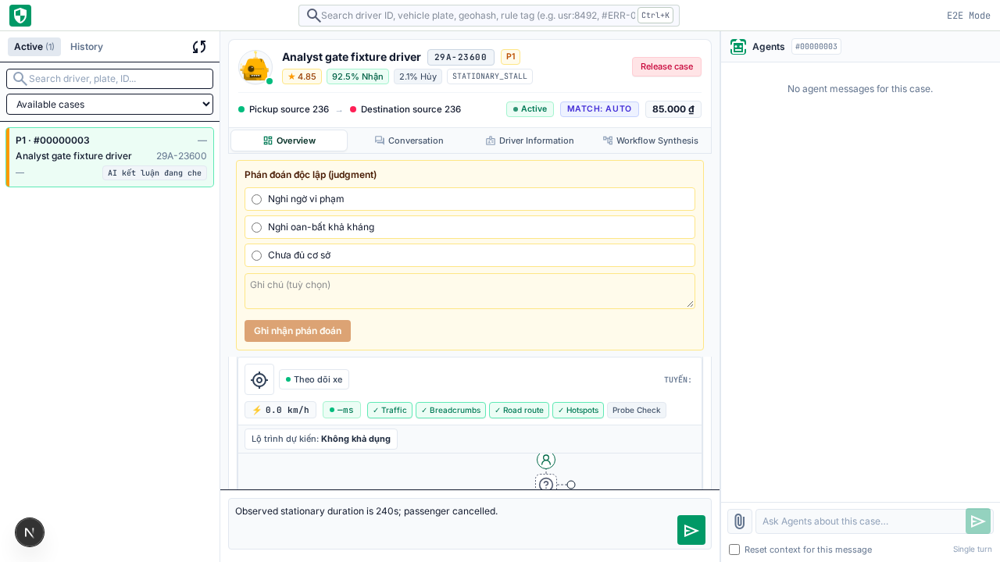
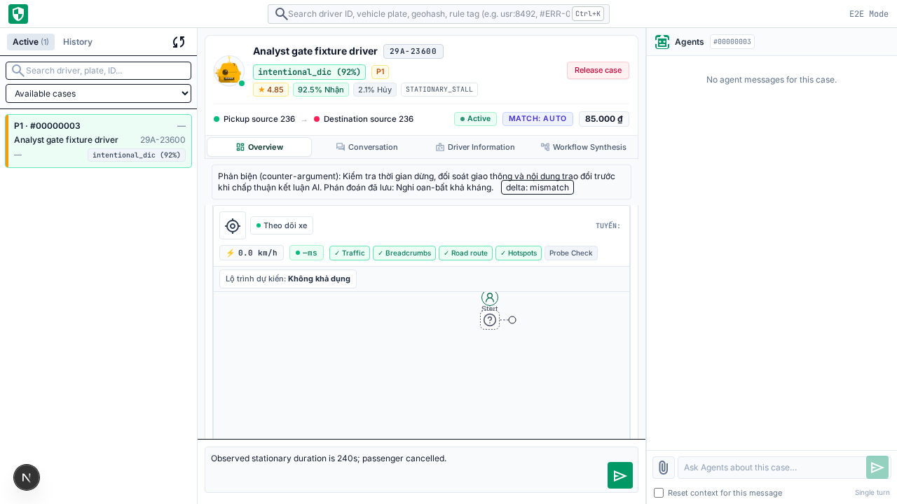

# Issue #236: independent judgment before AI reveal

This runbook verifies [issue #236](https://github.com/AI20K-Build-Phase-Cohort-4/P-063/issues/236). Use disposable cases with an authenticated analyst, a second analyst, known evidence, an AI suggestion, and a matched precedent. Record revision, environment, case IDs, analyst identities, timestamps, observed results, and artifact links. Hosted authentication must use real accounts.

## Acceptance checks and test boundaries

- **U**: [schema and HITL units](../../../tests/unit/test_staged_adjudication_contract.py).
- **A**: [HTTP/service integration](../../../tests/integration/api/test_staged_adjudication.py), using real routes and CaseService with isolated test storage.
- **F**: [workspace component tests](../../../src/webapp/tests/unit/components/staged-adjudication.test.tsx), using real components, adapters, API client, and an external HTTP transport fixture.
- **B**: [browser acceptance tests](../../../tests/e2e/browser/staged-adjudication.spec.ts) and [HTTP inputs](../../../tests/e2e/browser/staged-adjudication-fixture.ts), using the real local app and offline case data.

| DoD | Observable acceptance check | Automated specification |
|---|---|---|
| 1 | Claim a fresh case. Category, confidence, recommendation, precedent, and apply-precedent action are absent from visible content and the accessibility tree, including the selected queue item, header, overview, and conversation tab. | F: three direct masking tests; B: claimed-case masking |
| 2 | Before judging, read the factual summary, source evidence, map, sensor/telemetry panels, and driver/customer conversation. These surfaces remain usable. | F/B: passing evidence controls |
| 3 | Select exactly one of the three named choices, optionally enter a note, then commit once. All three choices persist; no note is required. Double commit must not overwrite the initial judgment. | U: choice/note round-trip; A: six commit/reload cases and duplicate protection; F/B: keyboard commit |
| 4 | An acknowledged commit immediately reveals category/confidence, recommendation, precedent, and a named counterargument panel. Pending/failed writes leave AI masked. | F: acknowledged, pending, failed, and already-committed cases; B: commit/reveal |
| 5 | Final decision retains the preliminary record/reference, AI suggestion, and match/mismatch delta. A mismatch with nine rationale characters fails; ten succeeds. A nonexistent preliminary reference cannot silently finalize a case. | U: reference/rationale; A: match/mismatch history/audit, invalid reference, short rationale; F/B: final payload |
| 6 | Reload before commit stays masked. After finalization, history and analyst audit show the retained judgment, AI suggestion, and textual delta; a fresh session still shows them. | U: explicit null and restored record; A: GET/history/audit; F: remount/restored record; B: reload and seeded history |
| 7 | Both dismissal and authorized adverse decisions require the authenticated analyst identity and rationale. After a valid judgment, existing permitted final actions still succeed. Evidence requests remain valid before judgment. | U: signature/rationale guards including SUSPEND; A: spoofed signature, evidence request, valid APPROVE/DISMISS; F/B: signed final actions |
| 8 | Tab reaches the named gate, choices, optional note, and commit control. Space selects; Enter commits. Visible labels/status/delta convey meaning without relying on color. | F/B: keyboard and accessible names; manual screen-reader/color checks below |

## Manual execution

1. Claim a fresh case. Inspect every conclusion surface in DoD 1, including hidden DOM titles/aria text. Open Overview and Conversation; verify all factual surfaces in DoD 2. Reload and repeat before choosing anything.
2. Test each choice on a separate fresh case: **Nghi ngờ vi phạm**, **Nghi oan-bất khả kháng**, **Chưa đủ cơ sở**. Repeat with no note and with a Vietnamese note. Time from the usable gate to the completed commit; target **≤5 seconds** for the basic no-note interaction. Record measured timings. Browser timing is a local regression bound, not proof of human completion time.
3. Use Tab, Space, and Enter only. Confirm visible focus and screen-reader announcements for choices, optional note, saving/error state, and the revealed counterargument. Check grayscale/high contrast: labels and delta remain understandable.
4. Delay or fail the preliminary write using a disposable environment. Confirm no premature reveal, a readable retryable error, and no duplicate record from rapid repeated commits. A second analyst and an unclaimed case cannot record the claimant's judgment.
5. For known AI suspicion, finalize one matching case with APPROVE and one exonerating mismatch with DISMISS. Nine non-whitespace rationale characters must fail; ten must succeed. Check authenticated signature, retained preliminary record, AI suggestion, and delta. Repeat an authorized sanction flow using the existing policy/role rules; record its actual sanction row and analyst signature.
6. Open case history and analyst audit, then reload and open a fresh authenticated browser session. Confirm preliminary judgment, note, AI suggestion, and match/mismatch are visible and identical to the saved record. Request evidence before preliminary judgment and confirm the existing flow works.
7. On an explicitly isolated PostgreSQL environment, verify actual persisted judgment/adjudication/audit records using the current migration schema. Restart the API and reread through case/history/audit endpoints. Record table/record IDs, timestamps, versions, and restart evidence. Do not infer durable storage from the in-memory API suite or browser HTTP fixtures.

## Contract assumptions

The issue fixes the endpoint `POST /api/v1/cases/{id}/preliminary-assessment`, request `analyst_id`, `judgment`, optional `note`, final request `preliminary_judgment_id`, and detail `preliminary_judgment`. The issue does not specify machine enum values or the audit payload layout. Until clarified, these tests use the user's literal Vietnamese labels (the exonerating UI label accepts slash or hyphen), a preliminary record `id`, and final/audit fields `preliminary_judgment_id`, `preliminary_judgment`, `ai_suggestion`, `delta: match|mismatch`. These are proposed wire contracts for implementation, not existing runtime guarantees.

## GREEN implementation evidence: 2026-10-14

The implementation follows the user's binding wire contract above. Base test commit: `6e7e811`, branch `feature/236-staged-adjudication`. The implementation remains uncommitted in this worktree. No push or PR was created.

All **42 original RED failures are now GREEN**, together with the original 19 regression controls:

| Suite | Original tests | Additional checks | Result |
|---|---:|---:|---|
| `tests/unit/test_staged_adjudication_contract.py` | 21 | 0 | 21 passed |
| `tests/integration/api/test_staged_adjudication.py` | 22 | 0 | 22 passed |
| `src/webapp/tests/unit/components/staged-adjudication.test.tsx` | 12 | 2 | 14 passed |
| `tests/e2e/browser/staged-adjudication.spec.ts` | 6 | 0 | 6 passed |
| `tests/integration/api/test_staged_adjudication_alignment.py` | 0 | 11 | 11 passed |
| `tests/integration/api/test_staged_adjudication_durability.py` | 0 | 5 | 5 passed |
| Requested adjacent rationale and active-queue baselines | 10 | 0 | 10 passed |

The final combined backend run passed **69 tests**. The complete frontend suite passed **325 tests across 42 files**. The final browser run passed the six acceptance tests and one temporary screenshot capture; the temporary capture spec was removed. TypeScript app checking (`tsc --noEmit --incremental false`), frontend/browser test typechecking, Ruff check, Ruff formatting, and `git diff --check` passed. Redis emitted three existing `retry_on_timeout` deprecation warnings in the combined backend run. Vitest emitted its existing config module-format warning, and Playwright emitted its existing color-environment warning.

### Implementation and refactoring

- Routes validate the authenticated identity and delegate to `CaseService`. Pydantic V2 models normalize the slash spelling, reject a fourth choice, and expose explicit null before commitment.
- PostgreSQL stores an immutable preliminary record with a unique case key. The service locks the scoped case and current lease before writing; identical retries return the original record and replacement attempts fail. The final signed decision stores the staged snapshot in the existing immutable adjudication transaction. In-memory storage remains restricted to the existing test fallback.
- Shared `StagedAdjudicationContext` and `AISuggestion` models/types eliminate repeated final/history/audit field definitions. Shared claimant, duplicate, and reference checks keep the PostgreSQL and test-storage paths consistent.
- Preliminary writes and in-memory finalization use the factual data reader without adding a motivation-model invocation. The new workflow has no LLM call.
- The UI reveals only an acknowledged, matching-case record. Pending/failed writes remain masked; a case switch resets the draft. Counterargument content gives concrete evidence checks. The live counterargument appears in the active review, while history retains the archived judgment, AI suggestion, and textual delta.
- Existing conclusion-formatting, precedent, and recommendation tests now seed a committed judgment through one shared test fixture. Their assertions remain intact. The original staged masking assertions remain intact; two additional component checks cover the actual preliminary response without synthetic AI/delta fields.

Delta is deterministic category alignment, independent of confidence, recommended action, or final outcome:

| Independent judgment | AI categories yielding `match` |
|---|---|
| Nghi ngờ vi phạm | `ERR-01` through `ERR-05`, `intentional_dic`, `confirmed_fraud`, `suspected_fraud` |
| Nghi oan-bất khả kháng | `no_violation`, `exonerated`, `force_majeure` |
| Chưa đủ cơ sở | `insufficient_evidence` |

All other category/judgment combinations, including unavailable or unknown categories, yield `mismatch`. Missing suggestion values remain null. The frontend and service use the same exact mapping; a regression check prevents `no_violation` from matching suspicion through a substring rule. Legacy final requests without a preliminary reference remain accepted under the binding optional-reference contract; existing rationale, role, and signature checks still apply.

### Durable database and visual evidence

All **21 repository migrations**, including [the staged migration](../../../db/migrations/20261014090000_staged_adjudication.sql), were applied unchanged on an explicitly disposable PostgreSQL 16/PostGIS container. HTTP tests create their own cases and identities, reconstruct `CaseService`, and verify that judgment and final context survive through detail, history, and analyst audit reads. They also verify that an unknown reference cannot increment the persisted version. Separate storage checks verify uniqueness and append-only enforcement. This establishes migrated local database and service-restart proof, not a hosted API process restart or production database-role/RLS proof.

The retained [synthetic database record](artifacts/236/db-record.json) includes the generated case/adjudication/analyst IDs, version, signed outcome, preliminary record, AI snapshot, delta, and timestamps before the disposable database was removed.

The local browser uses external HTTP fixtures and offline map data. Its keyboard-only choice and acknowledged reveal meet the five-second automated bound. The screenshots show the factual summary and map remaining available while the AI category/confidence changes from masked to revealed:

| Before commitment | After commitment |
|---|---|
|  |  |

The screenshot case is `23600000-0000-4000-8000-000000000003`, analyst `analyst-e2e`, with the exonerating choice and `mismatch`. These are fixture screenshots, not real-account evidence. Deployments must apply the staged migration before running the changed service; no migration was applied to shared or hosted infrastructure.

### Broader checks and remaining proof

`bash scripts/check.sh` passed lint and formatting, then stopped at **seven mypy errors in four untouched files**: `src/rag/embedder.py`, `src/rag/store.py`, `src/services/motivation_assessment_service.py`, and `src/api/test_routes.py`. Running mypy against a read-only HEAD archive reproduced exactly those seven errors. There are no new mypy errors.

The broader unit discovery produced **1,061 passed and 11 failed**. Broad API discovery produced **226 passed, 52 failed, and 9 skipped**. These are not green release gates. Some broad API tests inherit configured backing services and the new migration is required there; those results are not used as durability proof. The modules containing the broader failures were rerun against two independent disposable, migrated database clones: current worktree **121 passed, 56 failed, 12 skipped**; HEAD **120 passed, 57 failed, 12 skipped**. The failing-test comparison has **no current-only failures**. Missing/retired fixture data, provider/configuration assumptions, and unrelated existing errors remain outside this issue's implementation scope.

Real-account hosted behavior, an actual hosted API process restart, non-superuser production database-role checks, measured human completion time, manual screen-reader/high-contrast behavior, and a real sanction row remain unverified. They require the explicit environments and manual actions described above. The automated signature/rationale guards include SUSPEND; the local durable finalization proof uses DISMISS.

Raw evidence remains in `/tmp/236-final-backend-green.log`, `/tmp/236-frontend-all-green.log`, `/tmp/236-browser-final.log`, `/tmp/236-typecheck-final.log`, `/tmp/236-typecheck-app.log`, `/tmp/236-check-final.log`, `/tmp/236-mypy-head-baseline.log`, `/tmp/236-mypy-current.log`, and `/tmp/236-isolated-{current,head}-baseline.{log,xml}`. These temporary logs are session-local. Screenshots are retained in this repository.

### Changed files

- Production: `src/api/routes.py`, `src/models/schemas.py`, `src/services/case_service.py`, `src/webapp/components/views/cockpit-view.tsx`, `src/webapp/components/adjudication/overview-tab.tsx`, `src/webapp/components/adjudication/conversation-tab.tsx`, `src/webapp/lib/api-client.ts`, `src/webapp/types/schemas.ts`.
- Database: `db/migrations/20261014090000_staged_adjudication.sql`, `db/rollbacks/20261014090000_staged_adjudication.down.sql`.
- Tests/support: `tests/integration/api/test_staged_adjudication_alignment.py`, `tests/integration/api/test_staged_adjudication_durability.py`, `src/webapp/tests/fixtures/staged-adjudication.ts`, and the five component test files `staged-adjudication.test.tsx`, `case-confidence-scoring.test.tsx`, `center-panel-tabs.test.tsx`, `driver-dispute.test.tsx`, `precedent-workflow.test.tsx` under `src/webapp/tests/unit/components/`.
- Review evidence: this runbook and `docs/testing/manual/artifacts/236/{before,after}.png`, `docs/testing/manual/artifacts/236/db-record.json`.

## RED evidence: 2026-10-14

Base revision: `f381c09be4f5c6a10ff30a89e89d0d8900da0274`, branch `feature/236-staged-adjudication`. No production files were changed. The worktree lacked dependencies; ignored links reuse the repository's existing `.venv` and webapp `node_modules`. A writable temporary `XDG_DATA_HOME` and disabled pnpm dependency verification avoid writing to the shared dependency installation. Browser used its own local port 3236.

```bash
.venv/bin/python -m pytest tests/unit/test_staged_adjudication_contract.py -q
# 8 failed, 13 passed
.venv/bin/python -m pytest tests/integration/api/test_staged_adjudication.py -q
# 18 failed, 4 passed
XDG_DATA_HOME=/tmp/p063-236-test-data pnpm --config.verify-deps-before-run=false --dir src/webapp test tests/unit/components/staged-adjudication.test.tsx
# 11 failed, 1 passed
PORT=3236 PLAYWRIGHT_TEST_BASE_URL=http://localhost:3236 XDG_DATA_HOME=/tmp/p063-236-test-data pnpm --config.verify-deps-before-run=false --dir src/webapp test:browser staged-adjudication.spec.ts
# 5 failed, 1 passed
XDG_DATA_HOME=/tmp/p063-236-test-data pnpm --config.verify-deps-before-run=false --dir src/webapp test:typecheck
# passed: frontend and browser TypeScript
.venv/bin/python -m pytest tests/unit/test_adjudication_rationale_validation.py tests/integration/api/test_active_case_queue.py -q
# baseline: 10 passed
.venv/bin/python -m ruff check tests/unit/test_staged_adjudication_contract.py tests/integration/api/test_staged_adjudication.py
.venv/bin/python -m ruff format --check tests/unit/test_staged_adjudication_contract.py tests/integration/api/test_staged_adjudication.py
```

Decisive final-run failures:

```text
Schema: assert None == '23600000-0000-4000-8000-000000000001'
Schema: Reload needs an explicit uncommitted gate state
API: Claimed analyst must be able to commit independent judgment: 404 {"detail":"Not Found"}
API: A nonexistent judgment must not yield a signed final decision; assert 200 == 409
Frontend: AI advice: ERR-02, 92% confidence remains in the DOM before judgment
TestingLibraryElementError: Unable to find an accessible element with the role "radiogroup" and name `/phán đoán|judgment/i`
TestingLibraryElementError: Unable to find an accessible element with the role "region" and name `/phản biện|counter.argument/i`
Browser: getByText(/intentional_dic/) Expected: 0; Received: 2
Browser reload: getByLabel(/AI advice:/) Expected: 0; Received: 1
Browser gate: named radiogroup radios Expected: 3; Received: 0
Browser final payload: missing preliminary_judgment_id
Browser history: getByText(/Nghi oan[-/]bất khả kháng/) element(s) not found
```

Final runs contain **61 tests: 42 expected failures and 19 passing regression controls**, with no collection/setup errors or skips. Initial fixture-required-field and browser selector mistakes were corrected before these counts. Raw logs are `/tmp/236-unit-red.log`, `/tmp/236-api-red.log`, `/tmp/236-frontend-red.log`, `/tmp/236-browser-red.log`, and `/tmp/236-typecheck.log`; fixture browser artifacts are under `src/webapp/test-results/`.

Assertions after the absent endpoint/gate have not executed: real commit/reveal latency, pending/error UI, double-commit storage, match/mismatch persistence, and full post-save audit flow remain implementation specifications. Direct tests independently demonstrate masking leaks, missing restored counterargument/history UI, and dropped final judgment references. PostgreSQL durability, real-account hosted behavior, screen-reader behavior, actual sanctions, and measured human timing remain manual/unverified.

## Local commit blocked by filesystem permissions

The test files are ready, but this sandbox permits writes only inside the worktree and `/tmp`. The worktree's Git index lives in the repository's external `.git` directory. The exact attempted command and diagnostic were:

```bash
rtk git add tests/unit/test_staged_adjudication_contract.py tests/integration/api/test_staged_adjudication.py src/webapp/tests/unit/components/staged-adjudication.test.tsx tests/e2e/browser/staged-adjudication-fixture.ts tests/e2e/browser/staged-adjudication.spec.ts docs/testing/manual/236-staged-adjudication.md
```

```text
fatal: Unable to create '/home/dat/dev/vinuni_aia/P-063/.git/worktrees/delivery-236-20261013/index.lock': Read-only file system
```

No files were staged and no commit SHA exists. A complete test/document patch is saved at `/tmp/236-staged-adjudication.patch`. From a session with writable repository Git metadata, stage the six explicit paths above and commit them locally on `feature/236-staged-adjudication`. Do not push or open a PR.
